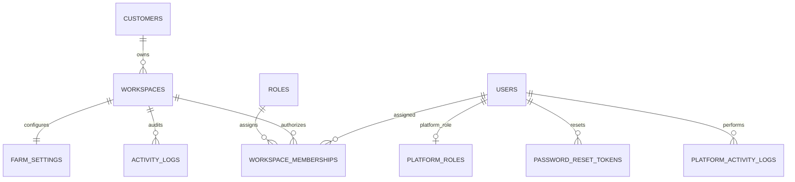
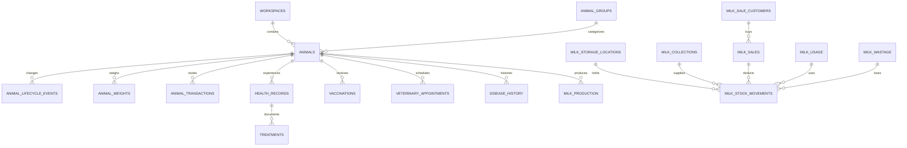
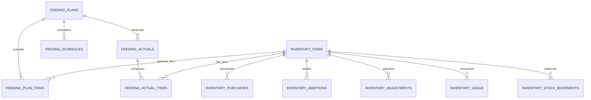
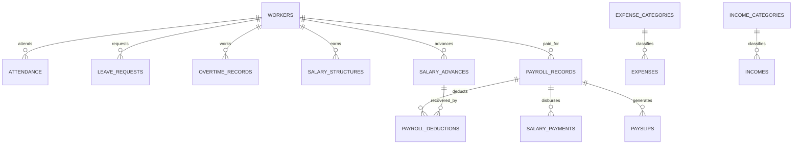
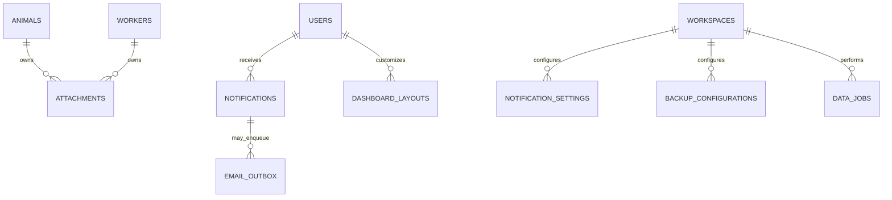

# SmartFarm — ERD Description

**Reference:** `docs/database.md` and `docs/schema.sql` (24 November 2026).  
**Notation:** `||--o{` = one to zero/many; `}o--o{` = many-to-many through a junction. All farm-owned records include `workspace_id` and its composite FK requirement, even where omitted for readability.

## 1. Platform / access

`WORKSPACE_MEMBERSHIPS` is a junction allowing future multiple workspace assignments, **not an approved policy**. Suspension blocks tenant RLS access (except restricted maintenance/recovery procedures). Sessions are held in a standalone `session` table and are never treated as a farm entity.

## 2. Animals, health and milk

An animal can optionally reference mother/father animals in the same workspace. Every milk movement points to **exactly one** source and has a signed delta; these are stock movements, not journal entries. Milk sales have Paid/Unpaid status, no partial-payment entity.

## 3. Inventory and feeding

A feeding plan targets **one animal or one group**; actual feeding may reference schedules. **No implicit inventory deduction** from feeding occurs until the client approves that rule. Inventory source/item match is reinforced by three-column FKs in `schema.sql`.

## 4. Workers, payroll and finance

Finance entries are separate from sales, animal transactions and salary payments until recognition rules are approved. No general ledger, online payment processor or accounting reconciliation subsystem.

## 5. Files, messaging and operations

An attachment must refer to **exactly one** worker or animal. Email outbox recipients need server-side permission validation; High/Critical animal health alerts must never target Supervisors. Graphile Worker internal queue tables are managed by its own installation/versioned migration process, and are not drawn here. Public `contact_inquiries` is standalone, intentionally not an automatic customer/workspace creation relationship.

## 6. Relationship validation checklist

- Composite FK rejects a child referencing a record in a different workspace.
- UUID internal PKs are unique globally; ear tag and CNIC uniqueness are **farm-scoped**.
- Suspended farm cannot read/update tenant rows under ordinary runtime policy.
- `milk_production` rejects duplicate date/animal/session combinations.
- A stock movement cannot name multiple source kinds; inventory movement references the **same item** as its source.
- Farm Admin/Supervisor visibility is **not** derived from ERD edges: it is enforced in Express RBAC and approved response schemas.
- Cleanup, reports, background jobs and data exports use the same tenant and permission boundaries.
