# SmartFarm Dairy Management System
# Application Flow Specification

**Document:** `docs/appflow.md`  
**Version:** 1.0  
**Date:** 22 November 2026  
**Status:** Draft — Implementation Flow Baseline  
**Source Documents:**
- `docs/srs.md` — Software Requirements Specification v1.0
- `docs/sitemap.md` — Section-wise Sitemap
- `docs/design.md` — Complete UI Design Blueprint v1.0
- `docs/business-rules.md` — Business Rules v1.0
- `docs/role-permission-matrix.md` — Role & Permission Matrix

---

# 1. Purpose

This document defines the end-to-end application flows for SmartFarm.

It establishes:

- How users enter the application.
- How users navigate between screens.
- What actions are available to each role.
- What happens after successful and unsuccessful actions.
- How the system handles loading, empty, error, success, and validation states.
- How permissions affect navigation and access.
- How users recover from failures or return to previous screens.
- How external events interact with application workflows.

The application flow specification is intended for UI generators, frontend developers, backend developers, and QA teams.

## 1.1 Flow design principles

1. Every approved sitemap page must appear in at least one journey.
2. Every journey must have a defined end state.
3. No screen should become a navigation dead end.
4. Every form must have a defined submission and cancellation path.
5. Every important action must have an appropriate confirmation or feedback state.
6. Role restrictions must apply to navigation, page access, actions, and backend authorization.
7. Unconfirmed business rules must not be implemented through invented behavior.
8. Users must be able to recover from validation errors and supported operational failures.
9. No public user may access private farm application screens.
10. No Supervisor may access restricted financial, payroll, settings, or data-management information.

## 1.2 Application areas

SmartFarm contains three distinct application areas:

| Area | Users | Purpose |
|---|---|---|
| Public website | Guest visitors | Product information and contact inquiries |
| Super Admin Panel | Super Admin | Customer and workspace administration |
| Private Farm Application | Farm Admin, Farm Supervisor | Dairy farm operations and management |

## 1.3 User roles

| Role | Description |
|---|---|
| Guest | Unauthenticated visitor using the public website |
| Super Admin | Platform administrator managing customers, workspaces, and access |
| Farm Admin | Authorized administrator of an assigned farm workspace |
| Farm Supervisor | Operational user with restricted farm-management permissions |
| System | Automated application processes, scheduled checks, and notifications |
| External Service | Email or other approved integrated service |

Workers are records in SmartFarm. They do not receive individual application login accounts.

---

# 2. Global Navigation and Authentication Rules

## 2.1 Public navigation

The public website is accessible without authentication.

Navigation:

Home → About → Features → How It Works → Benefits → Dashboard Preview → Contact

These are sections of the approved public Home page, not independently created application pages.

Public users can:

- View public information.
- Navigate between public sections.
- Submit a contact inquiry.
- Return to the top of the page.

Public users cannot:

- Register a farm account.
- Create a workspace.
- Access farm dashboards.
- Access Super Admin functions.
- Purchase software through online checkout.

## 2.2 Super Admin navigation

Authenticated Super Admin navigation contains only:

1. Dashboard
2. Customer Management
3. Workspace Management
4. Farm Admin Management
5. Customer Access Management
6. Workspace Suspension

Super Admin does not receive routine farm operational navigation.

## 2.3 Farm Admin navigation

Farm Admin navigation includes the approved farm-management modules:

1. Dashboard
2. Animal Management
3. Animal Health
4. Milk Production
5. Milk Management
6. Inventory
7. Feeding
8. Workers
9. Attendance
10. Payroll
11. Finance
12. Equipment
13. Notifications
14. Reports
15. Settings
16. Data Management

Only approved pages and actions within these modules may be displayed.

## 2.4 Farm Supervisor navigation

Farm Supervisor receives a permission-filtered navigation configuration.

Permitted areas include:

- Operational Dashboard
- Permitted Animal Access
- Permitted Animal Health Operations
- Milk Production Operations
- Permitted Milk Management Operations
- Inventory Viewing and Permitted Usage
- Feeding Plans and Actual Feeding Records
- Worker Access
- Attendance Operations
- Equipment Operations
- Operational Notifications
- Authorized Reports

The Supervisor must not see or access:

- Payroll
- Finance
- Farm Settings
- Data Management
- Stock Adjustments
- Leave Approval or Rejection
- Animal Archiving
- Restricted Lifecycle Management
- High/Critical health alert information

The exact permission of an action must follow the approved role-permission matrix and SRS.

## 2.5 Authentication entry flow

Private application access requires an authorized account.

Authentication sequence:

1. User opens the appropriate private login entry point.
2. User enters an approved login identifier.
3. User enters a password.
4. User submits the login form.
5. System validates the supplied credentials.
6. System verifies account status and workspace access.
7. System identifies the authenticated role.
8. System applies the role-specific navigation and permissions.
9. System opens the authorized dashboard.

Possible outcomes:

| Condition | Result |
|---|---|
| Valid credentials and authorized account | Open role-specific dashboard |
| Invalid credentials | Show authentication error |
| Inactive or suspended access | Deny access with appropriate feedback |
| Missing workspace authorization | Deny access |
| Network failure | Preserve recoverable form state and allow retry |
| Expired session | Redirect to the appropriate login entry point |

The exact lockout threshold, session timeout, activation process, and first-login policy remain subject to confirmation.

## 2.6 Password recovery and change

Password recovery flow:

1. User opens the approved password recovery entry point.
2. User submits the registered email address.
3. System validates the email input.
4. System initiates the approved password reset process.
5. User receives a reset email if email delivery is configured and supported.
6. User follows the reset link.
7. System validates the reset token.
8. User enters and confirms a new password.
9. System validates password requirements.
10. System saves the new password.
11. System displays success feedback.
12. User returns to the appropriate login screen.

Failure branches:

- Invalid email input → remain on recovery screen.
- Unknown or ineligible account → show the approved safe response.
- Expired reset token → show an expired-link message and provide a recovery route.
- Invalid new password → show field-level validation.
- Email delivery failure → show a recoverable error without falsely claiming delivery.
- Network failure → allow retry.

Optional email OTP must only be included if enabled and approved.

---

# 3. Journey 01 — Public Visitor and Contact Inquiry

**Primary actor:** Guest  
**Entry point:** Public website  
**End state:** Visitor completes an inquiry or leaves the public website.

## 3.1 Main flow

1. Guest opens SmartFarm Home.
2. System loads the public website.
3. Guest views the Navbar.
4. Guest selects a navigation item or scrolls through the page.
5. Guest views the Hero.
6. Guest views About SmartFarm.
7. Guest views Features.
8. Guest views How It Works.
9. Guest views Benefits.
10. Guest views Dashboard Preview.
11. Guest reaches Contact Inquiry.
12. Guest enters the approved inquiry information.
13. Guest submits the inquiry.
14. System validates the submitted fields.
15. System processes the inquiry.
16. System displays the appropriate result.
17. Guest may return to other public sections or leave the website.

## 3.2 Decision branches

| Decision | Yes | No |
|---|---|---|
| Is the submitted form valid? | Continue submission | Show field errors |
| Did the submission succeed? | Show success feedback | Show error and allow retry |
| Does the visitor want to continue browsing? | Navigate to another section | End session |

The exact inquiry fields and notification recipients must follow approved requirements. Do not add unconfirmed fields.

## 3.3 Mermaid flowchart

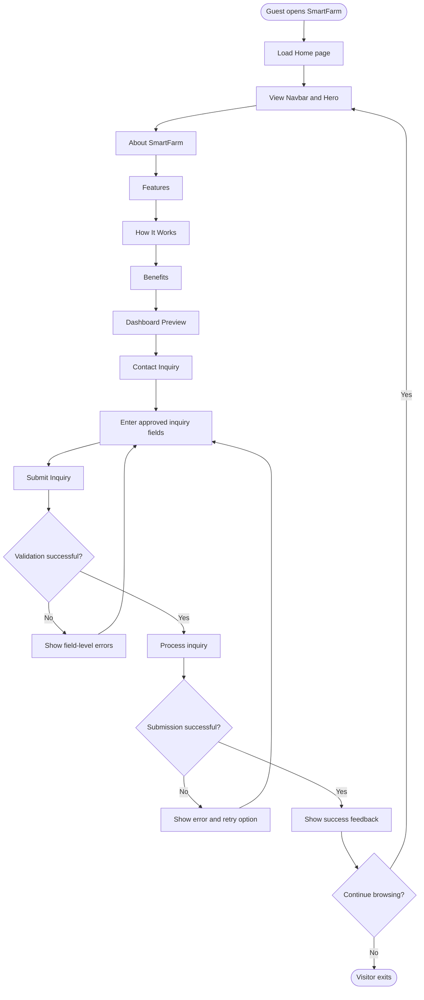

## 3.4 Navigation and recovery

- Navbar links move to their corresponding approved sections.
- Mobile menu opens and closes without losing the current page position.
- Contact form validation returns the visitor to the relevant fields.
- Submission errors retain recoverable input where technically possible.
- Success feedback does not imply account creation.
- Footer navigation returns to the corresponding public sections.
- No public-to-private dashboard transition is available.

## 3.5 End states

- Inquiry successfully submitted.
- Inquiry submission failed and remains retryable.
- Visitor exits without submitting an inquiry.

---

# 4. Journey 02 — Super Admin Authentication

**Primary actor:** Super Admin  
**Entry point:** Super Admin Login  
**End state:** Authorized Super Admin dashboard or denied access.

## 4.1 Main flow

1. Super Admin opens the login screen.
2. System displays the Super Admin identification and login form.
3. Super Admin enters login identifier and password.
4. Super Admin selects Sign In.
5. System validates required fields.
6. System verifies credentials.
7. System checks account and access status.
8. System establishes the authorized session.
9. System opens Super Admin Dashboard.

## 4.2 Branches

- Missing identifier/password → field-level validation.
- Invalid credentials → authentication error.
- Inactive or unauthorized account → access denied.
- Network failure → retry login.
- Session expiration → return to Super Admin Login.
- Optional OTP → request and verify OTP only if configured and approved.

## 4.3 Mermaid flowchart

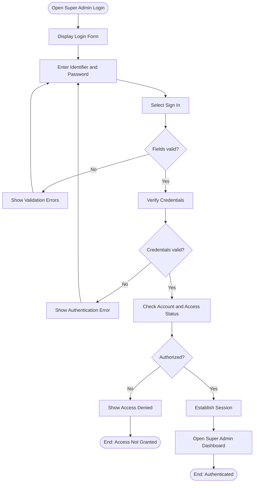

## 4.4 Navigation and recovery

- No registration action is available.
- The login form remains available after invalid credentials.
- The password visibility control does not submit the form.
- Logout returns to Super Admin Login.
- Session expiry returns to the login entry point.

---

# 5. Journey 03 — Super Admin Platform Overview

**Primary actor:** Super Admin  
**Entry point:** Super Admin Dashboard  
**End state:** User completes platform overview or enters an approved management journey.

## 5.1 Main flow

1. Super Admin logs in.
2. System opens Dashboard.
3. System loads customer, workspace, and access-status metrics.
4. System loads customer/workspace summaries.
5. System loads platform activity.
6. Super Admin reviews the overview.
7. Super Admin selects an available quick action.

Available transitions:

| Current page | Action | Next page |
|---|---|---|
| Dashboard | Add Customer | Add Customer |
| Dashboard | Manage Customers | Customer Management |
| Dashboard | Manage Workspaces | Workspace Management |
| Dashboard | Select Customer Management navigation | Customer Management |
| Dashboard | Select Workspace Management navigation | Workspace Management |
| Dashboard | Select Farm Admin Management navigation | Farm Admin Management |
| Dashboard | Select Customer Access Management navigation | Customer Access Management |
| Dashboard | Select Workspace Suspension navigation | Workspace Suspension |

## 5.2 Mermaid flowchart

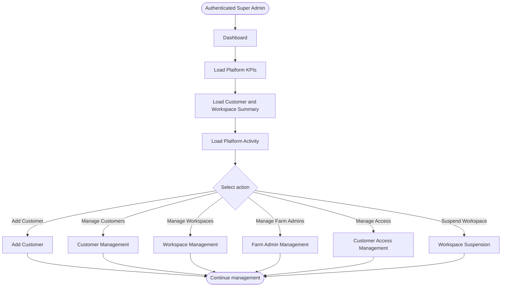

---

# 6. Journey 04 — Customer Creation and Workspace Provisioning

**Primary actor:** Super Admin  
**Entry points:** Dashboard quick action or Customer Management  
**End state:** Customer creation succeeds, fails, or is cancelled.

## 6.1 Main flow

1. Super Admin opens Customer Management or selects Add Customer.
2. System displays customer records and available actions.
3. Super Admin selects Add Customer.
4. System opens Add Customer.
5. Super Admin enters approved customer information.
6. Super Admin enters the confirmed workspace registration information where applicable.
7. System validates the submitted fields.
8. Super Admin reviews the information.
9. Super Admin selects Save/Create Customer.
10. System processes the customer creation request.
11. System displays the result.
12. On success, the user returns to Customer Management or the appropriate management context.

Workspace creation and Farm Admin provisioning must follow the approved provisioning sequence. The UI must not assume that customer creation automatically provisions every related account unless confirmed.

## 6.2 Branches

- Missing required field → show validation.
- Invalid data → show field-level error.
- Duplicate information → show an appropriate conflict message if uniqueness is confirmed.
- User cancels → return to Customer Management.
- Creation succeeds → display confirmation.
- Creation fails → preserve recoverable data and allow retry.

## 6.3 Mermaid flowchart

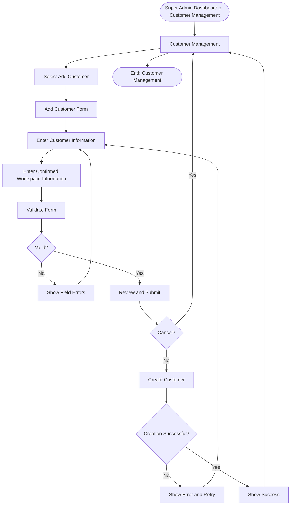

## 6.4 Screen-to-screen transitions

| Current page | Action | Next page |
|---|---|---|
| Dashboard | Add Customer | Add Customer |
| Customer Management | Add Customer | Add Customer |
| Add Customer | Cancel | Customer Management |
| Add Customer | Successful save | Customer Management |
| Customer Management | Open dashboard navigation | Dashboard |

---

# 7. Journey 05 — Workspace Management and Farm Admin Provisioning

**Primary actor:** Super Admin  
**Entry points:** Dashboard or Workspace Management  
**End state:** Workspace information reviewed or an approved provisioning action completed.

## 7.1 Main flow

1. Super Admin opens Workspace Management.
2. System loads workspace records and status indicators.
3. Super Admin searches or filters workspaces.
4. Super Admin selects a workspace.
5. System displays available workspace information and associated customer.
6. Super Admin reviews the workspace.
7. Super Admin selects an authorized action.
8. If Farm Admin provisioning is required, Super Admin opens Farm Admin Management.
9. Super Admin identifies the associated customer/workspace.
10. Super Admin enters approved Farm Admin account information.
11. System validates the provisioning information.
12. Super Admin confirms the action.
13. System processes provisioning.
14. System displays the outcome.

## 7.2 Branches

- No matching workspace → show no-results state.
- Workspace information unavailable → show error and retry.
- Required customer/workspace relationship missing → stop provisioning and request valid selection.
- Invalid Farm Admin information → show field-level validation.
- Provisioning cancelled → return to the previous management screen.
- Provisioning succeeds → display success.
- Provisioning fails → display error and preserve recoverable input.

The exact activation and temporary credential delivery mechanism remains subject to clarification.

## 7.3 Mermaid flowchart

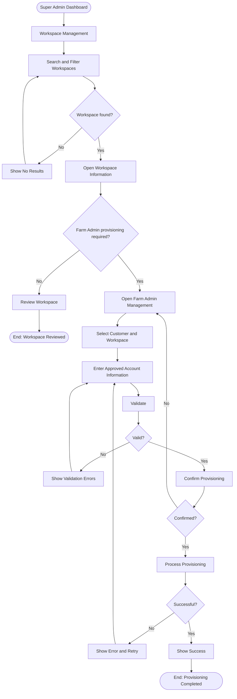

---

# 8. Journey 06 — Customer Access Management and Workspace Suspension

**Primary actor:** Super Admin  
**Entry points:** Customer Access Management or Workspace Suspension  
**End state:** Access status reviewed or an approved status change completed.

## 8.1 Customer access flow

1. Super Admin opens Customer Access Management.
2. System loads customer search and selection controls.
3. Super Admin searches for a customer.
4. System displays matching customer records.
5. Super Admin selects a customer.
6. System loads associated workspace and Farm Admin information.
7. Super Admin reviews current access status.
8. Super Admin selects an available access-management action.
9. System displays a confirmation dialog.
10. Super Admin reviews the exact change and its consequence.
11. Super Admin confirms or cancels.
12. System processes the confirmed change.
13. System displays the updated status or an error.

## 8.2 Workspace suspension flow

1. Super Admin opens Workspace Suspension.
2. Super Admin searches for a workspace.
3. System displays matching workspaces.
4. Super Admin selects the target workspace.
5. System displays customer and current workspace status.
6. Super Admin selects the suspension action.
7. System displays a warning confirmation dialog.
8. Dialog identifies the workspace and explains the impact.
9. Super Admin confirms or cancels.
10. System processes suspension if confirmed.
11. System displays the updated workspace status or an error.

Suspension must never occur from a single accidental click.

## 8.3 Mermaid flowchart

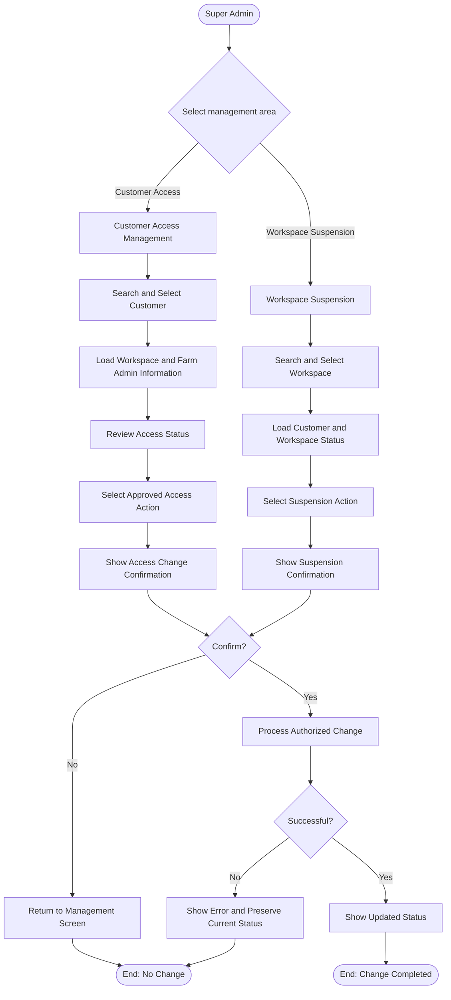

## 8.4 Important access rules

- Only authorized Super Admin actions may change access.
- Workspace suspension must be confirmed.
- The system must display the affected customer/workspace.
- A failed operation must not falsely show the new status.
- No unapproved automatic suspension or renewal behavior may be introduced.
- The exact difference between customer access changes and workspace suspension must follow approved business rules.

---

# 9. Journey 07 — Farm Admin and Supervisor Daily Dashboard

**Primary actors:** Farm Admin and Farm Supervisor  
**Entry point:** Successful authentication  
**End state:** User reviews the operational dashboard or opens an authorized module.

## 9.1 Farm Admin flow

1. Farm Admin logs in.
2. System verifies workspace access.
3. System loads Farm Admin Dashboard.
4. System loads approved farm overview indicators.
5. System loads milk production summaries.
6. System loads animal health information.
7. System loads feeding and inventory information.
8. System loads worker and attendance information.
9. System loads financial summaries.
10. System loads recent activity.
11. Farm Admin may customize supported dashboard widgets.
12. Farm Admin opens an authorized module or logs out.

## 9.2 Farm Supervisor flow

1. Supervisor logs in.
2. System verifies Supervisor account and workspace permissions.
3. System loads Supervisor Dashboard.
4. System loads operational KPI information.
5. System loads permitted milk production information.
6. System loads attendance operations.
7. System loads assigned feeding information.
8. System loads permitted animal information.
9. System loads permitted health information.
10. System loads equipment information.
11. System loads operational notifications.
12. Supervisor opens an authorized operational module or logs out.

The Supervisor dashboard must not expose:

- Financial summaries.
- Payroll information.
- Farm settings.
- Data management.
- High/Critical health alerts.

## 9.3 Mermaid flowchart

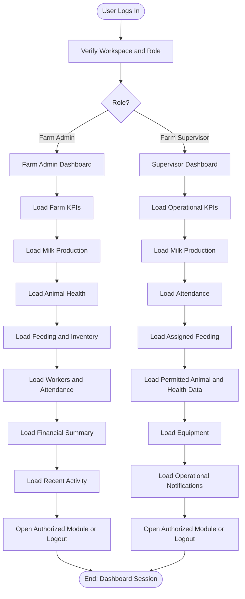

## 9.4 Dashboard data states

| Condition | Behavior |
|---|---|
| Data loading | Skeleton cards and chart placeholders |
| No operational records | Relevant empty state |
| Partial module failure | Show available data and module-specific error |
| Full data request failure | Dashboard error with retry |
| Successful load | Display actual authorized data |
| Missing permission | Do not request or display restricted data |

KPI count-up animations may only use actual values and must not simulate new farm activity.

---

# 10. Journey 08 — Animal Management

**Primary actors:** Farm Admin and Farm Supervisor  
**Entry points:** Dashboard, Animal List, or authorized animal navigation  
**End state:** Animal record viewed, created, updated, or related history reviewed.

## 10.1 Animal list flow

1. User opens Animal List.
2. System loads permitted animal records.
3. User searches or applies filters.
4. System displays matching animals.
5. User selects an animal.
6. System opens Animal Profile.

Farm Admin may also select Add Animal.

Supervisor receives permitted viewing access only. Restricted animal management actions must not be displayed or accepted by the backend.

## 10.2 Add/Edit Animal flow

Farm Admin:

1. Opens Animal List.
2. Selects Add Animal or an authorized Edit action.
3. System opens Add/Edit Animal.
4. Farm Admin enters animal identification.
5. Farm Admin enters animal details.
6. Farm Admin enters parent/calf information where applicable.
7. Farm Admin enters purchase and lifecycle information where supported.
8. Farm Admin uploads an animal photo or permitted attachments.
9. System validates all required information.
10. Farm Admin selects Save.
11. System processes the record.
12. System returns to Animal List or the appropriate Animal Profile context.

Cancellation returns to Animal List or the prior record context.

## 10.3 Animal Profile and history flow

1. User selects an animal.
2. System opens Animal Profile.
3. User reviews animal overview.
4. User reviews permitted lifecycle information.
5. User reviews permitted health summary.
6. User reviews milk production summary.
7. User reviews weight summary.
8. User selects Lifecycle History or Weight History.
9. System opens the selected related record page.
10. User returns to Animal Profile.

## 10.4 Weight History flow

1. User opens Weight History from Animal Profile.
2. System loads the latest weight.
3. System loads historical weight records.
4. System renders the chart using actual data.
5. User reviews the trend and table.
6. Authorized Farm Admin may add or edit a weight record.
7. System validates the record.
8. System saves and displays feedback.
9. User returns to Animal Profile.

## 10.5 Lifecycle History flow

1. User opens Lifecycle History.
2. System loads the selected animal's recorded lifecycle events.
3. User reviews the timeline/table.
4. Authorized Farm Admin may perform permitted record actions.
5. System validates and processes changes.
6. User returns to Animal Profile.

## 10.6 Mermaid flowchart

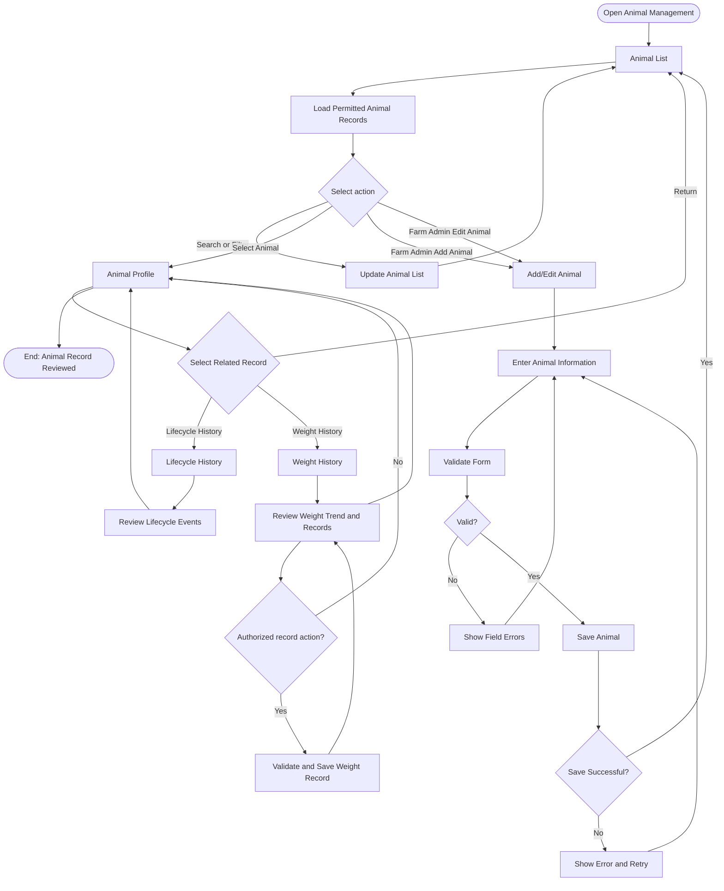

## 10.7 Role and failure rules

- Animal creation/editing is Farm Admin-only.
- Supervisor access must follow permitted animal viewing and operational rules.
- No unauthorized animal archiving.
- No invented breeding workflow.
- Animal photos must use actual uploaded assets.
- Missing records produce empty states, not fabricated history.
- Invalid animal information produces field-specific errors.
- Attachment failures allow retry or removal before saving.

---

# 11. Journey 09 — Animal Health Management

**Primary actors:** Farm Admin and Farm Supervisor  
**Entry point:** Dashboard, Animal Profile, or Animal Health navigation  
**End state:** Health information reviewed or an authorized health record operation completed.

## 11.1 Health Records flow

1. User opens Health Records.
2. System loads role-authorized records.
3. User searches by animal, date, severity, or supported status.
4. System displays matching records.
5. User selects a record.
6. System opens the relevant detail panel.
7. User reviews the record.
8. Authorized user performs a permitted action.
9. System validates and saves changes.
10. User returns to Health Records or the associated animal context.

## 11.2 Treatments flow

1. User opens Treatments.
2. System loads permitted treatment records.
3. User searches or filters.
4. User opens a treatment record or selects Add Treatment if authorized.
5. System displays treatment details or the entry form.
6. User enters the permitted treatment information.
7. System validates.
8. User saves or cancels.
9. System displays the outcome.
10. User returns to Treatments.

## 11.3 Vaccinations flow

1. User opens Vaccinations.
2. System loads vaccination records and due reminders.
3. User searches or filters records.
4. User selects a vaccination record or authorized Add Vaccination action.
5. User reviews or enters vaccination information.
6. System validates.
7. System saves the record if valid.
8. System displays feedback.
9. User returns to Vaccinations.

## 11.4 Veterinary Appointments flow

1. User opens Veterinary Appointments.
2. System loads appointment records.
3. User searches by animal, date, or status.
4. User selects an appointment or authorized Add Appointment action.
5. System displays appointment details or entry form.
6. User enters approved information.
7. System validates and saves.
8. User returns to the appointment list.

Appointment management must respect the role restrictions in the permission matrix.

## 11.5 Disease History flow

1. User opens Disease History.
2. System loads role-authorized disease records.
3. User filters by animal, date, and permitted severity.
4. User selects a record.
5. System displays the disease information and related health references.
6. User may navigate to permitted related records.
7. User returns to Disease History.

High/Critical health information must not be exposed to Supervisors where the permission matrix prohibits access.

## 11.6 Mermaid flowchart

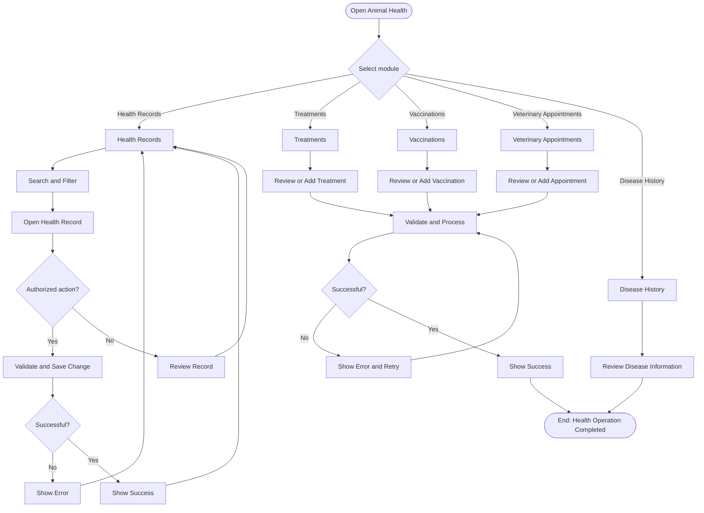

## 11.7 Health notification rules

- Health notifications must use actual recorded health data.
- Vaccination reminders must use approved due-date logic.
- Severity labels must appear alongside semantic colors.
- Supervisors must not receive High/Critical health alerts where prohibited.
- Alert acknowledgement and suppression rules remain subject to approved business rules.

---

# 12. Journey 10 — Milk Production

**Primary actors:** Farm Admin and Farm Supervisor  
**Entry points:** Dashboard or Milk Production navigation  
**End state:** Production is recorded or production information is reviewed.

## 12.1 Production Entry flow

1. User opens Production Entry.
2. System displays production date and session controls.
3. User selects the date.
4. User selects Morning or Evening.
5. User searches and selects an animal.
6. System displays the selected animal identity.
7. User enters milk quantity.
8. User selects quality: Good, Average, or Poor.
9. System validates required fields and numeric values.
10. User selects Save Production.
11. System processes the entry.
12. System displays success or error feedback.
13. User may enter another record or return to the dashboard.

## 12.2 Production history flow

1. User opens Animal Production History.
2. User selects an animal.
3. System loads the selected period's production records.
4. System displays summary cards and chart.
5. User changes date filters.
6. System reloads matching records.
7. User reviews the records and returns to the previous context.

## 12.3 Daily Totals flow

1. User opens Daily Totals.
2. User selects a date.
3. System loads daily production data.
4. System calculates and displays approved daily, morning, and evening totals.
5. System displays animal-level breakdown.
6. User reviews production records and chart.
7. User may navigate to related production information.

## 12.4 Monthly Reports flow

1. User opens Monthly Reports.
2. User selects month and year.
3. System loads approved monthly production data.
4. System displays monthly totals and trends.
5. User reviews daily and animal breakdowns.
6. User selects an available export or print action.
7. System generates the supported output.
8. User receives the result or an error.

## 12.5 Mermaid flowchart

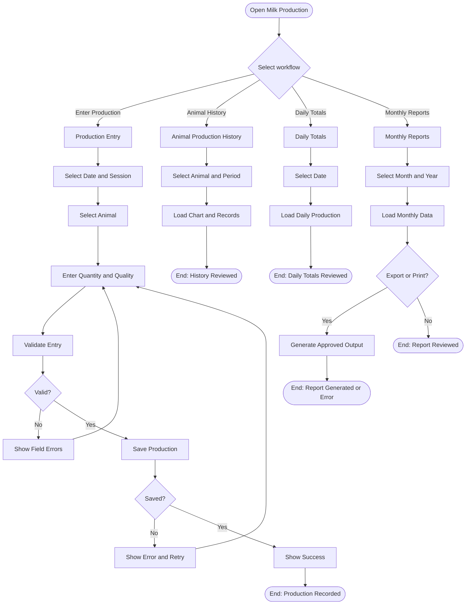

## 12.6 Validation and calculation boundaries

- Production quantity must be numeric and valid under approved input constraints.
- Units must be visible.
- Duplicate entry handling must follow approved business rules.
- Production-drop alert behavior must follow the confirmed threshold and calculation specification.
- Missing-day and rolling-average semantics must not be invented.
- Reports must use actual records and configured units.

---

# 13. Journey 11 — Milk Management

**Primary actors:** Farm Admin and authorized Farm Supervisor  
**Entry point:** Milk Management navigation  
**End state:** Collection, storage, sale, or wastage information is recorded or reviewed.

## 13.1 Collection flow

1. User opens Collection.
2. System loads collection records and approved summary information.
3. User reviews records.
4. Authorized user selects a collection operation.
5. User enters the supported date/time, quantity, and session information.
6. System validates the information.
7. User confirms save.
8. System processes the record.
9. System displays success or error feedback.
10. User returns to Collection.

## 13.2 Storage flow

1. User opens Storage.
2. System loads current recorded storage information.
3. User reviews quantity and units.
4. User opens a storage record.
5. System displays relevant details.
6. Authorized user performs a permitted storage operation.
7. System validates and processes the operation.
8. User returns to Storage.

## 13.3 Milk Sales flow

1. User opens Milk Sales.
2. System loads sales records and payment status indicators.
3. User searches or filters sales.
4. User selects Add Sale or an existing sale.
5. For a new sale, user enters approved customer and sale information.
6. System validates the sale information.
7. User confirms the operation.
8. System processes the sale.
9. System displays the result.
10. User returns to Milk Sales or reviews sale details.

Important: Out-of-stock handling, sale cancellation, reversal, and inventory reconciliation behavior remain unresolved until confirmed.

## 13.4 Wastage Records flow

1. User opens Wastage Records.
2. System loads existing records and approved summaries.
3. User selects Add Wastage if authorized.
4. User enters the permitted date, quantity, and wastage information.
5. System validates the entry.
6. User saves.
7. System processes the record.
8. System displays the result.
9. User returns to Wastage Records.

Estimated loss must only be shown when the approved calculation and required inputs are available.

## 13.5 Mermaid flowchart

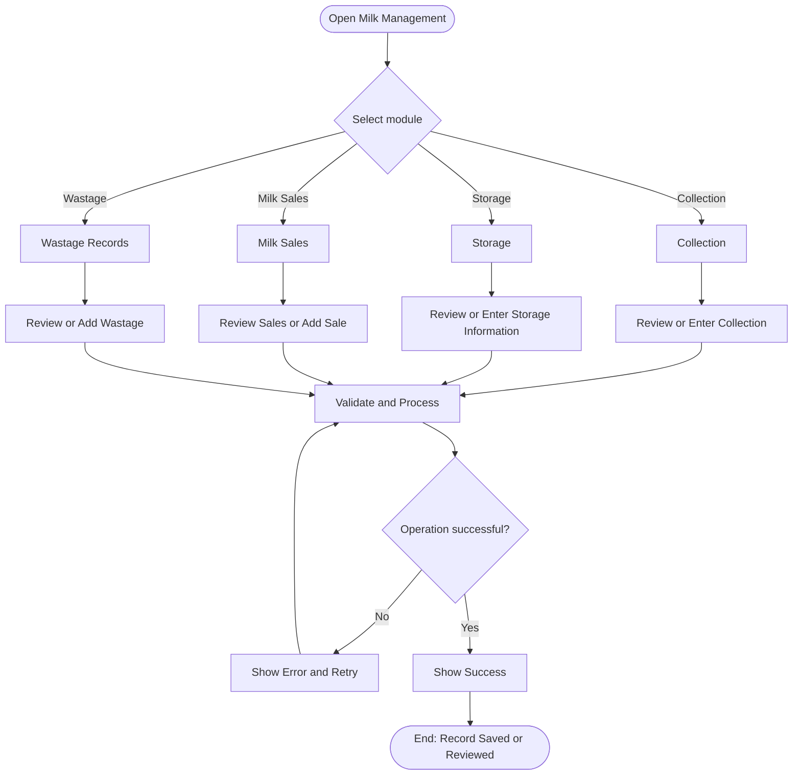

## 13.6 Unresolved sale and storage behavior

The UI must not assume:

- How out-of-stock sales are handled.
- Whether unpaid sales reserve or deduct stock.
- How cancelled sales are reversed.
- How storage movements affect available sale quantities.
- Whether wastage automatically updates storage.
- How milk quantity reconciliation works.

These rules require explicit approval.

---

# 14. Journey 12 — Inventory Management

**Primary actors:** Farm Admin and Farm Supervisor  
**Entry point:** Inventory navigation  
**End state:** Inventory reviewed or an authorized inventory operation completed.

## 14.1 Inventory List and Item Details

1. User opens Inventory List.
2. System loads role-authorized inventory information.
3. User searches or filters by category, stock status, or expiry where supported.
4. System displays matching inventory items.
5. User selects an item.
6. System opens Item Details.
7. User reviews current stock and history.
8. User returns to Inventory List or opens a permitted related workflow.

Farm Admin receives full authorized inventory management. Supervisor receives permitted viewing and usage access only.

## 14.2 Purchases flow

1. Farm Admin opens Purchases.
2. System loads purchase records.
3. Farm Admin filters by item, date, or category.
4. Farm Admin selects Add Purchase.
5. Farm Admin selects an inventory item.
6. Farm Admin enters approved purchase information.
7. System validates the entry.
8. Farm Admin saves.
9. System processes the purchase.
10. System displays the result.

## 14.3 Stock Additions flow

1. Authorized user opens Stock Additions.
2. User selects an inventory item.
3. User enters quantity and unit.
4. User enters approved supporting details.
5. System validates the entry.
6. User saves.
7. System processes the stock addition.
8. System displays feedback.
9. User returns to Stock Additions.

## 14.4 Stock Adjustments flow

Farm Admin only:

1. Farm Admin opens Stock Adjustments.
2. System loads permitted adjustment records.
3. Farm Admin selects an item.
4. System displays current stock.
5. Farm Admin enters adjustment quantity and reason.
6. System validates the input.
7. Farm Admin reviews the adjustment.
8. Farm Admin selects Save Adjustment.
9. System requests confirmation.
10. Farm Admin confirms or cancels.
11. System processes the confirmed adjustment.
12. System displays updated stock information or an error.

Supervisor access is denied.

## 14.5 Mermaid flowchart

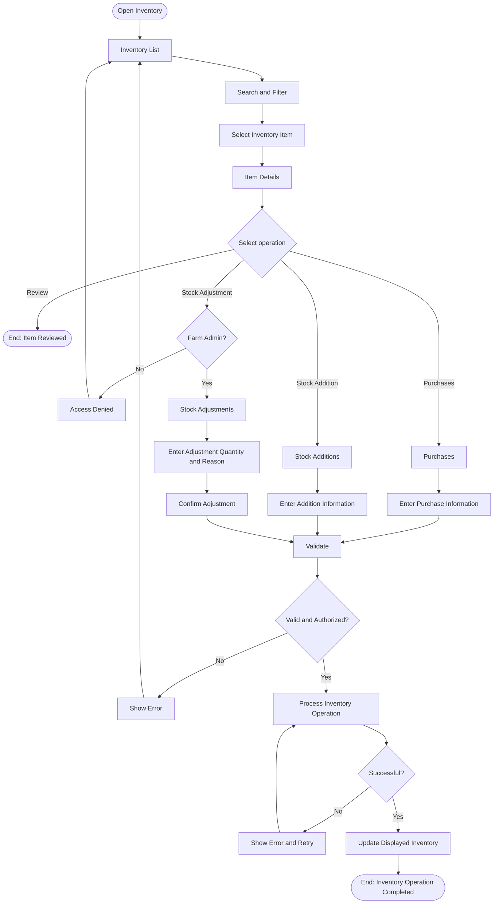

## 14.6 Inventory restrictions and unresolved rules

- Stock Adjustments are Farm Admin-only.
- Supervisors cannot correct inventory stock.
- Usage access must be limited to approved operational functions.
- Negative stock behavior is not to be invented.
- Automatic deductions from feeding or other operations require confirmation.
- Expiry handling and stock valuation rules require approved definitions.
- Failed stock operations must not show an incorrect updated balance.

---

# 15. Journey 13 — Feeding Management

**Primary actors:** Farm Admin and Farm Supervisor  
**Entry point:** Feeding navigation or dashboard  
**End state:** Feeding plan reviewed/managed or actual feeding recorded.

## 15.1 Feeding Plans flow

1. User opens Feeding Plans.
2. System loads permitted feeding plans.
3. User searches by animal/group or status.
4. User selects a plan.
5. System displays assigned animals/groups, feed items, quantities, and effective dates.
6. Farm Admin may create or edit plans where authorized.
7. Supervisor may view permitted plans.
8. User returns to Feeding Plans.

## 15.2 Feeding Schedule flow

1. User opens Feeding Schedule.
2. System loads configured morning/evening and custom schedule information.
3. User selects a date or animal/group filter.
4. System displays matching feeding schedule records.
5. User opens a schedule detail.
6. System displays relevant plan information.
7. User returns to Feeding Schedule.

## 15.3 Actual Feeding Records flow

1. Authorized user opens Actual Feeding Records.
2. System displays feeding date and schedule controls.
3. User selects the date.
4. User selects the feeding session/time.
5. User selects an assigned animal or group.
6. User selects feed item.
7. User enters actual quantity and unit.
8. System validates the information.
9. User selects Save Feeding Record.
10. System processes the record.
11. System displays success or error feedback.
12. User returns to the feeding record screen.

## 15.4 Mermaid flowchart

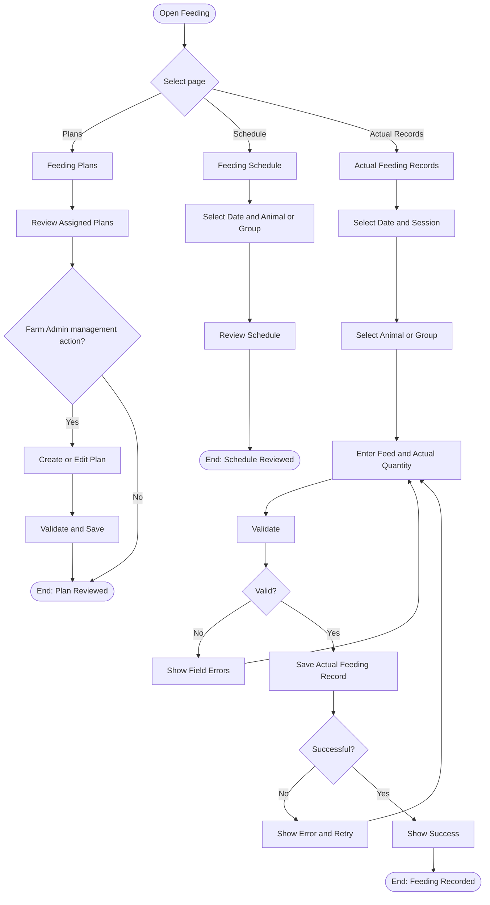

## 15.5 Feeding restrictions

- Supervisor may view assigned feeding plans.
- Supervisor may record actual feeding where authorized.
- Supervisor cannot access unauthorized plan-management actions.
- Automatic inventory deduction from feeding records is not assumed.
- Feeding quantity calculation rules must follow approved business rules.

---

# 16. Journey 14 — Workers and Worker Documents

**Primary actors:** Farm Admin and Farm Supervisor  
**Entry point:** Workers navigation  
**End state:** Worker information or documents reviewed, or an authorized record updated.

## 16.1 Worker List flow

1. User opens Worker List.
2. System loads permitted worker records.
3. User searches or filters workers.
4. User selects a worker.
5. System opens Worker Profile.
6. Farm Admin may select Add Worker if authorized.
7. User returns to Worker List.

## 16.2 Worker Profile flow

1. User opens Worker Profile.
2. System loads authorized personal and employment information.
3. User reviews identification information.
4. User reviews CNIC information where permitted.
5. User opens Worker Documents.
6. User reviews related attendance information where authorized.
7. Farm Admin may perform authorized profile management.
8. System validates changes.
9. System saves and displays feedback.
10. User returns to Worker Profile or Worker List.

## 16.3 Worker Documents flow

1. User opens Worker Documents.
2. User selects a worker.
3. System loads available documents.
4. User reviews document information.
5. Authorized Farm Admin may upload or manage a document.
6. System validates the file and associated information.
7. System saves the document.
8. System displays success or error feedback.
9. User returns to Worker Documents or Worker Profile.

## 16.4 Mermaid flowchart

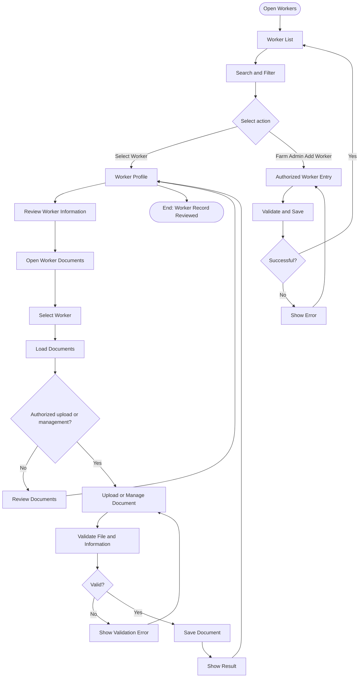

## 16.5 Worker access rules

- Workers are records, not login accounts.
- CNIC uniqueness validation must follow confirmed data rules.
- Only authorized users may modify worker profiles.
- Sensitive worker documents must follow approved access controls.
- File upload failure must allow retry.
- Unauthorized users must not access restricted documents.

---

# 17. Journey 15 — Attendance and Leave Management

**Primary actors:** Farm Admin and Farm Supervisor  
**Entry point:** Attendance navigation or Supervisor Dashboard  
**End state:** Attendance recorded/reviewed or leave request processed by an authorized user.

## 17.1 Attendance Records flow

1. User opens Attendance Records.
2. System loads attendance summaries.
3. User selects date and worker filters.
4. System displays matching records.
5. User selects an attendance record.
6. System displays relevant attendance details.
7. Authorized user performs a permitted action.
8. System validates and saves changes.
9. User returns to Attendance Records.

## 17.2 Check-in/Check-out flow

1. Supervisor or authorized Farm Admin opens Check-in/Check-out.
2. User selects a worker.
3. User selects the attendance date.
4. System displays the current attendance status.
5. User selects Check-in or Check-out as applicable.
6. System validates the operation.
7. System records the action.
8. System displays confirmation.
9. User returns to the attendance screen.

The UI must make Check-in and Check-out visually distinct.

## 17.3 Leave Management flow

1. Farm Admin opens Leave Management.
2. System loads leave records and status indicators.
3. Farm Admin searches or filters records.
4. Farm Admin selects a leave record.
5. System displays leave details.
6. Farm Admin selects an approved action.
7. System displays a confirmation dialog.
8. Farm Admin confirms or cancels.
9. System processes the approved decision.
10. System displays the updated status or an error.

Supervisor may not approve or reject leave.

## 17.4 Mermaid flowchart

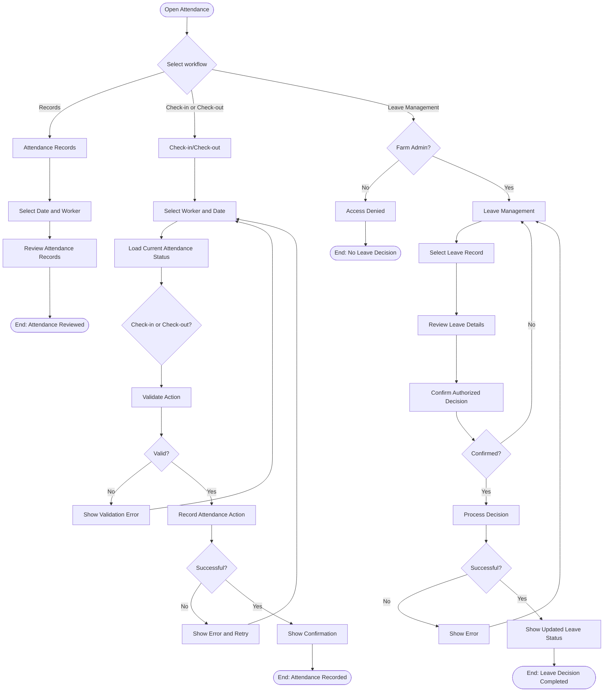

## 17.5 Attendance rules requiring confirmation

The following must not be invented:

- Late-arrival threshold.
- Overtime calculation.
- Missing check-out behavior.
- Duplicate check-in handling.
- Attendance correction policy.
- Leave balance calculation.
- Leave approval rules beyond the confirmed role restriction.
- Attendance-to-payroll calculation details.

---

# 18. Journey 16 — Payroll Management

**Primary actor:** Farm Admin  
**Access:** Farm Admin only  
**End state:** Payroll information reviewed or an authorized payroll record generated/updated.

Supervisor access to all payroll pages is denied.

## 18.1 Salary Management flow

1. Farm Admin opens Salary Management.
2. System loads authorized salary records.
3. Farm Admin selects a worker.
4. System displays wage type and salary information.
5. Farm Admin reviews attendance-related information.
6. Farm Admin creates or edits authorized salary information.
7. System validates the values.
8. Farm Admin saves.
9. System displays success or error feedback.

## 18.2 Payroll Records flow

1. Farm Admin opens Payroll Records.
2. Farm Admin selects a payroll period.
3. System loads payroll records.
4. System displays payroll summaries.
5. Farm Admin selects a worker's payroll record.
6. System displays the available calculation breakdown.
7. Farm Admin reviews or performs permitted actions.
8. System validates changes.
9. System saves and displays feedback.

## 18.3 Advances flow

1. Farm Admin opens Advances.
2. Farm Admin selects a worker.
3. Farm Admin enters advance amount and date.
4. Farm Admin enters approved supporting details.
5. System validates the information.
6. Farm Admin saves.
7. System displays the result.
8. Farm Admin returns to Advances.

## 18.4 Deductions flow

1. Farm Admin opens Deductions.
2. Farm Admin selects a worker.
3. Farm Admin enters deduction amount, date, and details.
4. System validates the information.
5. Farm Admin saves.
6. System displays success or error feedback.

## 18.5 Payslips flow

1. Farm Admin opens Payslips.
2. Farm Admin selects a worker.
3. Farm Admin selects a payroll period.
4. System loads the corresponding payroll information.
5. System displays a structured payslip preview.
6. Farm Admin selects Download PDF or Print.
7. System generates the approved output.
8. Browser download or print interface opens.
9. Farm Admin returns to Payslips.

## 18.6 Mermaid flowchart

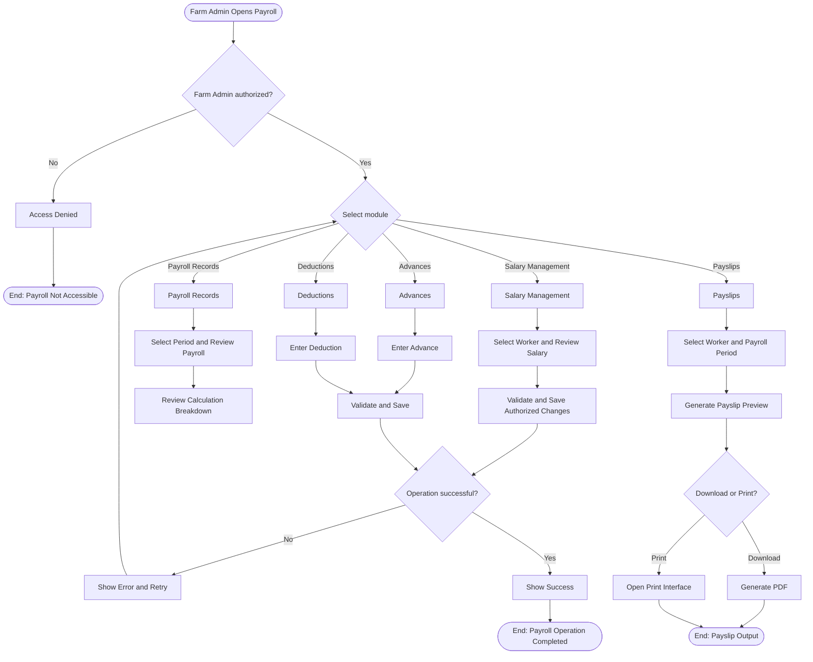

## 18.7 Payroll restrictions

- Supervisor must not access payroll routes or data.
- Payroll formulas must follow approved business rules.
- Unconfirmed overtime, advance deduction, leave, and adjustment calculations must not be invented.
- Unpaid or reopened payroll behavior requires confirmation.
- Payslips must display approved calculated values only.
- Failed PDF generation must provide a retry path.

---

# 19. Journey 17 — Finance Management

**Primary actor:** Farm Admin  
**Access:** Farm Admin only  
**End state:** Financial record reviewed, saved, or report generated.

## 19.1 Income Records flow

1. Farm Admin opens Income Records.
2. System loads income summary and records.
3. Farm Admin applies date/category filters.
4. Farm Admin selects a record or Add Income.
5. System displays details or an entry form.
6. Farm Admin enters approved income information.
7. System validates the information.
8. Farm Admin saves.
9. System displays success or error feedback.

## 19.2 Expense Records flow

1. Farm Admin opens Expense Records.
2. System loads expense records and summary.
3. Farm Admin searches or filters.
4. Farm Admin selects an expense or Add Expense.
5. Farm Admin enters approved expense information.
6. System validates the entry.
7. Farm Admin saves.
8. System displays the result.

## 19.3 Financial Dashboard flow

1. Farm Admin opens Financial Dashboard.
2. Farm Admin selects a reporting period.
3. System loads approved financial data.
4. System displays income, expenses, and approved profit/loss indicators.
5. System displays comparison and trend charts.
6. Farm Admin reviews financial records.
7. Farm Admin navigates to Financial Reports or another authorized finance page.

## 19.4 Financial Reports flow

1. Farm Admin opens Financial Reports.
2. Farm Admin selects the reporting period.
3. System loads financial data.
4. System displays summary and charts.
5. Farm Admin reviews structured financial records.
6. Farm Admin selects PDF, Excel, or Print.
7. System generates the selected output.
8. User receives the output or an error.

## 19.5 Mermaid flowchart

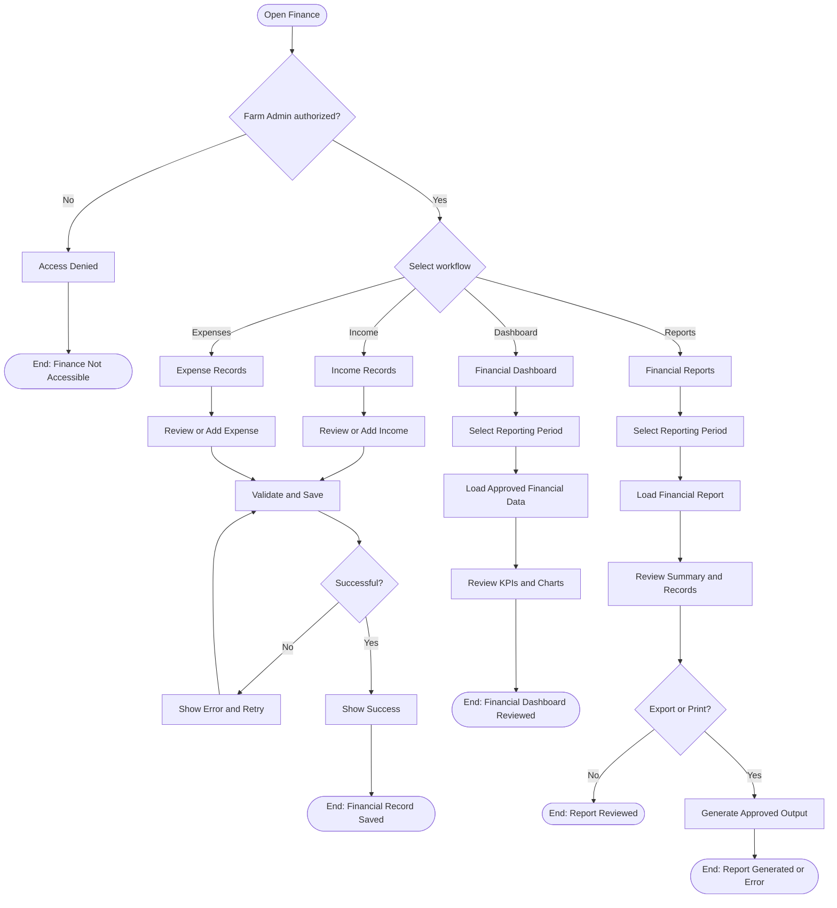

## 19.6 Finance restrictions and calculation boundaries

- Finance is Farm Admin-only.
- Income and expense values must use the configured currency.
- Profit/loss calculations must follow approved business rules.
- Unpaid sales treatment must not be assumed.
- Cost allocation and inventory expense treatment must not be invented.
- Financial charts must not contain fabricated values.

---

# 20. Journey 18 — Equipment Management

**Primary actors:** Farm Admin and Farm Supervisor  
**Entry point:** Equipment navigation or Supervisor Dashboard  
**End state:** Equipment information reviewed or a permitted equipment operation recorded.

## 20.1 Equipment List flow

1. User opens Equipment List.
2. System loads permitted equipment records.
3. User searches or filters by condition/status.
4. System displays matching records.
5. User selects an equipment record.
6. System opens Equipment Details.

## 20.2 Equipment Details flow

1. User opens Equipment Details.
2. System loads equipment information.
3. User reviews current condition.
4. User reviews maintenance summary.
5. User reviews usage summary.
6. User opens Maintenance History or Usage Records.
7. User returns to Equipment Details.

## 20.3 Maintenance History flow

1. User opens Maintenance History.
2. System loads equipment maintenance records.
3. User reviews maintenance information.
4. Farm Admin performs authorized management actions.
5. Supervisor performs only permitted maintenance/condition updates.
6. System validates and saves changes.
7. System displays feedback.

## 20.4 Usage Records flow

1. User opens Usage Records.
2. System loads relevant usage records.
3. User reviews the usage information.
4. Authorized user records or manages permitted usage information.
5. System validates and saves.
6. System displays success or error feedback.

## 20.5 Mermaid flowchart

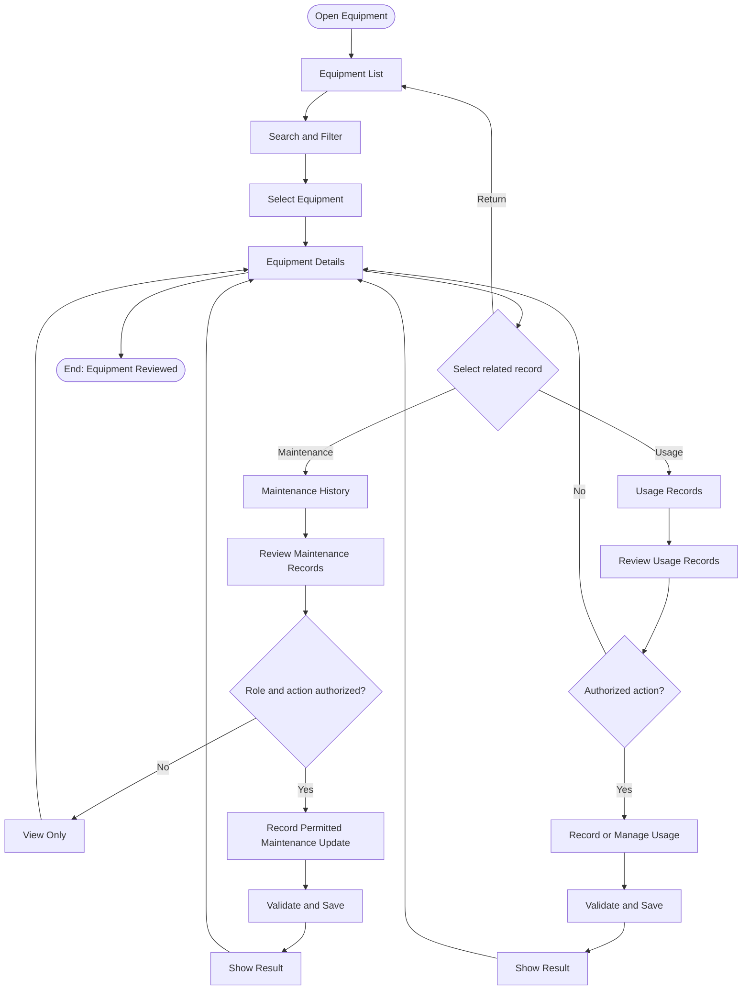

## 20.6 Restrictions

- Supervisor access is limited to permitted equipment viewing and updates.
- Farm Admin receives authorized equipment management.
- No unapproved equipment maintenance automation.
- Equipment photos must use actual uploaded images.
- Missing history must show an empty state.

---

# 21. Journey 19 — Notifications

**Primary actors:** Farm Admin and Farm Supervisor  
**Entry point:** Application header notification control or Notifications navigation  
**End state:** Notification reviewed or permitted notification action completed.

## 21.1 Notification Center flow

1. User selects notification access from the application header.
2. System opens Notification Center.
3. System loads role-authorized notifications.
4. User reviews unread/read counts.
5. User filters by read status or category.
6. User selects a notification.
7. System displays notification details.
8. User selects an available read/unread or authorized action.
9. System processes the action.
10. System updates the notification status.
11. User returns to Notification Center or opens a permitted related record.

## 21.2 Notification History flow

1. User opens Notification History.
2. System loads historical notifications.
3. User searches or filters by category, date, or read status.
4. User selects a notification.
5. System displays details.
6. User returns to Notification History.

## 21.3 Mermaid flowchart

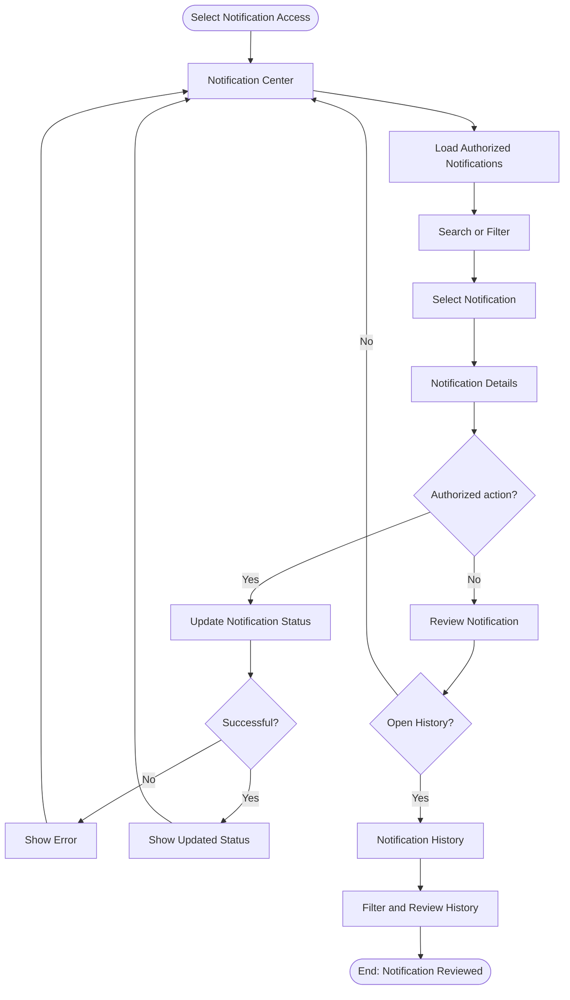

## 21.4 Notification rules

- Notifications must be filtered by role and workspace.
- Supervisor must not receive prohibited High/Critical health alerts.
- Email notifications must only be shown as an available delivery option when configured and supported.
- Notification retry, suppression, deduplication, and acknowledgement policies require approved business rules.
- A failed notification action must not falsely update the read/unread state.

---

# 22. Journey 20 — Reports and Data Exports

**Primary actors:** Farm Admin and authorized Farm Supervisor  
**Entry point:** Reports navigation  
**End state:** Report reviewed or an approved export/print operation completed.

## 22.1 Milk Reports flow

1. User opens Milk Reports.
2. User selects reporting period.
3. System loads authorized production information.
4. System displays production summaries.
5. System displays charts and animal breakdown.
6. User reviews report records.
7. User selects Export or Print where available.
8. System generates the supported output.
9. System displays success or error feedback.

## 22.2 Financial Reports flow

Farm Admin only:

1. Farm Admin opens Financial Reports.
2. Farm Admin selects reporting period.
3. System loads authorized financial information.
4. System displays financial summary and charts.
5. Farm Admin reviews the structured records.
6. Farm Admin selects PDF, Excel, or Print.
7. System generates the output.
8. System displays the result.

Supervisor must not access financial report information.

## 22.3 Available Data Exports flow

Farm Admin:

1. Opens Available Data Exports.
2. System displays approved exportable categories.
3. Farm Admin selects data categories.
4. Farm Admin configures applicable date filters.
5. Farm Admin selects Excel or CSV.
6. Farm Admin selects Export.
7. System validates the request.
8. System generates the export.
9. System provides the output or error feedback.

## 22.4 Mermaid flowchart

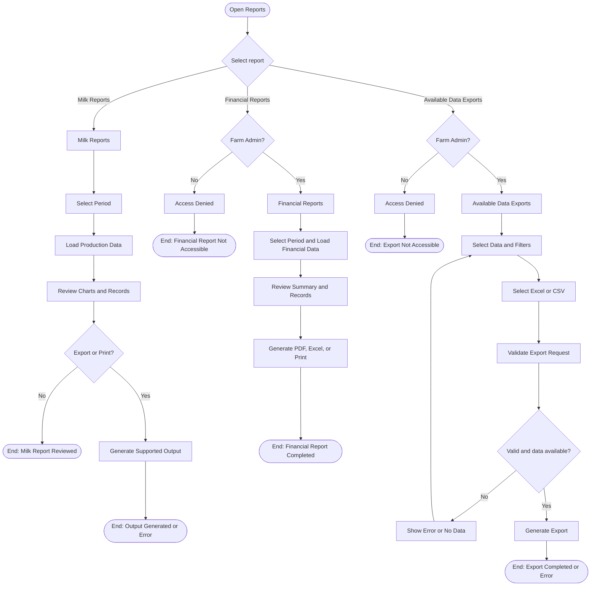

## 22.5 Export failure handling

- No matching data → show a no-data state.
- Invalid filters → show validation feedback.
- Unsupported format → reject the request with a clear message.
- Generation failure → allow retry.
- Permission failure → deny access.
- Download failure → provide an appropriate retry path where supported.

---

# 23. Journey 21 — Farm Settings

**Primary actor:** Farm Admin  
**Access:** Farm Admin only  
**Entry point:** Settings navigation  
**End state:** Settings reviewed or saved successfully.

Supervisor access is denied.

## 23.1 Shared settings flow

All settings pages follow the same interaction structure:

1. Farm Admin opens the relevant settings page.
2. System loads the current saved configuration.
3. Farm Admin reviews the current values.
4. Farm Admin changes one or more approved settings.
5. System validates the input.
6. Farm Admin selects Save Changes.
7. System processes the update.
8. System displays success or error feedback.
9. Farm Admin may return to the settings page or open another settings page.

Cancel returns to the previous saved state.

## 23.2 Settings pages

| Page | Main interaction |
|---|---|
| Farm Profile | Review and update approved farm information |
| Units | Select supported measurement units |
| Currency | Select farm currency and review formatting |
| Timezone | Select farm timezone and review date/time context |
| Preferences | Configure date, time, numeric formatting, and approved preferences |
| Notifications Settings | Configure approved in-app/email notification preferences |
| Configuration | Manage approved farm/module configuration |

## 23.3 Mermaid flowchart

```mermaid
flowchart TD
    A([Farm Admin Opens Settings]) --> B{Farm Admin authorized?}
    B -- No --> C[Access Denied]
    C --> D([End: Settings Not Accessible])
    B -- Yes --> E{Select Settings Page}

    E --> F[Farm Profile]
    E --> G[Units]
    E --> H[Currency]
    E --> I[Timezone]
    E --> J[Preferences]
    E --> K[Notifications Settings]
    E --> L[Configuration]

    F --> M[Load Current Settings]
    G --> M
    H --> M
    I --> M
    J --> M
    K --> M
    L --> M

    M --> N[Edit Approved Values]
    N --> O[Validate]
    O --> P{Valid?}
    P -- No --> Q[Show Field Errors]
    Q --> N
    P -- Yes --> R{Save or Cancel?}
    R -- Cancel --> S[Restore Saved Values]
    S --> T([End: No Changes])
    R -- Save --> U[Save Configuration]
    U --> V{Successful?}
    V -- No --> W[Show Error and Retry]
    W --> N
    V -- Yes --> X[Show Success]
    X --> Y([End: Settings Saved])
```

## 23.4 Configuration consequences

Changes to units, currency, timezone, and preferences may affect how data is displayed.

The UI must:

- Clearly show the selected setting.
- Validate supported values.
- Avoid silently changing historical stored data.
- Explain important consequences where confirmed.
- Require confirmation for important configuration changes.

Unconfirmed recalculation or historical conversion behavior must not be invented.

---

# 24. Journey 22 — Data Management

**Primary actor:** Farm Admin  
**Access:** Farm Admin only  
**Entry point:** Data Management navigation  
**End state:** Data import/export/backup operation completed, cancelled, or failed with recovery options.

Supervisor access is denied.

## 24.1 Import flow

1. Farm Admin opens Import.
2. System displays approved importable categories.
3. Farm Admin selects a data category.
4. Farm Admin uploads an Excel/CSV file.
5. System validates file type and structure.
6. System validates relevant fields and records.
7. System displays validation issues and warnings.
8. Farm Admin reviews the import information.
9. Farm Admin selects Confirm Import or Cancel.
10. System processes the confirmed import.
11. System displays the import outcome.

Branches:

- Invalid file → show file error.
- Unsupported format → reject upload.
- Invalid records → display relevant validation issues.
- User cancels → discard pending import operation.
- Import succeeds → show outcome.
- Import fails → show error and preserve the source file where technically possible.

The system must not silently import invalid records.

## 24.2 Export flow

1. Farm Admin opens Export.
2. System displays approved exportable categories.
3. Farm Admin selects data categories.
4. Farm Admin selects date filters.
5. Farm Admin selects Excel or CSV.
6. Farm Admin selects Export.
7. System validates the request.
8. System generates the file.
9. System provides the result or an error.

## 24.3 Backup Configuration flow

1. Farm Admin opens Backup Configuration.
2. System loads approved backup status and history.
3. Farm Admin reviews backup configuration.
4. Farm Admin selects available automatic/manual and supported storage settings.
5. Farm Admin saves configuration or requests a manual backup.
6. System requests confirmation where required.
7. Farm Admin confirms or cancels.
8. System processes the supported operation.
9. System displays the outcome.

Restore workflows and controls must not be implemented until backup/recovery requirements are confirmed.

## 24.4 Activity Logs flow

1. Farm Admin opens Activity Logs.
2. System loads authorized activity records.
3. Farm Admin searches or filters by date and activity.
4. System displays matching records.
5. Farm Admin selects a record.
6. System displays activity details.
7. Farm Admin returns to Activity Logs.

## 24.5 Mermaid flowchart

```mermaid
flowchart TD
    A([Farm Admin Opens Data Management]) --> B{Farm Admin authorized?}
    B -- No --> C[Access Denied]
    C --> D([End: Data Management Not Accessible])
    B -- Yes --> E{Select workflow}

    E -- Import --> F[Import]
    F --> G[Select Category and Upload File]
    G --> H[Validate File and Records]
    H --> I{Validation successful?}
    I -- No --> J[Display Validation Issues]
    J --> G
    I -- Yes --> K[Review Import]
    K --> L{Confirm Import?}
    L -- No --> M([End: Import Cancelled])
    L -- Yes --> N[Process Import]
    N --> O{Successful?}
    O -- No --> P[Show Import Error]
    O -- Yes --> Q[Show Import Result]
    P --> R([End: Import Failed])
    Q --> S([End: Import Completed])

    E -- Export --> T[Export]
    T --> U[Select Categories and Filters]
    U --> V[Select Excel or CSV]
    V --> W[Validate and Generate Export]
    W --> X([End: Export Completed or Error])

    E -- Backup --> Y[Backup Configuration]
    Y --> Z[Review Status and Settings]
    Z --> AA[Select Approved Backup Action]
    AA --> AB[Confirm Where Required]
    AB --> AC[Process Backup Operation]
    AC --> AD([End: Backup Completed or Error])

    E -- Activity Logs --> AE[Activity Logs]
    AE --> AF[Search and Filter]
    AF --> AG[Open Activity Details]
    AG --> AH([End: Activity Reviewed])
```

## 24.6 Data management restrictions

- Supervisor cannot access Data Management.
- Only approved import/export categories are available.
- Import validation must occur before confirmation.
- Backup frequency, retention, storage, and recovery rules remain subject to clarification.
- No restore interface may be enabled without approval.
- Progress indicators must reflect actual processing progress, not simulated progress.

---

# 25. Cross-Module Navigation Map

The following table defines important cross-module transitions.

| Current page | User action | Next page |
|---|---|---|
| Farm Admin Dashboard | Select Animal Management | Animal List |
| Supervisor Dashboard | Select permitted animal access | Animal List |
| Animal List | Select animal | Animal Profile |
| Animal Profile | Lifecycle History | Lifecycle History |
| Animal Profile | Weight History | Weight History |
| Animal Profile | Authorized health record access | Health Records |
| Animal Profile | Production information | Animal Production History |
| Farm Admin Dashboard | Select Milk Production | Daily Totals or Production Entry |
| Supervisor Dashboard | Select Production Entry | Production Entry |
| Daily Totals | Open production history | Animal Production History |
| Monthly Reports | Open report output | Report export/print action |
| Inventory List | Select item | Item Details |
| Item Details | Purchase History | Purchases |
| Item Details | Stock Additions | Stock Additions |
| Item Details | Stock Adjustments | Stock Adjustments (Farm Admin only) |
| Feeding Plans | Open schedule | Feeding Schedule |
| Feeding Schedule | Record actual feeding | Actual Feeding Records |
| Worker List | Select worker | Worker Profiles |
| Worker Profiles | Open documents | Worker Documents |
| Worker Profiles | Review attendance | Attendance Records |
| Attendance Records | Open leave management | Leave Management |
| Farm Admin Dashboard | Open Payroll | Payroll Records |
| Farm Admin Dashboard | Open Finance | Financial Dashboard |
| Financial Dashboard | Open financial reports | Financial Reports |
| Equipment List | Select equipment | Equipment Details |
| Equipment Details | Maintenance History | Maintenance History |
| Equipment Details | Usage Records | Usage Records |
| Application Header | Open notifications | Notification Center |
| Notification Center | Open history | Notification History |
| Reports | Open Milk Reports | Milk Reports |
| Reports | Open Available Data Exports | Available Data Exports |
| Settings | Open Farm Profile | Farm Profile |
| Settings | Open Units | Units |
| Settings | Open Currency | Currency |
| Settings | Open Timezone | Timezone |
| Settings | Open Preferences | Preferences |
| Settings | Open Notifications Settings | Notifications Settings |
| Settings | Open Configuration | Configuration |
| Data Management | Open Import | Import |
| Data Management | Open Export | Export |
| Data Management | Open Backup Configuration | Backup Configuration |
| Data Management | Open Activity Logs | Activity Logs |

All transitions must be permission-checked before navigation and again by the backend when data or actions are requested.

---

# 26. Screen State Specification

Every data-driven screen must implement the applicable states below.

## 26.1 Global state definitions

| State | Definition | Expected UI behavior |
|---|---|---|
| Loading | Data or action is being processed | Skeletons or action spinner |
| Empty | No records exist | Helpful empty state and permitted next action |
| No Results | Search/filter returns no matching records | Explain that no records match current filters |
| Error | Data request or operation fails | Clear error message and retry path where possible |
| Success | Operation completes successfully | Toast or clear success feedback |
| Validation | Input is missing or invalid | Field-level error and preserved input |
| Disabled | Action is unavailable | Visually disabled control with appropriate explanation |
| Permission Denied | User lacks authorization | Clear access explanation; no restricted data |
| Confirmation | Important action requires approval | Dialog with affected record and consequence |

## 26.2 Public screens

| Screen | Loading | Empty | Error | Success |
|---|---|---|---|---|
| Home | Page loading | Not applicable | Page load failure | Page rendered |
| Contact Inquiry | Submission spinner | Not applicable | Validation/submission error | Inquiry submitted |

## 26.3 Super Admin screens

| Screen | Loading | Empty | Error | Success |
|---|---|---|---|---|
| Super Admin Login | Authentication spinner | Not applicable | Authentication failure | Dashboard opened |
| Dashboard | KPI/activity skeletons | No activity/data | Data request failure | Platform overview loaded |
| Customer Management | Table skeleton | No customers | Search/load failure | Customer action completed |
| Add Customer | Form submission spinner | Not applicable | Validation/create failure | Customer created |
| Workspace Management | Table skeleton | No workspaces | Load/action failure | Workspace action completed |
| Farm Admin Management | Table skeleton | No accounts | Load/provision failure | Account provisioned |
| Customer Access Management | Information skeleton | No matching customer | Load/update failure | Access status updated |
| Workspace Suspension | Workspace search skeleton | No matching workspace | Load/suspension failure | Suspension completed |

## 26.4 Farm application screens

| Module | Screen | Loading | Empty | Error | Success |
|---|---|---|---|---|---|
| Dashboard | Farm Admin Dashboard | KPI/chart skeletons | No farm records | Dashboard data failure | Dashboard loaded |
| Dashboard | Supervisor Dashboard | Operational skeletons | No operational records | Dashboard data failure | Dashboard loaded |
| Animals | Animal List | Table skeleton | No animals | Load/search failure | Animal action completed |
| Animals | Add/Edit Animal | Form spinner | Not applicable | Validation/save failure | Animal saved |
| Animals | Animal Profile | Profile skeleton | Missing related records | Profile load failure | Profile loaded |
| Animals | Lifecycle History | Timeline skeleton | No lifecycle events | Load failure | Record action completed |
| Animals | Weight History | Chart/table skeleton | No weight records | Load/save failure | Weight record saved |
| Health | Health Records | Table skeleton | No health records | Load/search failure | Record action completed |
| Health | Treatments | Table skeleton | No treatments | Load/save failure | Treatment saved |
| Health | Vaccinations | Table skeleton | No vaccination records | Load/save failure | Vaccination saved |
| Health | Veterinary Appointments | Table skeleton | No appointments | Load/save failure | Appointment saved |
| Health | Disease History | Table skeleton | No disease records | Load failure | Record reviewed |
| Milk Production | Production Entry | Form/action spinner | Not applicable | Validation/save failure | Production saved |
| Milk Production | Animal Production History | Chart/table skeleton | No production records | Load failure | History loaded |
| Milk Production | Daily Totals | KPI/chart skeleton | No production for date | Load failure | Daily totals loaded |
| Milk Production | Monthly Reports | Report skeleton | No monthly data | Load/export failure | Report generated |
| Milk Management | Collection | Table skeleton | No collection records | Load/save failure | Collection saved |
| Milk Management | Storage | Storage skeleton | No storage records | Load/save failure | Storage action completed |
| Milk Management | Milk Sales | Table skeleton | No sales | Load/save failure | Sale saved |
| Milk Management | Wastage Records | Table skeleton | No wastage records | Load/save failure | Wastage saved |
| Inventory | Inventory List | Table/KPI skeleton | No inventory items | Load/search failure | Inventory action completed |
| Inventory | Item Details | Detail skeleton | No related history | Load failure | Record action completed |
| Inventory | Purchases | Table skeleton | No purchases | Load/save failure | Purchase saved |
| Inventory | Stock Additions | Form/table skeleton | No additions | Validation/save failure | Stock addition saved |
| Inventory | Stock Adjustments | Form/table skeleton | No adjustments | Validation/save failure | Adjustment saved |
| Feeding | Feeding Plans | Table skeleton | No plans | Load/save failure | Plan saved |
| Feeding | Feeding Schedule | Schedule skeleton | No scheduled feeding | Load failure | Schedule loaded |
| Feeding | Actual Feeding Records | Form/table skeleton | No feeding records | Validation/save failure | Feeding recorded |
| Workers | Worker List | Table skeleton | No workers | Load/search failure | Worker action completed |
| Workers | Worker Profiles | Profile skeleton | No related records | Load/save failure | Profile saved |
| Workers | Worker Documents | Document skeleton | No documents | Upload/load failure | Document saved |
| Attendance | Attendance Records | Table/KPI skeleton | No attendance records | Load failure | Record action completed |
| Attendance | Check-in/Check-out | Action spinner | Not applicable | Validation/recording failure | Attendance recorded |
| Attendance | Leave Management | Table skeleton | No leave records | Load/action failure | Leave decision completed |
| Payroll | Salary Management | Form/table skeleton | No salary records | Load/save failure | Salary saved |
| Payroll | Payroll Records | Table/KPI skeleton | No payroll records | Load/action failure | Payroll action completed |
| Payroll | Advances | Form/table skeleton | No advances | Validation/save failure | Advance saved |
| Payroll | Deductions | Form/table skeleton | No deductions | Validation/save failure | Deduction saved |
| Payroll | Payslips | Document skeleton | No payroll period data | Generation failure | PDF generated/print opened |
| Finance | Income Records | Table/KPI skeleton | No income records | Load/save failure | Income saved |
| Finance | Expense Records | Table/KPI skeleton | No expense records | Load/save failure | Expense saved |
| Finance | Financial Dashboard | Chart/KPI skeleton | No financial records | Load failure | Dashboard loaded |
| Finance | Financial Reports | Report skeleton | No report data | Load/export failure | Report generated |
| Equipment | Equipment List | Table skeleton | No equipment | Load/search failure | Equipment action completed |
| Equipment | Equipment Details | Detail skeleton | No related history | Load failure | Record reviewed |
| Equipment | Maintenance History | Table skeleton | No maintenance records | Load/save failure | Maintenance saved |
| Equipment | Usage Records | Table skeleton | No usage records | Load/save failure | Usage saved |
| Notifications | Notification Center | List skeleton | No notifications | Load/update failure | Notification status updated |
| Notifications | Notification History | List skeleton | No history | Load failure | History loaded |
| Reports | Milk Reports | Report skeleton | No production data | Load/export failure | Report generated |
| Reports | Financial Reports | Report skeleton | No financial data | Load/export failure | Report generated |
| Reports | Available Data Exports | Category skeleton | No exportable data | Generation failure | Export generated |
| Settings | Farm Profile | Form skeleton | Not applicable | Validation/save failure | Settings saved |
| Settings | Units | Form skeleton | Not applicable | Validation/save failure | Settings saved |
| Settings | Currency | Form skeleton | Not applicable | Validation/save failure | Settings saved |
| Settings | Timezone | Form skeleton | Not applicable | Validation/save failure | Settings saved |
| Settings | Preferences | Form skeleton | Not applicable | Validation/save failure | Settings saved |
| Settings | Notifications Settings | Form skeleton | Not applicable | Validation/save failure | Settings saved |
| Settings | Configuration | Form skeleton | Not applicable | Validation/save failure | Configuration saved |
| Data Management | Import | Upload/progress state | No selected file | Validation/import failure | Import completed |
| Data Management | Export | Export spinner | No matching data | Export failure | File generated |
| Data Management | Backup Configuration | Backup status skeleton | No backup history | Backup failure | Backup action completed |
| Data Management | Activity Logs | Table skeleton | No activity records | Load/search failure | Logs loaded |

## 26.5 State consistency requirements

1. Loading states must not display old values as newly updated values without clear indication.
2. Empty states must distinguish no records from no search results.
3. Success feedback must only appear after confirmed backend success.
4. Error feedback must not imply that an operation succeeded.
5. Validation errors must identify the relevant field.
6. Permission-denied states must not reveal restricted information.
7. Disabled actions must not be treated as authorization.
8. Important actions must be protected by backend authorization.
9. Data tables must retain essential information on mobile.
10. Charts must support empty and error states independently.

---

# 27. External Triggers and System Events

The following external or automated events may affect application flows.

| Trigger | Expected flow | Destination or result | Status |
|---|---|---|---|
| Contact inquiry submission | Validate and process inquiry | Public success/error feedback | Required |
| Password reset email | User opens reset link | Password reset flow | Subject to email configuration |
| Optional email OTP | User receives OTP | OTP verification flow | Optional, confirmation required |
| Session expiration | Invalidate expired session | Appropriate login screen | Required behavior; timeout value unresolved |
| Account/workspace suspension | Access check fails | Access denied/login outcome | Required access enforcement |
| Production drop detection | Evaluate approved production data | Authorized notification | Threshold partly confirmed; semantics unresolved |
| Vaccination reminder | Evaluate approved vaccination dates | Authorized notification | Calculation/timing details require confirmation |
| Low-stock alert | Evaluate inventory stock | Authorized notification | Threshold/configuration requires confirmation |
| Expiry alert | Evaluate applicable expiry information | Authorized notification | Policy requires confirmation |
| Email notification | Send approved notification | Email delivery outcome | Configuration and retries unresolved |
| Import processing | Validate and process file | Import result | Required |
| Export generation | Build approved output | File output or error | Required |
| Backup execution | Run supported backup operation | Backup status/history | Requirements require clarification |
| Network interruption | Request or save fails | Recoverable error state | Required |
| Browser print request | Invoke print interface | Print workflow | Required where specified |

## 27.1 Email events

Email-related workflows must not assume:

- Delivery guarantees.
- Retry count.
- Delivery schedule.
- Notification recipient.
- Activation credential policy.
- Password reset token lifetime.

These values must be confirmed before implementation.

## 27.2 Webhooks and external integrations

No unconfirmed webhook or third-party integration is introduced by this specification.

If an approved integration is added later, it must define:

- Trigger event.
- Authentication and authorization.
- Request/response behavior.
- Retry policy.
- Failure handling.
- Duplicate-event handling.
- Audit logging.

## 27.3 Timeouts and session expiry

On session expiry:

1. The application detects an expired session.
2. The system stops protected requests.
3. The user receives an appropriate session-expired message.
4. The user is redirected to the relevant login screen.
5. After successful login, the user enters the authorized dashboard.

Automatic restoration to the exact prior screen is not assumed unless confirmed and implemented securely.

---

# 28. Global Failure and Recovery Flows

## 28.1 Network failure

Applies to all pages.

1. User performs an action or requests data.
2. Network request fails.
3. System displays an understandable error.
4. System preserves recoverable form input where possible.
5. User retries or cancels.
6. If retry succeeds, the normal flow continues.
7. If retry fails, the user remains in a recoverable error state.

The UI must not claim that a failed operation was saved.

## 28.2 Invalid input

1. User submits a form.
2. System validates input.
3. Invalid fields are identified.
4. Field-level error messages are displayed.
5. User corrects the fields.
6. User submits again.
7. System processes valid input.

## 28.3 Failed record save

1. User submits a record.
2. Backend processing fails.
3. System displays a failure message.
4. User remains on the relevant form.
5. Recoverable input remains available.
6. User retries or cancels.

## 28.4 Permission denied

1. User opens an unauthorized page or requests an unauthorized action.
2. System checks authorization.
3. System denies the request.
4. System does not return restricted data.
5. UI displays an access explanation.
6. User returns to an authorized page.

## 28.5 Session expiration

1. Session becomes invalid.
2. Protected requests are rejected.
3. Application displays session-expired feedback.
4. User returns to the correct login screen.
5. User authenticates again.

## 28.6 Duplicate submission protection

For actions where duplicate processing could create incorrect records:

- Disable the submit control while the request is processing.
- Prevent repeated submission where supported.
- Use backend protection where required.
- Display the confirmed result.
- Do not assume every failed response means the server did not process the request.

Exact idempotency requirements must be confirmed for relevant operations.

## 28.7 Out-of-stock sales

The system must detect and communicate the relevant stock condition if the approved inventory relationship supports that validation.

However, the exact response is unresolved.

Do not assume whether the system should:

- Block the sale.
- Permit a partial sale.
- Permit an override.
- Reserve stock.
- Reverse previous stock deductions.

The client must approve the policy before this branch is implemented.

## 28.8 Failed export or report generation

1. User requests an export/report.
2. System validates the request.
3. Generation fails.
4. System displays an error.
5. User may retry or revise the request.
6. No download is presented as successful unless the file is actually generated.

---

# 29. Back, Escape, and Exit Paths

Every screen must have a predictable way to return to an appropriate context.

| Screen type | Back/escape path |
|---|---|
| Public section | Navbar or footer navigation |
| Contact Inquiry | Public page navigation |
| Super Admin Login | No authenticated back destination; public website remains separate |
| Super Admin Dashboard | Navigation to management areas or logout |
| Listing page | Parent navigation or dashboard |
| Add/Edit form | Cancel/back to originating list or context |
| Profile page | Back to originating list |
| History page | Back to related profile |
| Detail drawer | Close drawer and return to underlying list |
| Report page | Reports navigation or dashboard |
| Export page | Return to Reports or Data Management |
| Settings page | Settings navigation |
| Import page | Cancel to Data Management context |
| Backup Configuration | Data Management navigation |
| Activity Logs | Data Management navigation |
| Notification details | Return to Notification Center or History |
| Confirmation dialog | Cancel returns to the unchanged underlying page |
| Permission denied | Return to an authorized dashboard/page |
| Session expired | Return to login |

## 29.1 Unsaved changes

Where a form contains unsaved changes:

1. User selects Cancel, Back, or navigation.
2. System detects unsaved changes.
3. System displays a confirmation dialog where appropriate.
4. User chooses:
   - Stay and continue editing.
   - Discard changes and leave.
5. System preserves or discards the form according to the selected action.

Do not discard user input silently.

---

# 30. Role-Based Access Gates

## 30.1 Access decision sequence

Every protected request must follow this order:

1. Verify authenticated session.
2. Verify account status.
3. Verify assigned workspace access.
4. Verify role.
5. Verify resource permission.
6. Verify action permission.
7. Execute the request only if authorized.
8. Return only authorized information.

## 30.2 Role access summary

| Feature | Guest | Super Admin | Farm Admin | Supervisor |
|---|---|---|---|---|
| Public website | Yes | Yes | Yes | Yes |
| Contact inquiry | Yes | Yes | Yes | Yes |
| Super Admin Dashboard | No | Yes | No | No |
| Customer Management | No | Yes | No | No |
| Workspace Management | No | Yes | No | No |
| Farm Admin Management | No | Yes | No | No |
| Customer Access Management | No | Yes | No | No |
| Workspace Suspension | No | Yes | No | No |
| Farm Admin Dashboard | No | No | Yes | No |
| Supervisor Dashboard | No | No | No | Yes |
| Animal Management | No | No | Full permitted | Restricted |
| Animal Health | No | No | Full permitted | Permitted records/actions |
| Milk Production | No | No | Full permitted | Operational |
| Milk Management | No | No | Full permitted | Permitted operations |
| Inventory | No | No | Full permitted | View/permitted usage |
| Stock Adjustments | No | No | Yes | No |
| Feeding Plans | No | No | Manage | View |
| Actual Feeding | No | No | Manage | Record permitted feeding |
| Workers | No | No | Manage | Permitted access |
| Attendance | No | No | Manage | Daily operations |
| Leave Approval | No | No | Yes | No |
| Payroll | No | No | Yes | No |
| Finance | No | No | Yes | No |
| Equipment | No | No | Manage | View/permitted updates |
| Notifications | No | No | Full permitted | Operational only |
| Reports | No | No | Full permitted | Authorized information only |
| Settings | No | No | Yes | No |
| Data Management | No | No | Yes | No |

## 30.3 Access enforcement requirements

- Hidden navigation is not a substitute for authorization.
- Direct URL access must be checked.
- Backend APIs must enforce permissions.
- Restricted data must not be sent to unauthorized clients.
- A denied request must not change the underlying record.
- Permissions must be checked on every sensitive action.

---

# 31. Sitemap Coverage Audit

Every approved sitemap page is represented in the journeys above.

## 31.1 Public website

| Sitemap item | Covered in |
|---|---|
| Navbar | Journey 01 |
| Hero | Journey 01 |
| About SmartFarm | Journey 01 |
| Features | Journey 01 |
| How It Works | Journey 01 |
| Benefits | Journey 01 |
| Dashboard Preview | Journey 01 |
| Contact Inquiry | Journey 01 |
| Footer | Journey 01 |

## 31.2 Super Admin

| Sitemap page | Covered in |
|---|---|
| Super Admin Login | Journey 02 |
| Super Admin Dashboard | Journey 03 |
| Customer Management | Journeys 03, 04 |
| Add Customer | Journey 04 |
| Workspace Management | Journeys 03, 05 |
| Farm Admin Management | Journey 05 |
| Customer Access Management | Journey 06 |
| Workspace Suspension | Journey 06 |

## 31.3 Farm Application

| Module | Sitemap page | Covered in |
|---|---|---|
| Dashboard | Farm Admin Dashboard | Journey 07 |
| Dashboard | Supervisor Dashboard | Journey 07 |
| Animal Management | Animal List | Journey 08 |
| Animal Management | Add/Edit Animal | Journey 08 |
| Animal Management | Animal Profile | Journey 08 |
| Animal Management | Lifecycle History | Journey 08 |
| Animal Management | Weight History | Journey 08 |
| Animal Health | Health Records | Journey 09 |
| Animal Health | Treatments | Journey 09 |
| Animal Health | Vaccinations | Journey 09 |
| Animal Health | Veterinary Appointments | Journey 09 |
| Animal Health | Disease History | Journey 09 |
| Milk Production | Production Entry | Journey 10 |
| Milk Production | Animal Production History | Journey 10 |
| Milk Production | Daily Totals | Journey 10 |
| Milk Production | Monthly Reports | Journey 10 |
| Milk Management | Collection | Journey 11 |
| Milk Management | Storage | Journey 11 |
| Milk Management | Milk Sales | Journey 11 |
| Milk Management | Wastage Records | Journey 11 |
| Inventory | Inventory List | Journey 12 |
| Inventory | Item Details | Journey 12 |
| Inventory | Purchases | Journey 12 |
| Inventory | Stock Additions | Journey 12 |
| Inventory | Stock Adjustments | Journey 12 |
| Feeding | Feeding Plans | Journey 13 |
| Feeding | Feeding Schedule | Journey 13 |
| Feeding | Actual Feeding Records | Journey 13 |
| Workers | Worker List | Journey 14 |
| Workers | Worker Profiles | Journey 14 |
| Workers | Worker Documents | Journey 14 |
| Attendance | Attendance Records | Journey 15 |
| Attendance | Check-in/Check-out | Journey 15 |
| Attendance | Leave Management | Journey 15 |
| Payroll | Salary Management | Journey 16 |
| Payroll | Payroll Records | Journey 16 |
| Payroll | Advances | Journey 16 |
| Payroll | Deductions | Journey 16 |
| Payroll | Payslips | Journey 16 |
| Finance | Income Records | Journey 17 |
| Finance | Expense Records | Journey 17 |
| Finance | Financial Dashboard | Journey 17 |
| Finance | Financial Reports | Journey 17 |
| Equipment | Equipment List | Journey 18 |
| Equipment | Equipment Details | Journey 18 |
| Equipment | Maintenance History | Journey 18 |
| Equipment | Usage Records | Journey 18 |
| Notifications | Notification Center | Journey 19 |
| Notifications | Notification History | Journey 19 |
| Reports | Milk Reports | Journey 20 |
| Reports | Financial Reports | Journey 20 |
| Reports | Available Data Exports | Journey 20 |
| Settings | Farm Profile | Journey 21 |
| Settings | Units | Journey 21 |
| Settings | Currency | Journey 21 |
| Settings | Timezone | Journey 21 |
| Settings | Preferences | Journey 21 |
| Settings | Notifications Settings | Journey 21 |
| Settings | Configuration | Journey 21 |
| Data Management | Import | Journey 22 |
| Data Management | Export | Journey 22 |
| Data Management | Backup Configuration | Journey 22 |
| Data Management | Activity Logs | Journey 22 |

---

# 32. Unresolved Requirements and Implementation Holds

The following items must remain unresolved until the client approves their behavior.

| ID | Area | Unresolved requirement | Implementation instruction |
|---|---|---|---|
| UF-001 | Customer Management | Multiple workspaces per customer | Do not assume a one-to-one or one-to-many rule |
| UF-002 | Farm Admin Management | Multiple Farm Admins per workspace | Await approved account policy |
| UF-003 | Account Access | One user accessing multiple workspaces | Do not create workspace switching |
| UF-004 | Super Admin | Support access to customer operational/financial data | Do not implement support access |
| UF-005 | Authentication | Account activation and first-login policy | Do not invent activation screens |
| UF-006 | Authentication | Session timeout and lockout policy | Use only approved security configuration |
| UF-007 | Authentication | Optional OTP behavior | Implement only after approval/configuration |
| UF-008 | Milk Production | Rolling average definition for production-drop alerts | Do not invent averaging logic |
| UF-009 | Milk Production | Missing days, duplicate alerts, acknowledgement | Await approved rules |
| UF-010 | Milk Sales | Out-of-stock handling | Do not assume block/override behavior |
| UF-011 | Milk Sales | Cancellation and reversal | Do not implement unapproved reversal logic |
| UF-012 | Inventory | Feeding/usage stock deduction | Do not assume automatic deductions |
| UF-013 | Inventory | Negative stock policy | Await approval |
| UF-014 | Inventory | Expiry and stock handling policy | Await approval |
| UF-015 | Payroll | Salary and wage calculations | Use approved formulas only |
| UF-016 | Payroll | Attendance and overtime treatment | Await approval |
| UF-017 | Payroll | Advances and deductions treatment | Await approval |
| UF-018 | Payroll | Payroll reopening/correction | Do not invent workflow |
| UF-019 | Attendance | Late, overtime, missing check-out and corrections | Await approved rules |
| UF-020 | Leave | Leave calculation and approval rules | Await approved rules |
| UF-021 | Finance | Unpaid sales and income treatment | Do not assume recognition rules |
| UF-022 | Finance | Inventory and cost treatment | Await approved rules |
| UF-023 | Notifications | Email retry and suppression policy | Await approval |
| UF-024 | Notifications | Alert deduplication and acknowledgement | Await approval |
| UF-025 | Backup | Frequency, retention and storage requirements | Await approval |
| UF-026 | Backup | Restore and recovery workflow | Do not implement restore controls |
| UF-027 | Data Management | Import duplicate and conflict resolution | Await approved policy |
| UF-028 | Data Management | Import rollback behavior | Await approved policy |

## 32.1 Scope exclusions

The following are explicitly excluded:

- Breeding workflows.
- Multi-farm switching.
- Super Admin operational-data support access.
- Public self-registration.
- Online checkout and payment.
- Subscription or automatic renewal workflows.
- Backup restoration controls.
- Unapproved calculation workflows.
- Unapproved notification channels.
- 3D livestock models and WebGL.
- Fake operational data presented as real.
- Unapproved external integrations.

---

# 33. UI and Interaction Implementation Requirements

## 33.1 Navigation

- Use the approved SmartFarm visual system.
- Maintain separate Super Admin and Farm Application shells.
- Use role-specific navigation configurations.
- Preserve the active navigation state.
- Support desktop sidebar collapse.
- Support mobile navigation drawers.
- Provide breadcrumb or page context where appropriate.
- Do not expose unauthorized routes through direct navigation.

## 33.2 Forms

- Labels appear above fields.
- Required indicators appear where applicable.
- Field-level errors appear below the relevant field.
- Use the approved 44px standard input height.
- Preserve recoverable values after errors.
- Disable repeated submission while processing.
- Provide Cancel and Back behavior.
- Confirm important operations.

## 33.3 Tables

- Show loading skeletons.
- Show empty and no-results states separately.
- Preserve essential columns in responsive layouts.
- Support approved pagination options.
- Display status text with semantic badges.
- Place authorized actions consistently.
- Avoid showing restricted columns to unauthorized roles.

## 33.4 Charts

- Use actual data.
- Respect configured units, currency, timezone, and date preferences.
- Include chart title, labels, axes, and units.
- Include legends for multiple series.
- Provide accessible information beyond hover-only tooltips.
- Support loading, empty, and error states.
- Never animate fictional production or financial activity.

## 33.5 Confirmation dialogs

Important destructive or access-changing actions must include:

1. Dialog title.
2. Explanation.
3. Affected record.
4. Consequence.
5. Confirm action.
6. Cancel action.

Examples:

- Workspace suspension.
- Customer access changes.
- Stock adjustment.
- Leave approval/rejection.
- Important record deletion or archival where approved.

## 33.6 Theme behavior

- Support Light, Dark, and System theme options where approved.
- Use semantic color tokens.
- Maintain the same SmartFarm brand identity in both themes.
- Do not use pure black as the dark-mode canvas.
- Preserve readable contrast and status meaning.

## 33.7 Accessibility

- Keyboard navigation.
- Visible focus states.
- Accessible modal focus management.
- Associated form labels.
- Screen-reader-friendly status updates.
- Semantic status labels alongside colors.
- Reduced-motion support.
- Touch-friendly mobile controls.
- WCAG 2.2 AA contrast target.

---

# 34. Final Flow Acceptance Checklist

## 34.1 Journey coverage

- [ ] Public visitor journey documented.
- [ ] Contact inquiry journey documented.
- [ ] Super Admin authentication documented.
- [ ] Customer creation documented.
- [ ] Workspace management documented.
- [ ] Farm Admin provisioning documented.
- [ ] Customer access management documented.
- [ ] Workspace suspension documented.
- [ ] Farm Admin dashboard documented.
- [ ] Supervisor dashboard documented.
- [ ] Animal management documented.
- [ ] Animal health documented.
- [ ] Milk production documented.
- [ ] Milk management documented.
- [ ] Inventory documented.
- [ ] Feeding documented.
- [ ] Workers and documents documented.
- [ ] Attendance and leave documented.
- [ ] Payroll documented.
- [ ] Finance documented.
- [ ] Equipment documented.
- [ ] Notifications documented.
- [ ] Reports and exports documented.
- [ ] Settings documented.
- [ ] Data management documented.

## 34.2 Navigation and security

- [ ] Every approved sitemap page appears in at least one journey.
- [ ] Every journey has a defined end state.
- [ ] No navigation dead ends.
- [ ] Back and cancellation paths are defined.
- [ ] Guest/private access boundaries are defined.
- [ ] Farm Admin and Supervisor access are separated.
- [ ] Backend authorization is required.
- [ ] Restricted data is not returned to unauthorized users.
- [ ] Super Admin operational farm access is excluded.

## 34.3 Interaction states

- [ ] Loading states defined.
- [ ] Empty states defined.
- [ ] No-results states defined.
- [ ] Error states defined.
- [ ] Success states defined.
- [ ] Validation states defined.
- [ ] Disabled states defined.
- [ ] Permission-denied states defined.
- [ ] Confirmation paths defined.
- [ ] Network failure recovery defined.
- [ ] Session expiration recovery defined.
- [ ] Failed submission recovery defined.

## 34.4 Scope and business rules

- [ ] No unapproved pages added.
- [ ] No public registration or checkout.
- [ ] No unsupported calculations invented.
- [ ] No unconfirmed stock deduction behavior.
- [ ] No unconfirmed payroll formulas.
- [ ] No unconfirmed financial treatment.
- [ ] No backup restore workflow.
- [ ] No 3D or WebGL.
- [ ] No simulated operational data.
- [ ] All unresolved requirements explicitly identified.

---

# 35. Final Implementation Directive

This document defines the approved application navigation and interaction baseline for SmartFarm.

Implementation teams must use:

1. `docs/srs.md` for functional and non-functional requirements.
2. `docs/business-rules.md` for approved calculations and operational rules.
3. `docs/role-permission-matrix.md` for authorization.
4. `docs/sitemap.md` for page structure and page coverage.
5. `docs/design.md` for visual design and responsive behavior.
6. `docs/appflow.md` for navigation, user journeys, decisions, states, and recovery flows.

If a workflow requires a decision that is not established in these documents, implementation must pause at that decision and request clarification.

**Final principle: Build the approved SmartFarm workflow, not an assumed workflow.**