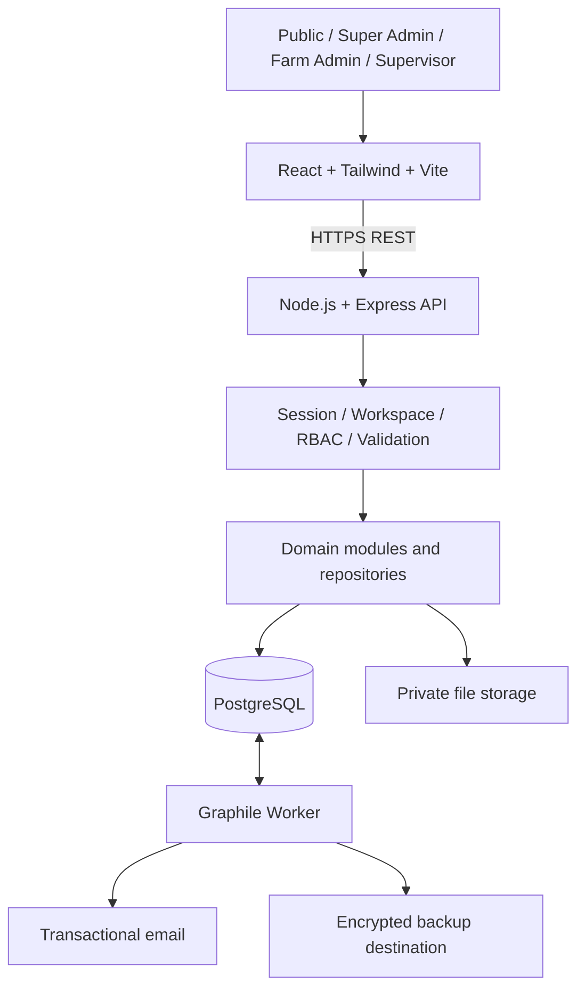

# SmartFarm — Architecture Rules

**Status:** LOCKED — approved by the project owner on 24 November 2026
**Authority:** `docs/architecture.md` (LOCKED), `docs/acr-001-prototype-fixtures.md` (approved prototype exception), `AGENTS.md`, `README.md`
**Purpose:** one operating rule set for implementation agents. This document restates approved decisions; it adds, removes and reinterprets nothing. Stitch exports, templates and visual handoff files are visual reference only and never set architecture, permissions, data or workflow rules.

## System map

The system is a modular monolith with a separate PostgreSQL-backed job process. All tenant records live in one shared PostgreSQL database and carry explicit workspace ownership.

Deployment shape (conditional items stay conditional): the browser reaches a same-origin Caddy HTTPS origin serving the React build and the Express API; the API reaches private PostgreSQL and private object storage; Graphile Worker shares PostgreSQL and reaches the email provider and an independent encrypted backup destination. Cloudflare Pages static hosting is an alternative only when the same-origin option is not viable. No microservices, no Kubernetes, no separate backend per role, no Redis.

## Ownership — who owns what

Each responsibility has exactly one owner. A component may use another owner's output through its defined interface, but may not take over that responsibility.

| Owner | Owns |
|---|---|
| Auth / authorization | Login, recovery, sessions, role policies, ownership checks |
| Platform | Customers, workspaces, provisioning, suspension |
| Animals | Profiles, identifiers, parent relationships, lifecycle, weight |
| Health | Treatments, vaccinations, appointments, disease history |
| Milk production | Morning/evening entries, approved totals, histories |
| Milk management | Collection, tanks, sales, usage, wastage, stock |
| Inventory | Items, purchases, additions, adjustments, usage |
| Feeding | Plans, schedules, actual feeding, approved suggestions |
| Workers | Worker profiles and authorized documents |
| Attendance | Check-in/out, attendance, leave, overtime |
| Payroll | Salary structures, advances, deductions, payments, payslips |
| Finance | Income, expenses, approved profit/loss, summaries |
| Equipment | Records, usage, maintenance |
| Reports | Authorized analytics and PDF/Excel/CSV outputs |
| Notifications | Recipient policy, history, read/unread |
| Automation | Approved calculations, schedules, jobs, outbox events |
| Settings | Farm configuration and preferences |
| Data management | Approved import/export and backup workflows |
| Activity logs | Actor, action, time and approved context |
| Public | Contact inquiry processing |

Process-level owners do not overlap with module owners: the API process owns request transport and response shaping; the worker process owns durable job execution; Pino owns structured process logging; the monitoring setup owns metrics and alerts; database migrations own deployable DDL, never application startup.

Cross-module mutations go through domain services and transactions. Animal records feed production; attendance informs payroll; stock changes affect inventory; financial reporting uses only approved recognition rules. These relationships do not authorize automatic accounting postings, feed deductions or new features where business rules remain unresolved. Super Admin owns platform administration and has no routine farm operational or financial access. Farm Admin owns farm administration. Supervisor owns only the approved operational subset. Workers are records, not login accounts.

## Allowed dependencies and forbidden paths

Allowed direction:

1. UI → typed API client → versioned REST API.
2. API route → controller (transport only) → Zod schema → policy → domain service → repository → PostgreSQL.
3. Domain service → transaction → one or more repositories; cross-module mutation → owning domain service.
4. Repository → PostgreSQL with transaction-local workspace context.
5. Worker → PostgreSQL outbox → policy check → provider adapter.
6. UI component → owned/shared UI primitives; navigation visibility follows role but never grants permission.
7. Prototype UI component → `@smartfarm/data-source` only (ACR-001). The build-time switch selects `apps/web/src/fixtures/` in development and the non-fixture adapter in production. Components never import fixture files directly.
8. Public Home hero → CSS/static decorative motif in `apps/web/src/features/public/` only (ACR-002), with lazy import, static fallback and no shared root import.

Named forbidden paths:

- UI → PostgreSQL, direct SQL, direct file storage, secrets, or a fixture file imported directly (use `@smartfarm/data-source`).
- Controller → business rules, calculations, or direct SQL.
- Repository → HTTP responses, permission decisions, or authorization bypass.
- Any component → client-supplied workspace ID as an authority; membership comes from trusted session context.
- Any component → cross-workspace parent reference or another workspace's data.
- Any component → unapproved formula, status, transition, rounding or valuation policy.
- Worker → tenant policy bypass, or direct business-state writes outside the owning domain service.
- Super Admin → routine farm operational or financial browsing.
- Supervisor → payroll, finance, stock correction, leave approval, animal archive, or High/Critical health alerts.
- Private route or private interface → 3D/WebGL code.
- Any route → WebGL, canvas, Three.js/R3F or GLB/GLTF assets unless a later ACR explicitly approves that runtime.
- Runtime database role → table ownership or `BYPASSRLS`.
- Application → payment gateway, worker login, RFID, PIN, social login, JWT replacement, or public registration.
- Application → public bucket or permanent public URL for a private file.
- Application startup → `schema.sql` execution.
- Any actor → cascade deletion of history or permanent deletion before policy approval.

## Critical data flows

**Authenticated read.** Browser sends a credentialed request → API validates session and checks account plus workspace status → policy applies the action check and field allowlist → repository sets `SET LOCAL app.workspace_id` inside the transaction → PostgreSQL RLS filters rows as defense in depth → response contains only allowed fields. A suspended account or workspace is rejected on this path, including an existing session.

**Milk sale (approved mutation example).** Authorize Farm Admin → validate references and approved quantities → begin transaction → check applicable stock rules with appropriate locking → create sale and matching stock movement → record the audit/outbox event → commit. Roll back on failure. Duplicate submissions are rejected. Rules for shortages, cancellations, returns and restocking are not inferred.

**Background job.** Outbox event → Graphile Worker → tenant policy check → provider adapter for email or backup. Provider failure is recorded and retried without corrupting the business transaction. Jobs never bypass tenant policy.

**Private file.** Bounded, content-validated upload → private object storage under an opaque key → metadata with workspace ownership in PostgreSQL → authorized streaming only. No public bucket and no permanent private URL.

**Public inquiry.** Guest submits the contact form → rate limit and Zod validation → inquiry record. No account, workspace or login is created.

## Invariants — must stay true, never silently broken

- The locked stack is React.js + Tailwind CSS, Node.js + Express.js, PostgreSQL, and COD/manual payments with no gateway.
- One shared PostgreSQL database; every tenant-owned table has `workspace_id`; RLS is enabled and forced; workspace context is set transaction-locally; the runtime role is a non-owner without `BYPASSRLS`.
- A client-supplied workspace ID is never trusted. Deny-by-default RBAC plus ownership and field allowlists come before RLS; RLS is never a substitute for action checks.
- The server is authoritative. Client previews are never saved as financial truth.
- Money and quantities use PostgreSQL `numeric` and `decimal.js`; binary floating point is never stored truth.
- Ear tags and CNIC are unique per workspace; cross-workspace parent references are rejected; history is preserved; no cascade history deletion; permanent deletion stays blocked pending approval.
- Sessions are server-side, revocable, regenerated on login and revoked on logout; account and workspace status are checked on every protected request.
- Workers are records, not login accounts. No public registration, worker login, RFID, PIN, social login, JWT replacement, activation default or assumed OTP.
- Private files use opaque keys and authorized streaming; no public bucket and no permanent private URL.
- Secrets, credentials, production data and realistic worker records never enter source control, logs or error responses; sensitive fields are redacted.
- Unresolved business rules, formulas, transitions and statuses stay blocked. No fake data, fake metrics or simulated live telemetry.
- 3D/WebGL is excluded by default; any 3D work requires explicit written scope and design change approval. ACR-002 permits one CSS/static public Home hero motif only; no WebGL is authorized.
- ACR-001 is the only sample-data exception: fixtures are visual-only, labelled, neutral, reached through `@smartfarm/data-source`, and excluded from production bundles. Prototype route guards and local-draft state are never authorization or persistence.
- No library outside the approved stack; no new package for a trivial utility.

## Stop-and-report rule

If work would change the framework, backend, database, authentication model, deployment model, locked stack or an approved boundary, or if a required business rule is unresolved:

1. **Stop** the task. Do not apply a workaround that silently changes the system.
2. State the conflict with evidence, the affected approved decision, and its impact on scope, cost, security and data.
3. Propose the **smallest** change that resolves it while preserving every locked decision.
4. Obtain **explicit human approval** and record the Architecture Change Request before proceeding.

Until approval, the locked architecture remains authoritative and the affected work stays blocked. Blocked work is never committed as done.
