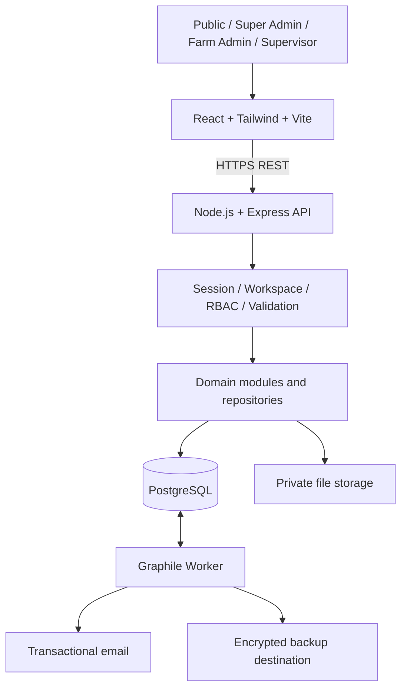
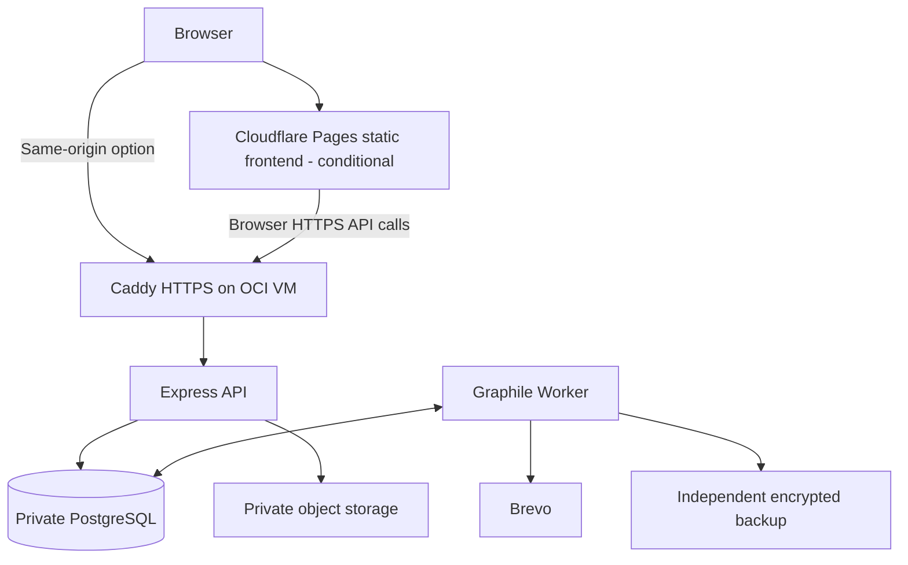

# SmartFarm — Complete Solution Architecture

**Document:** `docs/architecture.md`  
**Version:** 1.2  
**Date:** 24 November 2026  
**Status:** LOCKED — approved by the project owner on 24 November 2026  
**Project:** SmartFarm Dairy Management System  
**Cost constraint:** Zero recurring service charges; production feasibility conditional  
**Payment constraint:** COD/manual handling only; no online gateways

## 1. Authority and scope

This document supersedes the earlier architecture drafts, not the approved product requirements. The locked stack is React.js + Tailwind CSS, Node.js + Express.js, and PostgreSQL. No supporting decision may replace these technologies.

| Source | Authority |
|---|---|
| `discovery.md` | Business objectives and product understanding |
| `scope.md` | Deliverables and exclusions |
| `srs.md` | Functional and non-functional requirements |
| `role-permission-matrix.md` | Server-enforced access and conditional permissions |
| `business-rules.md` (renamed from the uploaded `bussiness rules.md`) | Calculations, transitions, automation and exceptions |
| `data-requirements.md` | Logical entities, relationships and integrity |
| `design.md` | Detailed UI blueprint |
| `design-system.md` | Reusable visual rules |
| `sitemap.md` | Page and navigation scope |
| `stitch-visual-handoff.md` | Visual references only |
| `acr-001-prototype-fixtures.md` | Approved prototype fixture and data-access seam exception |

The SRS, permission matrix and approved business rules govern behavior. Stitch is not a source of permissions, calculations, routes, fake statuses or new features. Unresolved requirements remain open questions. ACR-001, approved 24 November 2026, permits visual-only fixtures only under `apps/web/src/fixtures/`, reached exclusively through the build-time data-access seam at `@smartfarm/data-source`; production builds use the non-fixture adapter by default and must contain no fixture markers. Prototype route guards and local-draft UI state are labels only and never substitute for server enforcement or persistence. Because SRS section 24 and scope section 6.3 exclude dedicated 3D, the small marketing enhancement is authorized only by **ACR-002**, approved by the owner on 25 November 2026 for one CSS/static Home hero motif. It does not authorize WebGL, operational 3D, farm simulations or additional pages.

## 2. Project evaluation

SmartFarm is a multi-tenant operational management and analytics platform, not an e-commerce storefront or IoT product. It supports three surfaces and four interface experiences: public marketing, Super Admin, Farm Admin and Farm Supervisor. Workers are records without login accounts. Customers purchase the software outside the application and are manually onboarded.

| Requirement | Architectural consequence |
|---|---|
| Isolated farm workspaces | Tenant-scoped access and relational constraints |
| Milk stock, payroll, finance | Transactions and exact decimals |
| Animal histories and attachments | Relational records and private storage |
| Workspace suspension | Revocable sessions and status checks on every request |
| Restricted Supervisor operations | Resource-, action-, record- and field-level authorization |
| Reminders and calculations | Durable scheduled background jobs |
| Imports, exports, backups | Bounded processing and recoverable storage |
| Mobile-first UI and themes | Responsive components and semantic tokens |
| Public SEO | Pre-rendered HTML |
| No offline synchronization | Connectivity-required UI, no offline mutation queue |
| No payment gateways | No checkout integration, gateway webhooks or transaction fees |

SRS sections on capacity and performance do not specify maximum farm, animal, worker or concurrent user counts, record volumes or approved numerical latency targets. No free hosting plan can therefore be certified sufficient yet. Estimates below are planning tools, not invented project scale.

## 3. Locked stack and architecture pattern

| Layer | Selection | Status |
|---|---|---|
| Frontend | React.js + Tailwind CSS | LOCKED |
| Backend | Node.js + Express.js | LOCKED |
| Database | PostgreSQL | LOCKED |
| Language | TypeScript | Recommended |
| Pattern | Modular monolith + separate job process | Recommended |
| Tenancy | Shared relational database with scoped records | Recommended |

A modular monolith minimizes infrastructure and allows cross-module operations to share transactions. Microservices, Kubernetes and separate backends for each role introduce needless orchestration and consistency work. Trade-off: modules share a deployment lifecycle; enforce clear service boundaries. License cost $0; complexity medium; principal risk is coupling.



## 4. Detailed technology decisions — all 25 categories

Unless otherwise stated, software choices below have a no-license-fee open-source implementation path. Verify exact versions and dependency licenses before pinning. Hosting, service quotas and human maintenance are separate from software licensing.

### 4.1 Frontend

**What:** React.js, Tailwind CSS, TypeScript, Vite, React Router; one frontend with distinct route groups and lazy-loaded features.

**Why:** Matches locked stack and existing design work; suitable for complex forms, tables and shared visual components. Build-time pre-render public content using React rendering APIs, hydrate interactive elements, and use client routing for private screens.

**Alternatives:** Webpack or other build tools; a full SSR framework adds unnecessary complexity and is not a replacement for the locked stack.

**Trade-offs / risks:** Explicit pre-render integration, asset and routing configuration; bundle bloat. **Cost:** $0 software. **Complexity:** Medium.

Use Public, Auth, Platform and Farm layouts; distinct Admin/Supervisor navigation and policies. Shared UI never grants shared permissions. Private API queries must only return authorized data.

### 4.2 Backend

**What:** Supported Node.js LTS + Express.js 5 + TypeScript. Feature modules with routes, controllers, validation schemas, policies, services and repositories. Use centralized error middleware and Pino HTTP logging.

**Why:** Express is locked, mature and straightforward to deploy on Linux. **Alternatives:** Different Express module conventions; no framework substitution permitted. **Trade-offs:** Express does not impose structure; code review must prevent business logic accumulating in controllers. **Cost:** $0. **Complexity:** Medium. **Risk:** Inconsistent middleware ordering or module boundaries.

```text
animals/
  animal.routes.ts
  animal.controller.ts
  animal.schema.ts
  animal.policy.ts
  animal.service.ts
  animal.repository.ts
  animal.types.ts
```

### 4.3 Database

**What:** PostgreSQL; shared schema with explicit workspace ownership. Separate platform records from farm operational records. Use UUID internal keys, scoped foreign keys, indexed queries, transactions and row-level security (RLS) on tenant-owned tables.

**Why:** Strong relational integrity, reporting and exact numeric operations. **Alternative:** Separate PostgreSQL database per farm; stronger physical separation but more migrations, connections and backups. No alternative database engine is permitted. **Trade-off:** Shared schema requires rigorous isolation. **Cost:** $0 software, hosting conditional. **Complexity:** Medium–high. **Risk:** Cross-tenant access or concurrent stock inconsistencies.

### 4.4 ORM

**What:** Drizzle ORM + Drizzle Kit + node-postgres (`pg`). Use parameterized SQL for specialized queries and version-controlled migrations.

**Why:** Typed schemas, SQL control and ordinary PostgreSQL transactions suit both CRUD and complex reporting. **Alternatives:** Prisma (mature tooling, more opinionated abstraction), TypeORM (entity abstractions), raw SQL (maximum control, more manual work). **Trade-off:** Team needs SQL skills. **Cost:** $0 core. **Complexity:** Medium. **Risk:** Inefficient queries, migration drift or accidental unscoped queries.

### 4.5 Authentication

**What:** `express-session` + `connect-pg-simple`, Argon2id password hashing, Node crypto for recovery tokens, secure HTTP-only session cookies. Persist sessions in PostgreSQL; regenerate session IDs on login, revoke on logout and enforce current account/workspace status on every protected request. Use expiring, single-use reset tokens stored as hashes. Email recovery is included; optional email OTP policy remains open.

**Why:** Revocable sessions simplify suspension and access management. **Alternatives:** JWT access/refresh tokens (more revocation coordination), managed identity services (provider quotas and coupling). **Trade-off:** Team owns credential lifecycle and security. **Cost:** $0 software; email conditional. **Complexity:** Medium–high. **Risks:** Session fixation, recovery abuse, CSRF and credential attacks.

No public registration, worker login, RFID, PIN, social login or unapproved authentication methods. Provision only through authorized roles; activation policy requires approval.

### 4.6 Authorization

**What:** Centralized deny-by-default RBAC + workspace and resource ownership policies + permitted-field response schemas. Use PostgreSQL RLS as defense in depth, not as a substitute for action checks.

| Actor | Boundary |
|---|---|
| Guest/prospective customer | Public content and approved inquiry submission |
| Super Admin | Platform customer, workspace and account administration; no routine farm operational/financial access |
| Farm Admin | Authorized actions within own workspace |
| Farm Supervisor | Approved operational records/actions only; no finance/payroll, leave approval, stock correction, animal archive or High/Critical alerts |
| Worker | Record only, no authentication |
| System | Named job with narrow service permissions |
| Email provider | Delivery payload only |

Enforce every matrix condition on APIs, nested IDs, search, aggregates, files, imports, exports and jobs. Reject suspended workspace access including existing sessions. Verify membership from trusted context; never trust a client-supplied workspace ID. Super Admin support access is unapproved. Supervisor export and other unresolved permissions default to NO.

**Alternatives:** Casbin/CASL; useful if approved rules grow more complex. **Trade-off:** Explicit policy code requires comprehensive tests. **Cost:** $0. **Complexity:** High. **Risk:** Cross-tenant leakage and privilege escalation.

### 4.7 API architecture

**What:** Versioned REST JSON API `/api/v1`, OpenAPI 3.1, Zod validation and Swagger UI Express (protected or development-only). Multipart only for approved uploads. Standard errors, ISO dates, bounded pagination, filter/sort allowlists, idempotency safeguards for applicable mutations and explicit response field selection.

**Why:** Resource-oriented business operations and familiar Express integration. **Alternatives:** GraphQL or tRPC add different authorization/contract complexity. **Trade-off:** REST endpoints require disciplined documentation. **Cost:** $0. **Complexity:** Medium. **Risk:** Contract drift and insecure object identifiers.

Candidate namespaces (not final endpoint approvals):

```text
/api/v1/public/inquiries
/api/v1/auth
/api/v1/platform/{customers,workspaces,accounts}
/api/v1/farm/{animals,health,milk-production,milk-stock,inventory,feeding}
/api/v1/farm/{workers,attendance,payroll,finance,equipment,reports}
/api/v1/farm/{notifications,settings,data-management}
```

### 4.8 Storage

**What:** Private object storage through a provider adapter; OCI Object Storage candidate for primary attachments, independent backup storage conditional. Official OCI SDK or AWS S3 SDK depending on provider. PostgreSQL holds file metadata and ownership; opaque keys; authorized streaming or short-lived signed URLs. Multer with strict limits, file-type validation and Sharp for approved image optimization.

**Why:** Avoid large database blobs and public exposure of worker CNICs or farm records. **Alternatives:** R2 primary storage (metered overages), local persistent filesystem (host-failure risk), PostgreSQL blobs (backup growth). **Trade-off:** Separate file/database recovery coordination. **Cost:** $0 only within verified quotas. **Complexity:** Medium. **Risk:** Unsafe uploads, file leakage, quota exhaustion, inconsistent backups. Attachment formats, size caps and retention require approval. Do not make public buckets or permanent public URLs for private files.

### 4.9 Search

**What:** PostgreSQL B-tree indexes, `pg_trgm` where useful, full-text search for approved fields, scoped pagination/filtering. **Why:** Search is ordinary record discovery, not a separate search product. **Alternatives:** Elasticsearch, Meilisearch, Algolia add infrastructure or quotas. **Trade-off:** Advanced matching requires query tuning. **Cost:** $0 incremental service fee. **Complexity:** Low–medium. **Risk:** Unbounded queries and unauthorized search results.

### 4.10 Payments

**What:** COD/manual handling only; no online payment gateway. One-time software sale occurs outside public checkout. Preserve approved milk Paid/Unpaid statuses and payroll payment records. Existing SRS cash/bank/mobile wallet/custom method recording is not a gateway; clarify if COD-only also restricts those recorded methods before altering scope.

**Why:** Owner mandate and SRS exclusions. **Alternatives:** No gateway alternative permitted. **Trade-off:** No automatic payment reconciliation. **Cost:** $0 gateway charges. **Complexity:** No gateway integration; operational transaction logic medium. **Risk:** Confusing recording a payment with processing it. No cart, shipping calculation, subscription, partial milk payment or delivery workflow is introduced.

### 4.11 Email

**What:** Brevo transactional API via official SDK/HTTP adapter, conditional on sender and capacity verification. Persistent email outbox and worker; record failures and provider responses, bounded retries and authorized recipient routing.

**Why:** Free allowance of 300 sends/day is larger than Resend's previously evaluated 100/day and 3,000/month. Brevo daily limits do not constitute a guaranteed 9,000-send monthly pool; peak day governs. **Alternatives:** Resend, client-authorized SMTP; self-hosted SMTP has substantial deliverability and maintenance risks. **Trade-off:** Provider quotas and sender verification. **Cost:** $0 within allowance, domain may cost. **Complexity:** Low–medium. **Risk:** Delayed urgent alerts or blocked password recovery.

In-app alerts remain independent of email; preserve capacity for urgent alerts and recovery. Never send High/Critical health notifications to Supervisors. Failed email must not roll back the underlying health record. Provider acceptance is not proof of recipient delivery. No SMS or paid email credits.

### 4.12 Admin

**What:** Custom React interfaces with shared AppShell, Sidebar, Topbar, DataTable, FormSection, StatCard, ChartCard, StatusBadge, ConfirmDialog, EmptyState, ErrorState and ThemeProvider. Platform operations separate from farm services; distinct permission-based role navigation.

**Why:** Detailed original UI and domain workflows. **Alternatives:** React Admin/Refine or generic templates; may impose unsuitable CRUD structure. **Trade-off:** More initial component development. **Cost:** $0. **Complexity:** Medium. **Risk:** Sharing privileged data-fetching logic with Supervisor screens.

### 4.13 2D animation and visual assets

**What:** CSS, SVG, Lucide React, Recharts, authentic licensed dairy photography and approved screenshots. Use local SVG for simple process/empty-state illustrations. **Why:** Accurate data visualization and restrained agricultural identity. **Alternatives:** Canvas/Lottie when justified; unnecessary initially. **Trade-off:** SVG/chart density must be managed. **Cost:** $0 libraries; use original or commercially licensed free assets. **Complexity:** Low–medium. **Risk:** Fake metrics, excessive effects, unlicensed photography.

### 4.14 Limited 3D rendering — approved CSS/static enhancement (ACR-002)

**What:** One small decorative 3D-style CSS/static element on the existing public Home hero. How It Works remains 2D/static. The motif is an abstract pasture/leaf and milk-drop brand mark using warm Forest Green, sage and gold materials; authentic farm photography remains the primary imagery when supplied. No livestock models, game-like farms, operational simulations or new routes.

**Approved implementation:** CSS perspective/transform for a layered 3D-style motif. ACR-002 explicitly selected CSS/static first, so this change introduces no WebGL, canvas, Three.js, React Three Fiber, GLB/GLTF, textures or new library. True mesh rendering remains a conditional future change requiring its own approval; if ever approved, use Three.js + React Three Fiber (`three`, `@react-three/fiber`) with locally generated primitive geometry or a small original GLB asset, official React integration, no paid Spline subscription or hosted 3D API, and Drei only if a helper is actually needed.

**Visual behavior:** Fixed camera, gentle pointer tilt on desktop only, no continuous rotation, autoplay video, heavy shadows, physics, orbit controls or required gesture. Render on demand; stop when outside viewport. Decorative canvas is hidden from assistive technology; real headings and CTAs remain ordinary HTML. Static SVG/WebP fallback for mobile, reduced motion, WebGL failure or slow device. Do not use 3D on login, dashboards, forms, tables, reports or any other private interface.

**Performance budget (proposed):** Lazy-load after critical content, keep 3D JS out of the initial route bundle, cap DPR at 1.5, target under 20k triangles and 10 draw calls, avoid large textures and postprocessing, target total incremental compressed scene/runtime transfer under 300 KB or use the CSS/static fallback. Test on representative low-end mobile devices; never delay the primary CTA or degrade approved Core Web Vitals.

**Why:** Adds a small distinctive brand moment without altering farm workflows. **Alternatives:** CSS-only 3D (preferred if visually adequate), direct Three.js (more imperative integration), static Blender render (no client GPU). **Trade-off:** True 3D introduces GPU/bundle overhead and asset/QA work. **Cost:** $0 libraries and original assets, no GPU server or paid service; development effort is real. **Complexity:** Low for CSS/static; medium for R3F. **Risk:** Mobile performance, context loss and scope creep.

**Approval boundary:** ACR-002 is the explicit approved scope/design change. It authorizes only the CSS/static Home hero motif described above and preserves the static/2D default everywhere else. Acceptance: static fallback works on reduced motion, coarse pointers and load failure; no WebGL code or canvas exists; no private route loads decorative 3D code; no layout shift or CTA obstruction; no critical content is placed inside the decorative element; mobile performance is verified. Frame-rate monitoring applies only if a later ACR approves a real rendering loop.

### 4.15 Motion

**What:** CSS transitions first; Motion for React selectively, Intersection Observer for restrained public reveals; Radix transitions and Recharts entrance effects. Typical 150–250 ms, chart animation per design. **Why:** Communicate state, not entertain. **Alternatives:** GSAP or CSS-only; GSAP unnecessary for current scope. **Trade-off:** Small additional bundle if Motion used. **Cost:** $0. **Complexity:** Low. **Risk:** Excess movement and accessibility issues. Respect `prefers-reduced-motion`; no required hover or parallax-heavy scroll.

### 4.16 Caching

**What:** TanStack Query in-memory caching, HTTP caching for versioned public assets, indexed database queries and measured report optimization. No Redis initially. **Why:** Avoid extra service. **Alternatives:** Valkey/Redis only after measured need and cost review. **Trade-off:** Limited distributed caching initially. **Cost:** $0 additional service. **Complexity:** Low–medium. **Risk:** Stale stock or cross-tenant data. Include workspace/identity context in cache keys, clear caches on logout/account/workspace change, invalidate after mutations, private/no-store headers for sensitive data; no sensitive localStorage or offline service-worker cache.

### 4.17 Background jobs

**What:** Graphile Worker + PostgreSQL with cron-style scheduling and separate Node process. Use supported Node/PostgreSQL versions, transactionally enqueue events or outbox records, scoped job identities, bounded concurrency, retries, deduplication and failure logging.

**Why:** Durable work without Redis. **Alternatives:** pg-boss (similar), BullMQ (Redis), node-cron alone (requires custom persistence/retry logic), GitHub scheduled workflows (not reliable primary production scheduler). **Trade-off:** Jobs share database and host resources. **Cost:** $0 software. **Complexity:** Medium. **Risk:** Duplicate executions and report/backup contention. Assume at-least-once processing; make effects idempotent.

Jobs include approved vaccination reminders, low-stock evaluation, milk-drop checks, monthly analytics, email, imports/exports and backup coordination. Exact reminder schedules, suspension behavior and business formulas remain approval-dependent. Use farm timezone and reconcile missed jobs after downtime according to approved policy.

### 4.18 Hosting

**What:** Cloudflare Pages Free for static frontend; OCI Always Free ARM VM for Express, PostgreSQL and worker, conditional. Ubuntu LTS, Caddy, systemd, private DB access. Prefer one-origin deployment through Caddy if custom domain/same-site cookie configuration is unavailable; optionally serve public assets via Pages. No paid plans or temporary trial dependence.

**Why:** Standard Node/PostgreSQL runtime, persistent jobs, portability and no designed per-request sleep. **Alternatives:** Render Free (sleep and expiring free DB), Neon Free (compute/storage/connection and cold-start constraints), client-owned Linux hardware (real electricity/connectivity costs). **Trade-off:** Self-managed VM maintenance; OCI capacity and reclaim risks; split hosting introduces origin configuration. **Cost:** $0 eligible resource fees only, see section 8. **Complexity:** Medium–high. **Risk:** Single host failure, ARM compatibility, no SLA guarantee, unproven scale. No artificial traffic to evade reclamation.

### 4.19 CI/CD

**What:** Git, private GitHub repository, GitHub Actions Linux runners within included usage. npm lockfile, lint/typecheck, unit/integration/permission tests, build, E2E, human deployment approval, reviewed migration and smoke test. Keep artifacts short-lived; cancel superseded jobs and enforce zero-overage budget where supported.

**Why:** Integrated source control and CI. **Alternatives:** GitLab CI, manual deployment, Jenkins (maintenance). **Trade-off:** Free minutes and artifact quotas. **Cost:** $0 within allowance. **Complexity:** Medium. **Risk:** Secret leakage, quota exhaustion and destructive migrations. Separate deployment credentials and test production ARM64 artifacts.

### 4.20 Security

**What:** Defense in depth: HTTPS, Helmet, strict CORS/origin checks, CSRF tokens, secure cookies, rate limiting, Argon2id, validated input, parameterized SQL, field allowlists, private files, restricted secrets, activity logs and encrypted backups. Separate migration/runtime DB roles; runtime must not own protected tables or have BYPASSRLS. Set workspace context transaction-locally on pooled connections, force RLS where appropriate, test policies and prevent context leakage. Platform services must not gain broad farm bypass.

**Why:** Sensitive workforce and financial data in shared database. **Alternatives:** External IAM/policy service (extra coupling), database-per-tenant (extra operations). **Trade-off:** Security verification effort is necessary. **Cost:** $0 tooling; operational time not free. **Complexity:** High. **Risk:** Tenant escape, privilege escalation, credential compromise, unsafe uploads. Use current dependency security reviews, least privilege, bounded parsing, file validation and private network DB access. Log actor/action/time and approved context without secrets or sensitive payloads.

### 4.21 SEO

**What:** Static build-time React HTML for approved public content; titles, descriptions, canonical URLs, sitemap.xml, robots.txt, Open Graph, verified structured data and image alt text. Private routes require auth and noindex; robots.txt is not security. **Why:** Marketing discoverability without SSR server. **Alternative:** CSR only (weaker crawl/preview reliability). **Trade-off:** Pre-render build integration. **Cost:** $0. **Complexity:** Low–medium. **Risk:** Unapproved marketing claims or exposed private data. Analytics only if approved; no paid SEO tooling.

### 4.22 Accessibility

**What:** Semantic HTML, Radix primitives, WCAG 2.2 AA proposed engineering target, keyboard focus, labels, error associations, contrast in both themes, touch targets, chart text summaries, dialog focus restore, reduced motion, axe-core + manual tests. **Why:** Mobile and operational usability. **Alternatives:** React Aria/custom primitives. **Trade-off:** Requires manual validation beyond component library. **Cost:** $0. **Complexity:** Medium. **Risk:** Dense tables/charts and custom controls may fail accessibility. 3D must be decorative and nonessential.

### 4.23 Performance

**What:** Route splitting, lazy charts/3D, compressed photography, local subset WOFF2 fonts, bounded `pg.Pool`, pagination, indexes, short transactions, bounded bodies, query timeouts, asynchronous large exports and backups. Lighthouse, k6, browser profiling and PostgreSQL EXPLAIN ANALYZE.

**Proposed targets, not approved SRS requirements:** Public LCP <= 2.5 s, INP <= 200 ms, CLS <= 0.1 (field p75 where measurable); standard API p95 <= 500 ms at agreed load; initial private JS budget 300 KB compressed excluding lazy chunks. Define device/network profile, peak concurrent traffic and report workloads before acceptance.

**Alternatives:** Replicas, dedicated caching or analytics services only after measurements. **Trade-off:** Shared VM limits simultaneous CPU-heavy tasks. **Cost:** $0 tooling. **Complexity:** Medium. **Risk:** Slow mobile experience, job contention, cold starts on alternative hosts.

### 4.24 Monitoring

**What:** Pino/pino-http structured logs, PostgreSQL statistics and `pg_stat_statements`, Linux resource metrics, queue/email/backup failure and quota alerts; Uptime Kuma on a separate verified host if available. **Why:** Lightweight monitoring without commercial service. **Alternatives:** Prometheus/Grafana (more resources), hosted error/uptime services (quotas). **Trade-off:** Same-host monitor cannot detect its own total outage independently. **Cost:** $0 software; independent host unresolved. **Complexity:** Low–medium. **Risk:** Missing alerts during complete outage. Redact CNIC, payroll, health details, tokens and passwords. Define retention and recipients.

### 4.25 Frontend and utility libraries

| Purpose | Selection | Alternative / rationale |
|---|---|---|
| Framework/styling | React.js, Tailwind CSS | Locked |
| Build | Vite | Webpack; simpler configuration |
| Routing | React Router | TanStack Router; familiar route model |
| UI | shadcn/ui + Radix UI | Custom/React Aria; source-owned styles, accessible primitives |
| Server state | TanStack Query | SWR; mutation invalidation |
| Local state | React state/context | Zustand only if needed |
| Forms | React Hook Form + Zod | Formik/Valibot; typed long forms |
| Tables | TanStack Table | AG Grid Community; custom visual control |
| Charts | Recharts | ECharts; React-friendly for ordinary chart volumes |
| Icons | Lucide React | Tabler; matches blueprint |
| Motion | CSS + Motion | GSAP; restrained transitions |
| 3D | CSS first, Three.js + R3F conditional | Static render or direct Three.js; official React integration |
| Date/time | date-fns + date-fns-tz | Luxon; explicit timezone utilities |
| Calendar | React DayPicker | Custom calendar; component integration |
| Toasts | Sonner | React Hot Toast |
| CSS classes | clsx + tailwind-merge | Manual composition |
| Maps | None | No approved need |
| Backend | Express.js 5, Node LTS | Locked |
| DB | Drizzle, Drizzle Kit, pg | Prisma/raw SQL alternatives |
| Sessions | express-session, connect-pg-simple | Managed auth not preferred |
| Passwords | argon2 | Established Argon2id implementation |
| Decimal arithmetic | decimal.js | Avoid binary floating point |
| Security | Helmet, express-rate-limit | Custom middleware only where necessary |
| Uploads | Multer, file-type, Sharp | Bounded streams and validation |
| API docs | Swagger UI Express + OpenAPI | Static spec |
| Jobs | Graphile Worker | pg-boss |
| Email | Official Brevo API/SDK | Resend or approved SMTP |
| PDF | PDFKit | pdf-lib/print CSS; server-generated payslips/reports |
| Excel | ExcelJS | SheetJS Community; validate imports and memory limits |
| CSV | csv-parse / csv-stringify | Papa Parse; controlled server processing |
| Storage | Official OCI or AWS S3 SDK | Provider-dependent |
| Logging | Pino, pino-http | Winston |
| Package manager | npm workspaces | pnpm; avoid needless tooling |
| Lint/format | ESLint, Prettier | Biome alternative |
| Testing | Vitest, Testing Library, Supertest, Playwright, axe-core, k6 | Selective use |
| Local infrastructure | Docker Engine/Compose optional | Native services; avoid paid Docker Desktop dependency |

Install only libraries actually required. Pin supported versions, confirm ARM64/native dependencies, licenses and compatibility. Graphile Worker runtime minimums and React/R3F major compatibility must be checked against the chosen release. Cost $0 software; complexity medium overall; risk is dependency bloat and incompatible versions.

## 5. Application module architecture

| Module | Responsibility |
|---|---|
| Auth / authorization | Login, recovery, sessions, role policies and ownership |
| Platform | Customers, workspaces, provisioning, suspension |
| Animals | Profiles, identifiers, parent relationships, lifecycle, weight |
| Health | Treatments, vaccinations, appointments and disease history |
| Milk production | Morning/evening entries, approved totals and histories |
| Milk management | Collection, tanks, sales, usage, wastage and stock |
| Inventory | Items, purchases, additions, adjustments and usage |
| Feeding | Plans, schedules, actual feeding, approved suggestions |
| Workers | Worker profiles and authorized documents |
| Attendance | Check-in/out, attendance, leave and overtime records |
| Payroll | Salary structures, advances, deductions, payments and payslips |
| Finance | Income, expenses, approved profit/loss and summaries |
| Equipment | Records, usage and maintenance |
| Reports | Authorized analytics, PDF/Excel/CSV outputs |
| Notifications | Recipient policy, history and read/unread |
| Automation | Approved calculations, schedules and jobs |
| Settings | Farm-specific configuration and preferences |
| Data management | Approved import/export and backup workflows |
| Activity logs | User/action/time and approved context |
| Public | Contact inquiry processing |

Cross-module mutations go through domain services and transactions. Animal records feed production; attendance informs payroll; stock changes affect available inventory; financial reporting uses only approved financial recognition rules. These relationships do not authorize automatic accounting postings, feed deductions or new features where the business rules remain unresolved.

## 6. Data integrity and correctness

| Data | Physical convention (candidate) |
|---|---|
| Internal IDs | UUID; externally visible ID format pending approval |
| Tenant ownership | workspace_id and same-workspace foreign keys |
| Money, quantities | PostgreSQL numeric and decimal.js; serialize precise decimals without JS float conversion |
| Calendar date | PostgreSQL date |
| Instant | timestamptz; store instants in UTC |
| Farm time zone | IANA identifier |
| Currency | Farm-configured; no hardcoded PKR or conversion |
| Status | Approved constrained values |
| Preferences | Validated JSONB where appropriate |
| Attachments | Metadata plus opaque storage reference |

Enforce ear-tag uniqueness per workspace. Duplicate session uniqueness, CNIC scope, archive and deletion behavior must follow approved rules, not generic assumptions. Preserve historical records and reject cross-workspace parent references. Use exact arithmetic but do not choose rounding or financial valuation policies before approval.

### 6.1 Atomic mutations

For a milk sale, authorize the Farm Admin, validate references and approved quantities, begin a transaction, check applicable stock rules with appropriate locking/concurrency control, create the sale and corresponding stock movement, record the applicable audit/outbox event and commit. Roll back on failure. Prevent accidental duplicate submissions; do not infer rules for stock shortages, cancellations, returns or restocking.

### 6.2 Calculation and automation boundaries

| Calculation | Status |
|---|---|
| Morning plus evening total for complete valid entries | Confirmed |
| Farm milk total | Confirmed |
| Production-drop threshold of 15% | Confirmed |
| Exact rolling three-day calculation and missing sessions | Pending |
| Group/feeding recommendation algorithm | Pending |
| Salary structure support | Confirmed |
| Payroll formulas, leave/advance recovery and rounding | Pending details |
| Income/expense and profit/loss reports | Confirmed capability; recognition details pending |
| Wastage estimated loss | Required; valuation method pending |

Server is authoritative; client-side previews are not saved financial truth. Do not add AI predictions, external AI APIs or unsupported recommendation formulas. Implement approved worked examples as tests. Use an outbox so notification provider failures do not corrupt business transactions.

## 7. Design system and visual implementation

The design documents have conflicting tokens; the Stitch handoff's provisional olive palette also differs from the supplied design.md. Proposed canonical source: detailed design.md, reconciled with design-system.md and approved before implementation. Store semantic CSS variables in a single token file consumed by Tailwind. Rebuild original React UI; do not deploy exported HTML as working application code.

| Token | Light | Dark |
|---|---|---|
| Primary | #245C45 | #8DC6A1 |
| Secondary | #397A58 | #75B38B |
| Accent | #D5A64A | #E4BC69 |
| Background | #F7F7F1 | #151D19 |
| Surface | #FFFFFF | #1E2922 |
| Text | #25332C | #EDF3EE |
| Border | #DCE3DA | #35443A |

Manrope headings, Inter body, tabular numerals, Lucide icons, 256px expanded and 76px collapsed sidebar (candidate). Mobile drawer, single-column forms, responsive tables/card alternatives, loading/empty/error states and reduced motion. Test at 320px through wide desktop. Both appearances use semantic tokens, not inversion filters. Small decorative public-only 3D is the proposed exception in section 4.14; panels stay strictly 2D. Do not inherit fake data, live telemetry, RFID, offline sync, unsupported badges or extra login methods from Stitch.

## 8. Free hosting and capacity verification

Provider limits are published allowances, not evidence of actual project fit. Verify account eligibility, region, quotas and terms before provisioning and periodically afterward. No paid hosting tier, automatic upgrade, paid API, paid overage or promotional-credit dependency is authorized.

| Resource | Published allowance / constraint | Decision |
|---|---|---|
| Cloudflare Pages Free | 500 builds/month, 20,000 files/site; static asset requests free | Preferred static candidate |
| OCI Always Free A1 | 1,500 OCPU-hours and 9,000 GB-hours/month, equivalent to 2 OCPUs/12 GB continuously | Conditional API/DB/worker |
| OCI block volumes | 200 GB combined, including boot volumes; five volume backups | Conditional |
| OCI outbound | 10 TB/month published allowance | Conditional |
| OCI Object Storage free-only account | 20 GB combined, 50,000 requests/month | Conditional primary files |
| Cloudflare R2 Standard | 10 GB-month, 1M Class A and 10M Class B operations/month; no internet egress fee | Conditional independent backup; metered overages risk |
| Brevo Free | 300 email sends/day; no rollover | Conditional |
| GitHub Actions Free private repo | Approximately 2,000 standard Linux minutes/month at published included compute/rate; 500 MB artifact storage | Conditional; check actual account billing |
| PostgreSQL connections | No separate managed-service quota on own VM; bounded by RAM, CPU and pool configuration | Benchmark required |

OCI's current Always Free A1 allocation is 2 OCPUs and 12 GB RAM, not older 4/24 tutorials. Idle instances may be reclaimed under published criteria; regional capacity can prevent provisioning. A free VM has no guaranteed production availability. Do not artificially generate traffic to evade idle rules. Render Free sleeping web services and 30-day free database expiry are unacceptable for persistent production. Neon free scale-to-zero and resource caps require separate workload and worker compatibility evaluation. Cloudflare Workers/D1 cannot replace the locked Express/PostgreSQL stack.

### 8.1 Deployment topology



Prefer serving React and API through the same Caddy origin if separate frontend/API hostnames cannot share a site. With separate same-site custom subdomains, use explicit credentialed CORS allowlist, CSRF and origin checks; avoid relying on third-party cookies. Domain ownership/TLS validation must be confirmed. Use Ubuntu LTS ARM64, Caddy, systemd and private DB networking. Docker Compose optional; no Kubernetes. Keep services portable and backups independent. A client-owned Linux server is a fallback only if suitable hardware, internet, power and maintenance already exist; it is not inherently zero-cost or an uptime guarantee.

### 8.2 Capacity worksheet — to complete before production approval

| Input | Approved value |
|---|---|
| Initial and future farm workspaces | TBD |
| Milking animals per farm | TBD |
| Workers and active users per farm | TBD |
| Peak concurrent users and requests/second | TBD |
| Report frequency and maximum report range | TBD |
| Database size including indexes/WAL growth | TBD |
| Attachment size, count, annual growth | TBD |
| Object requests/month and outbound traffic | TBD |
| Backup size, frequency, retention and restore time | TBD |
| Peak daily email recipients and retries | TBD |
| CI minutes/artifacts and frontend builds/month | TBD |
| CPU/RAM and connection pool under peak load | TBD |

Planning formulas (not business rules): annual milk session entries = farms × milking animals/farm × 2 × 365, assuming full daily recording; attachment storage = sum of retained file bytes; daily sends = sum of recipients across all approved events plus recovery/onboarding and retry allowance; CI Linux minutes = sum of job duration × run count; disk budget = OS + database + indexes + WAL + logs + temp + any local backups. Use representative records, realistic concurrency and overlapping jobs for k6/load tests. Check provider request, rate, storage, bandwidth and connection limits with headroom, not just average utilization. Propose alerts at 70%, 85%, 95% of measurable allowances. Validate actual latency, restore and email delivery before onboarding production farms.

### 8.3 Cost enforcement and unavoidable expenses

All application software selected has a no-license-fee path; $0/month is the service-fee target, not a proven production total. Use free-only accounts when possible, disable paid overages where supported and stop optional CI before quota exhaustion. R2 billing activation/overages require explicit safeguards; if no dependable hard cap exists, do not enable it under the mandatory constraint. Independent backup remains a blocker until a suitable verified destination exists. Never silently delete records to fit quotas. A blocked upload or delayed required email is a failure, not proof of adequate infrastructure. Do not purchase extra email credits or upgrade hosting automatically.

A commercial domain may require registration/renewal; verified sender domain may require existing DNS access; client hardware/power/internet and human maintenance carry real costs. SMS is excluded; payment gateway fees are inapplicable. TLS certificates can be free subject to supported validation. If free-host reliability, capacity or recovery cannot satisfy approved requirements, stop production approval and resolve the conflict; no genuinely guaranteed free alternative has been established by the supplied documents.

## 9. Backup and disaster recovery

Distinguish complete infrastructure recovery (operator-only) from authorized farm-level backup/export. A Farm Admin must never receive a full multi-tenant database dump. Use pg_dump/pg_restore, restic or age for encrypted archives, approved schedule via systemd timers or durable jobs, checksums and restore verification. Protect attachments, metadata, database and necessary configuration consistently; backup credentials separate from ordinary runtime. Keep an independent encrypted copy outside primary VM failure domain. VM snapshots alone are insufficient. Confirm RPO, RTO, frequency, retention, restoration actors, acceptable loss, failure alerts and storage capacity. Backup tooling $0; destination conditional. Restore drill and recovery documentation are release gates.

## 10. Repository structure

```text
smartfarm/
  apps/
    web/
      public/
      src/
        app/ routes/ layouts/ components/ hooks/ lib/ styles/
        features/
          public/ auth/ platform/ animals/ health/ milk/
          inventory/ feeding/ workers/ attendance/ payroll/
          finance/ equipment/ reports/ notifications/ settings/
      vite.config.ts
      package.json
    api/
      src/
        config/ middleware/ modules/ policies/ integrations/ utils/
        app.ts
        server.ts
      package.json
    worker/
      src/jobs/
      src/schedules/
      src/worker.ts
      package.json
  packages/
    database/schema/ migrations/ seeds/
    contracts/schemas/ types/
    domain/calculations/ rules/ constants/
    ui/components/ tokens/
  infrastructure/
    caddy/ systemd/ docker/ scripts/ backups/
  tests/
    unit/ integration/ permissions/ e2e/ performance/
  docs/
    discovery.md
    scope.md
    srs.md
    role-permission-matrix.md
    business-rules.md
    data-requirements.md
    design.md
    design-system.md
    sitemap.md
    stitch-visual-handoff.md
    architecture.md
  .github/workflows/
  .env.example
  .gitignore
  package.json
  package-lock.json
  tsconfig.base.json
  README.md
```

One private repository with npm workspaces. Keep public-only 3D in `apps/web/src/features/public/` with lazy import and static fallback; no shared root import. This structure is proposed, not existing code. Avoid packages for trivial utilities. Secrets and production data never enter source control.

## 11. Testing and release gates

| Test | Tool / expected coverage |
|---|---|
| Unit | Vitest; confirmed rules and worked examples |
| Components | Testing Library; forms and states |
| API | Supertest; contracts, validation, errors |
| Database | Real PostgreSQL; migrations, constraints, concurrent transactions |
| Permission | Every matrix boundary; denied actions and fields |
| Cross-tenant | Altered IDs, nested refs, exports, search, files and jobs |
| Auth | Session fixation, logout, reset, suspended workspace with existing cookie |
| Jobs | Retries, duplicate delivery, failure, correct recipients, timezone |
| File security | Content/type/size validation and unauthorized downloads |
| Browser | Playwright; public and all role journeys |
| Responsive | Narrow mobile through wide desktop, light/dark |
| Accessibility | axe-core, keyboard and screen reader |
| Performance | k6, Lighthouse, actual device and workload profiles |
| 3D | No private loading, static fallback, reduced motion, WebGL loss, mobile budget |
| Recovery | Encrypted backup restoration and verification |

Required negative cases: Farm A cannot access Farm B records; Supervisor cannot read payroll/finance, approve leave, correct stock, archive animals or receive restricted alerts; Super Admin cannot browse unapproved farm data; guest cannot provision workspace; suspended workspace access rejected; concurrent duplicate mutation does not cause unintended double deduction; background jobs do not bypass tenant policy. No fake production data. Deployment requires reviewed migrations, smoke tests, representative load and recovery verification.

## 12. Risk register

| ID | Risk | Severity | Mitigation |
|---|---|---|---|
| AR-001 | Unknown scale | Critical | Approve capacity figures, benchmark |
| AR-002 | OCI capacity/reclamation | Critical | Verify provisioning, portable recovery, accept availability risk |
| AR-003 | Tenant leakage | Critical | RLS, scoped queries, field filtering, negative tests |
| AR-004 | Unapproved formulas | Critical | Block affected logic until approved |
| AR-005 | Data/attachment loss | Critical | Independent encrypted backups, restore drills |
| AR-006 | Email exhaustion | High | Verify peak sends, outbox, reserve capacity |
| AR-007 | Attachment growth | High | Approved limits and retention |
| AR-008 | Metered storage charges | High | No activation without acceptable cost controls |
| AR-009 | Unsafe migration | High | Review, compatibility and recovery |
| AR-010 | ARM64 incompatibility | Medium | Native dependency/build tests |
| AR-011 | Design token conflicts | Medium | Canonical tokens approval |
| AR-012 | Frontend bundle growth | Medium | Lazy modules and budgets |
| AR-013 | Job contention | High | Bounded concurrency and load tests |
| AR-014 | Sensitive document exposure | Critical | Private storage and authorization |
| AR-015 | Provider policy changes | High | Periodic quota review and portability |
| AR-016 | Cross-origin auth | High | Same-origin or same-site strategy |
| AR-017 | Maintenance ownership | High | Named operator before launch |
| AR-018 | 3D scope/performance | Medium | Limited public-only scope, CSS/static fallback, approval |

## 13. Open questions / approval gates

1. Initial and projected farm, animal, worker and user volumes; peak concurrency and report sizes.
2. Attachment formats, maximum size, retention, object operations and backup growth.
3. Peak email demand, sender identity, domain access and delivery latency.
4. Acceptance of OCI free-host availability risk or suitable existing client hardware.
5. Uptime, response time, RPO/RTO, backup schedule/retention and restore authority.
6. Customer-to-workspace and user-to-workspace cardinality, multiple admins and account lifecycle.
7. Activation, session expiry, optional OTP and access restoration policy.
8. Unresolved business rules: production-drop inputs, missing entries, feed/group suggestions, stock shortage/returns, payroll, financial recognition, rounding, lifecycle transitions and archive semantics.
9. Canonical design tokens and explicit approval of public-only decorative 3D change to SRS/scope/design.
10. Production maintenance responsibility, sensitive data retention and geographic/legal storage constraints.
11. Whether COD-only also restricts recorded offline farm payment methods rather than solely external processing.
12. Inquiry recipients, access, retention and delivery workflow.

## 14. Implementation roadmap

1. Approve architecture, capacity assumptions, security boundaries, design tokens and limited 3D change.
2. Foundation: repository, React/Tailwind, Express, PostgreSQL, Drizzle, migrations and CI.
3. Authentication, tenant isolation, authorization and activity logging before operational UI integration.
4. Public site and Super Admin provisioning/suspension. Add decorative 3D only after approval and performance validation.
5. Animals, health, milk, inventory and feeding using approved rules.
6. Workforce, attendance, payroll, finance and equipment.
7. Reports, notifications, jobs, imports/exports and backups.
8. Security, accessibility, performance, capacity and recovery testing.
9. Deploy only to approved infrastructure, hand over code, deployment instructions and operating procedures.

## 15. External verification references

Official documentation for provider limits and integration; verify again before implementation because terms and package versions change. Reviewed for this architecture revision on 24 November 2026.

- [OCI Always Free resources](https://docs.oracle.com/en-us/iaas/Content/FreeTier/freetier_topic-Always_Free_Resources.htm)
- [OCI Free Tier](https://www.oracle.com/cloud/free/)
- [Cloudflare Pages limits](https://developers.cloudflare.com/pages/platform/limits/)
- [Cloudflare R2 pricing](https://developers.cloudflare.com/r2/pricing/)
- [Brevo Free plan limits](https://help.brevo.com/hc/en-us/articles/208580669-FAQs-What-are-the-limits-of-the-Free-plan)
- [Resend pricing](https://resend.com/pricing)
- [Render free service restrictions](https://render.com/docs/free)
- [GitHub Actions billing](https://docs.github.com/en/billing/managing-billing-for-your-products/managing-billing-for-github-actions/about-billing-for-github-actions)
- [Graphile Worker](https://worker.graphile.org/docs)
- [React Three Fiber installation and compatibility](https://r3f.docs.pmnd.rs/getting-started/introduction)
- [React Three Fiber scaling performance](https://r3f.docs.pmnd.rs/advanced/scaling-performance)
- [React Three Fiber MIT license](https://github.com/pmndrs/react-three-fiber)
- [Three.js](https://threejs.org/)

## 16. APPROVED ARCHITECTURE (LOCKED)

**Approved and LOCKED by the project owner on 24 November 2026. The core stack and supporting architecture are locked; production services remain conditional, and limited 3D is approved only as the CSS/static Home hero motif recorded in ACR-002.**

| Category | Decision |
|---|---|
| Frontend | **React.js + Tailwind CSS** (LOCKED) |
| Backend | **Node.js + Express.js** (LOCKED) |
| Database | **PostgreSQL** (LOCKED) |
| Architecture | Multi-tenant modular monolith, separate job process |
| Language / build | TypeScript, Vite |
| ORM / driver | Drizzle ORM, Drizzle Kit, pg |
| Authentication | express-session + connect-pg-simple + Argon2id |
| Authorization | RBAC + ownership/field policies + RLS |
| API / validation | REST, OpenAPI, Zod |
| UI / data | shadcn/ui, Radix, React Router, TanStack Query/Table, React Hook Form |
| Charts / icons / fonts | Recharts, Lucide React, Manrope + Inter |
| Motion | CSS + selective Motion |
| 3D | ACR-002 approved: one CSS/static Home hero motif, no WebGL/GLB; Three.js + R3F remain conditional |
| Search / caching | PostgreSQL native search, HTTP and TanStack Query |
| Background jobs | Graphile Worker, PostgreSQL, cron-style schedules |
| Payments | COD/manual only; no online gateways |
| Email | Brevo Free candidate |
| Storage | OCI private Object Storage candidate; independent backup destination pending |
| Backups | pg_dump/pg_restore, encrypted archive, verified separate copy |
| Frontend hosting | Cloudflare Pages Free or same-origin Caddy static hosting |
| Backend/database hosting | OCI Always Free VM candidate, self-managed PostgreSQL |
| OS / proxy / processes | Ubuntu LTS, Caddy, systemd |
| CI/CD | Private GitHub, GitHub Actions within free allowance |
| Monitoring | Pino, PostgreSQL/Linux metrics, independent Uptime Kuma conditional |
| Reports | PDFKit, ExcelJS, csv-parse/stringify |
| Testing | Vitest, Testing Library, Supertest, Playwright, axe-core, k6 |
| SEO / accessibility | Static pre-render, semantic HTML, proposed WCAG 2.2 AA |
| Excluded | Payment gateways, Redis initially, microservices, Kubernetes, operational 3D, IoT, offline sync, unapproved AI predictions, paid API tiers |

**Approval record:** The locked-stack application architecture and supporting open-source selections were approved and LOCKED by the project owner on 24 November 2026. Limited 3D is approved only through ACR-002 as a CSS/static Home hero motif; true WebGL, GLB/GLTF and private-surface 3D remain conditional pending separate written approval. Production hosting, email, storage and independent backups remain conditional until verified capacity, costs, availability and recovery requirements are satisfied. Guaranteed zero ongoing production cost is not established by the current requirements.

| Human decision | Status |
|---|---|
| Locked core stack | LOCKED — confirmed by project owner |
| Supporting architecture | LOCKED — approved as scaffold baseline |
| ACR-002 CSS/static Home hero motif | APPROVED by project owner — 25 November 2026 |
| ACR-003 Stitch-hosted Public Home visual assets | APPROVED by project owner — 25 November 2026; Public Home only |
| ACR-004 Stitch visual treatment across approved public pages | APPROVED by owner instruction — 25 November 2026; no new routes, no private surfaces, neutral preview data only |
| True WebGL / GLB / R3F 3D | Conditional; requires a separate written ACR |
| Free infrastructure and recovery | Conditional; pending capacity and operational acceptance |
| Approved by / date | Project owner — 24 November 2026 |
