# SmartFarm Dairy Management System
# Data Requirements

**Document:** `docs/data-requirements.md`  
**Version:** 1.0  
**Date:** 22 November 2026  
**Source Documents:**
- SmartFarm Dairy Management System SRS v1.0
- SmartFarm Business Rules v1.0
- SmartFarm Role & Permission Matrix

**Status:** Draft — Pending Client Clarification

---

## 1. Purpose

This document defines the logical data requirements for the SmartFarm Dairy Management System.

It describes:

1. Logical entities and their purposes.
2. Important attributes and logical data types.
3. Relationships and cardinality.
4. Data constraints and validation requirements.
5. Historical record and deletion behavior.
6. Workspace isolation and tenant ownership.
7. Audit and ownership fields.
8. Expected data volumes and principal query patterns.
9. Personal-data retention, export, and deletion requirements.
10. A logical entity relationship diagram.

This document defines logical data requirements, not a final physical database schema.

**Implementation rule:** Confirmed requirements must be represented in the data model. Unresolved requirements must remain explicitly identified as OPEN QUESTION and must not be converted into assumptions.

## 2. Data modelling conventions

### 2.1 Logical data types

| Type | Meaning |
|---|---|
| ID | Unique identifier |
| String | Text value |
| Text | Longer text value |
| Integer | Whole number |
| Decimal | Numeric value supporting fractional precision |
| Boolean | True/false |
| Date | Calendar date |
| Time | Time of day |
| DateTime | Date and time |
| Enum | Value selected from an approved set |
| Money | Monetary amount in the farm's configured currency |
| FileReference | Reference to a stored file |
| JSON/Object | Structured configuration where the structure is confirmed |

These are logical types. Their physical database equivalents are to be selected during technical design.

### 2.2 Common ownership and audit attributes

Workspace-owned entities should include:

| Attribute | Type | Purpose |
|---|---|---|
| id | ID | Primary identifier |
| workspace_id | ID | Owning workspace |
| created_at | DateTime | Creation timestamp |
| created_by | ID | User or service identity responsible for creation |
| updated_at | DateTime | Last update timestamp |
| updated_by | ID | User or service identity responsible for the last update |

These fields apply where appropriate. They must not be added mechanically to entities that are global platform records, immutable event records, or system-generated records without considering their purpose.

The SRS confirms basic activity logging, but comprehensive before-and-after audit tracking is not confirmed.

### 2.3 Workspace ownership

Every farm operational record must have an unambiguous owning workspace, either directly through `workspace_id` or through a verified parent relationship.

A child record must never reference a parent belonging to another workspace.

The application must derive workspace access from trusted authenticated context, not from an untrusted workspace ID supplied by a user.

## 3. Logical entities

### 3.1 Platform administration and workspace entities

#### 3.1.1 Customer

**Purpose:** Represents a customer who purchases or receives the SmartFarm software.

| Attribute | Type | Description |
|---|---|---|
| id | ID | Customer identifier |
| name | String | Customer or business name |
| contact_person | String | Contact person, if collected |
| email | String | Customer contact email |
| phone | String | Customer contact number |
| status | Enum | Customer status, if defined |
| created_at | DateTime | Creation timestamp |
| created_by | ID | Creating Super Admin |

**Constraints:**
- Customer records are managed by Super Admin.
- Customer contact fields must be validated when required.
- Customer status values and lifecycle are OPEN QUESTION.
- A customer must not gain access to another customer's workspace through customer identity alone.

#### 3.1.2 Workspace

**Purpose:** Represents an isolated farm management environment.

| Attribute | Type | Description |
|---|---|---|
| id | ID | Workspace identifier |
| customer_id | ID | Owning customer |
| name | String | Workspace or farm name |
| status | Enum | Active or Suspended, subject to approved lifecycle |
| timezone | String | Configured farm timezone |
| currency | String | Configured farm currency |
| date_format | String | Configured date format |
| time_format | String | Configured time format |
| number_format | String | Configured number formatting |
| language | String | Application language |
| created_at | DateTime | Creation timestamp |
| created_by | ID | Creating Super Admin |
| updated_at | DateTime | Last update timestamp |
| updated_by | ID | Last updating actor |

**Constraints:**
- Every workspace belongs to a customer.
- Workspace access is isolated.
- Suspended workspaces reject customer-user operations.
- Suspension preserves existing data.
- Currency and timezone are configurable.
- No currency conversion is implied.
- Workspace reactivation behavior is OPEN QUESTION.
- Whether one customer may own multiple workspaces is OPEN QUESTION.

#### 3.1.3 User Account

**Purpose:** Represents a person or authorized account that can authenticate to the application.

| Attribute | Type | Description |
|---|---|---|
| id | ID | User identifier |
| name | String | User's display name |
| email | String | Login/contact email |
| password_hash | String | Secure password hash, if password authentication is approved |
| account_status | Enum | Account state |
| last_login_at | DateTime | Last successful login |
| created_at | DateTime | Creation timestamp |
| updated_at | DateTime | Last update timestamp |

**Constraints:**
- Farm Admin and Farm Supervisor require application accounts.
- Super Admin requires platform administration access.
- Workers do not receive application login accounts.
- Prospective customers do not receive automatic farm application access.
- Authentication policy, account activation, password reset, OTP, and account status values require confirmation.
- Passwords must never be stored as plain text.

#### 3.1.4 Workspace User Membership

**Purpose:** Associates an authenticated user with an authorized workspace.

| Attribute | Type | Description |
|---|---|---|
| id | ID | Membership identifier |
| workspace_id | ID | Workspace |
| user_id | ID | User account |
| role_id | ID | Assigned role |
| status | Enum | Membership state, if approved |
| created_at | DateTime | Creation timestamp |
| created_by | ID | Actor creating membership |

**Constraints:**
- Membership must reference an existing user and workspace.
- A user's workspace access must be explicitly authorized.
- Duplicate active membership for the same user, workspace, and role should be prevented if the approved membership model allows only one such assignment.
- Multiple workspaces per user and multiple Farm Admins per workspace are OPEN QUESTIONS.
- Cross-workspace access must never be inferred from a membership in another workspace.

#### 3.1.5 Role

**Purpose:** Represents an application role.

| Attribute | Type | Description |
|---|---|---|
| id | ID | Role identifier |
| name | Enum/String | Role name |
| description | String | Role description |
| scope | Enum | Platform or workspace scope |

**Known roles:**
- Super Admin
- Farm Admin
- Farm Supervisor

Worker and Prospective Customer are business actors, but are not application roles with login permissions under the current SRS.

**Constraints:**
- Role permissions must follow the approved role-permission matrix.
- Farm-level roles must be evaluated within the user's workspace membership.
- Super Admin platform administration does not grant routine farm operational-data access.

#### 3.1.6 Permission

**Purpose:** Represents an allowed action on a resource or feature.

| Attribute | Type | Description |
|---|---|---|
| id | ID | Permission identifier |
| resource | String | Resource or feature |
| action | Enum | View, Create, Edit, Delete, Approve, Export, Archive |
| description | String | Permission description |

#### 3.1.7 Role Permission

**Purpose:** Associates roles with permitted actions.

| Attribute | Type | Description |
|---|---|---|
| id | ID | Association identifier |
| role_id | ID | Role |
| permission_id | ID | Permission |

**Constraints:**
- The approved permission matrix is authoritative.
- A role must not gain an action merely because a user interface hides or displays a control.
- API and background operations must enforce the same authorization policy.
- Farm Supervisor must not access Finance or Payroll.
- Farm Supervisor cannot approve leave, correct inventory stock, or archive animals.
- Farm Supervisor cannot receive High/Critical health alerts.
- Super Admin has no routine farm operational-data access.

### 3.2 Animal management entities

#### 3.2.1 Animal

**Purpose:** Stores the main profile of each farm animal.

| Attribute | Type | Description |
|---|---|---|
| id | ID | Internal animal identifier |
| workspace_id | ID | Owning workspace |
| ear_tag | String | External or physical animal tag |
| name | String | Animal name, if provided |
| breed_id | ID | Breed reference |
| category_id | ID | Animal category reference |
| date_of_birth | Date | Date of birth, if known |
| gender | Enum | Gender, allowed values require confirmation |
| acquisition_date | Date | Purchase/acquisition date, if applicable |
| acquisition_type | Enum/String | Acquisition method, if defined |
| lifecycle_status | Enum | Active, Sold, Deceased, Removed |
| notes | Text | Additional information |
| created_at | DateTime | Creation timestamp |
| created_by | ID | Creating actor |
| updated_at | DateTime | Last update timestamp |
| updated_by | ID | Last updating actor |

**Constraints:**
- Every animal belongs to one workspace.
- Internal animal ID must be unique according to the approved identifier scope.
- Ear-tag uniqueness is required within the workspace according to the SRS.
- Duplicate ear tags within the same workspace must be rejected.
- Lifecycle values are Active, Sold, Deceased, and Removed.
- Lifecycle transition rules are OPEN QUESTION.
- Farm Supervisor cannot archive animals.
- Animal history must remain associated with the correct animal.

**OPEN QUESTION:** Whether internal IDs are globally unique or workspace-specific.

#### 3.2.2 Breed

**Purpose:** Stores animal breed reference data.

| Attribute | Type | Description |
|---|---|---|
| id | ID | Breed identifier |
| workspace_id | ID | Workspace ownership, if breeds are farm-configured |
| name | String | Breed name |
| description | Text | Optional description |

**OPEN QUESTION:** Whether breed values are global application reference data or configurable separately by each farm.

#### 3.2.3 Animal Category

**Purpose:** Classifies animals into farm-defined categories.

| Attribute | Type | Description |
|---|---|---|
| id | ID | Category identifier |
| workspace_id | ID | Owning workspace |
| name | String | Category name |
| description | Text | Optional description |

**OPEN QUESTION:** Approved category values, uniqueness, and whether categories can be deleted after use.

#### 3.2.4 Animal Parent Relationship

**Purpose:** Represents parentage between animals where parent information is maintained.

| Attribute | Type | Description |
|---|---|---|
| id | ID | Relationship identifier |
| workspace_id | ID | Owning workspace |
| animal_id | ID | Animal whose parent is recorded |
| parent_animal_id | ID | Parent animal |
| relationship_type | Enum | Parent relationship type |

**Constraints:**
- Both animal references must belong to the same workspace.
- An animal must not be its own parent.
- Duplicate parent relationships should be prevented.
- Allowed relationship types and whether both parents are required are OPEN QUESTIONS.

#### 3.2.5 Animal Lifecycle History

**Purpose:** Preserves animal status changes over time.

| Attribute | Type | Description |
|---|---|---|
| id | ID | History identifier |
| workspace_id | ID | Owning workspace |
| animal_id | ID | Related animal |
| previous_status | Enum | Previous lifecycle status |
| new_status | Enum | New lifecycle status |
| effective_date | Date | Date of status change |
| reason | Text | Reason for change |
| changed_by | ID | Actor responsible |
| created_at | DateTime | Record timestamp |

**Constraints:**
- Status values must use the approved lifecycle enumeration.
- History must reference the correct animal and workspace.
- A status change must not silently overwrite the historical event.
- Valid transitions remain OPEN QUESTION.

#### 3.2.6 Animal Weight Record

**Purpose:** Preserves historical animal weight measurements.

| Attribute | Type | Description |
|---|---|---|
| id | ID | Weight record identifier |
| workspace_id | ID | Owning workspace |
| animal_id | ID | Related animal |
| weight_value | Decimal | Recorded weight |
| weight_unit | String/Enum | Measurement unit |
| measured_at | DateTime | Measurement time |
| notes | Text | Optional notes |

**Constraints:**
- Weight history must be retained as separate measurements.
- Weight unit and allowed range are OPEN QUESTION.
- No automatic growth-rate calculation is confirmed.

### 3.3 Animal health and veterinary entities

#### 3.3.1 Health Record

**Purpose:** Stores animal health incidents, observations, and related records.

| Attribute | Type | Description |
|---|---|---|
| id | ID | Health record identifier |
| workspace_id | ID | Owning workspace |
| animal_id | ID | Related animal |
| record_date | DateTime | Health event date/time |
| description | Text | Health observation or issue |
| severity | Enum | Low, Moderate, High, Critical |
| diagnosis | Text | Diagnosis, if available |
| notes | Text | Additional notes |
| created_at | DateTime | Creation timestamp |
| created_by | ID | Creating actor |
| updated_at | DateTime | Last update timestamp |
| updated_by | ID | Last updating actor |

**Constraints:**
- Severity must be one of Low, Moderate, High, or Critical.
- The animal and health record must belong to the same workspace.
- High/Critical alert routing is Farm Admin-only.
- Supervisor access to restricted health information must follow the approved permission matrix.
- Health record correction and deletion policies are OPEN QUESTION.

#### 3.3.2 Treatment

**Purpose:** Records treatment associated with an animal health event.

| Attribute | Type | Description |
|---|---|---|
| id | ID | Treatment identifier |
| workspace_id | ID | Owning workspace |
| health_record_id | ID | Related health record |
| animal_id | ID | Related animal |
| treatment_date | DateTime | Treatment date |
| treatment_description | Text | Treatment details |
| medication | String | Medication name, if applicable |
| dosage | String/Decimal | Recorded dosage |
| dosage_unit | String | Dosage unit |
| veterinarian | String | Veterinarian, if recorded |
| notes | Text | Additional information |

**Constraints:**
- Treatment must reference a valid health record and animal in the same workspace.
- Dosage units and validation ranges are OPEN QUESTION.
- Treatment history must not be silently overwritten.

#### 3.3.3 Vaccination Record

**Purpose:** Stores animal vaccination information and due dates.

| Attribute | Type | Description |
|---|---|---|
| id | ID | Vaccination identifier |
| workspace_id | ID | Owning workspace |
| animal_id | ID | Related animal |
| vaccine_name | String | Vaccine name |
| vaccination_date | Date | Administration date |
| due_date | Date | Next due date |
| notes | Text | Additional information |

**Constraints:**
- Vaccination must belong to the correct animal and workspace.
- Due dates must be stored for reminders.
- Reminder lead time, recurrence, and overdue rules are OPEN QUESTION.

#### 3.3.4 Veterinary Appointment

**Purpose:** Stores veterinary appointment scheduling information.

| Attribute | Type | Description |
|---|---|---|
| id | ID | Appointment identifier |
| workspace_id | ID | Owning workspace |
| animal_id | ID | Related animal, where applicable |
| appointment_date | DateTime | Appointment date/time |
| veterinarian | String | Veterinarian information |
| purpose | Text | Appointment purpose |
| status | Enum | Appointment state, values require confirmation |
| notes | Text | Additional notes |

**OPEN QUESTION:** Whether appointments are confirmed as a separate module, their status values, and whether one appointment may cover multiple animals.

### 3.4 Milk production and milk stock entities

#### 3.4.1 Milk Production Record

**Purpose:** Stores animal milk production for morning and evening sessions.

| Attribute | Type | Description |
|---|---|---|
| id | ID | Production record identifier |
| workspace_id | ID | Owning workspace |
| animal_id | ID | Producing animal |
| production_date | Date | Production date |
| session | Enum | Morning or Evening |
| quantity | Decimal | Milk quantity |
| unit | String | Litres |
| quality | Enum | Good, Average, Poor |
| notes | Text | Additional notes |
| created_at | DateTime | Creation timestamp |
| created_by | ID | Recording actor |
| updated_at | DateTime | Last update timestamp |
| updated_by | ID | Last updating actor |

**Constraints:**
- Quantity must use litres for the confirmed milk production feature.
- Quality values must be Good, Average, or Poor where quality is recorded.
- Records must belong to the correct animal and workspace.
- Morning and Evening are the supported sessions.
- Duplicate session handling is OPEN QUESTION.
- Zero and negative quantity policies are OPEN QUESTION.
- Flexible quantity precision is supported; rounding is OPEN QUESTION.

**Suggested uniqueness constraint, pending confirmation:** `(workspace_id, animal_id, production_date, session)`. This should only be enforced if the client confirms one record per animal per session per day.

#### 3.4.2 Milk Daily Summary

**Purpose:** Represents or provides the derived daily milk total for an animal.

| Attribute | Type | Description |
|---|---|---|
| id | ID | Summary identifier, if persisted |
| workspace_id | ID | Owning workspace |
| animal_id | ID | Related animal |
| production_date | Date | Summary date |
| morning_quantity | Decimal | Morning quantity |
| evening_quantity | Decimal | Evening quantity |
| daily_total | Decimal | Derived daily quantity |

**Calculation requirement:**

`daily_total = morning_quantity + evening_quantity`

This is the stated mathematical relationship, subject to the approved treatment of missing sessions.

**Design note:** The daily summary may be calculated dynamically rather than stored as an independent record. Whether it is persisted is a technical design decision.

#### 3.4.3 Milk Collection Record

**Purpose:** Records collected milk entering the farm's collection or storage process.

| Attribute | Type | Description |
|---|---|---|
| id | ID | Collection identifier |
| workspace_id | ID | Owning workspace |
| collection_date | DateTime | Collection date/time |
| quantity | Decimal | Collected quantity |
| unit | String | Milk unit |
| source | String | Collection source, if defined |
| notes | Text | Additional notes |
| created_by | ID | Recording actor |

**OPEN QUESTION:** Exact collection-to-stock increase behavior and whether collection records are automatically generated from production records.

#### 3.4.4 Milk Storage Tank

**Purpose:** Represents a milk storage location or tank.

| Attribute | Type | Description |
|---|---|---|
| id | ID | Tank identifier |
| workspace_id | ID | Owning workspace |
| name | String | Tank name |
| capacity | Decimal | Capacity, if recorded |
| unit | String | Capacity unit |
| status | Enum | Tank status, if defined |

**OPEN QUESTION:** Tank attributes, capacity validation, and transfer behavior.

#### 3.4.5 Milk Stock Movement

**Purpose:** Maintains the movement history of available milk stock.

| Attribute | Type | Description |
|---|---|---|
| id | ID | Movement identifier |
| workspace_id | ID | Owning workspace |
| movement_type | Enum | Collection, Sale, Wastage, or another approved type |
| quantity | Decimal | Movement quantity |
| unit | String | Milk unit |
| movement_date | DateTime | Movement timestamp |
| source_record_id | ID | Related source transaction |
| source_record_type | String | Source entity type |
| tank_id | ID | Storage tank, if applicable |
| created_by | ID | Initiating actor |

**Constraints:**
- Sale and wastage operations automatically deduct milk stock.
- Stock movements must remain workspace-scoped.
- The same source transaction must not create duplicate movements.
- Negative stock, cancellation, return, and reversal behavior are OPEN QUESTION.
- A stock movement history should be retained rather than overwritten.

**Design note:** A transaction-safe stock movement model is recommended. The exact movement types and reversal policy require client approval.

#### 3.4.6 Milk Sale

**Purpose:** Records operational milk sales.

| Attribute | Type | Description |
|---|---|---|
| id | ID | Sale identifier |
| workspace_id | ID | Owning workspace |
| sale_date | DateTime | Sale date/time |
| customer_id | ID | Customer reference, if maintained |
| quantity | Decimal | Milk quantity sold |
| unit | String | Applicable quantity unit |
| unit_price | Money | Recorded sale price, if unit pricing is confirmed |
| total_amount | Money | Sale total, if calculation is confirmed |
| payment_status | Enum | Paid, Unpaid |
| payment_method | Enum/String | Payment method, if recorded |
| notes | Text | Additional notes |
| created_by | ID | Recording actor |

**Constraints:**
- Farm Admin may record milk sales.
- Supervisor cannot create milk sales.
- Sale quantity automatically deducts milk stock.
- Sale price may be overridden by Farm Admin for an individual sale.
- Recorded sale price must be retained.
- Payment status supports Paid and Unpaid.
- Price multiplication, zero-price sales, partial payments, and outstanding balance rules are OPEN QUESTION.
- Multiple sale lines or product tiers are OPEN QUESTION.

#### 3.4.7 Milk Wastage Record

**Purpose:** Records milk wastage and associated stock deductions.

| Attribute | Type | Description |
|---|---|---|
| id | ID | Wastage identifier |
| workspace_id | ID | Owning workspace |
| wastage_date | DateTime | Wastage date/time |
| quantity | Decimal | Wasted milk quantity |
| unit | String | Milk unit |
| reason | Text | Wastage reason, if collected |
| estimated_loss | Money | Estimated financial loss, if calculated |
| created_by | ID | Recording actor |

**Constraints:**
- Farm Admin records wastage under the confirmed role permissions.
- Wastage automatically deducts milk stock.
- The estimated financial loss is supported, but its formula is unresolved.
- Wastage exceeding available stock and reversal behavior are OPEN QUESTION.

#### 3.4.8 Milk Sale Payment

**Purpose:** Potentially records individual payments against milk sales.

| Attribute | Type | Description |
|---|---|---|
| id | ID | Payment identifier |
| workspace_id | ID | Owning workspace |
| sale_id | ID | Related sale |
| amount | Money | Payment amount |
| payment_date | DateTime | Payment timestamp |
| payment_method | String | Payment method |
| created_by | ID | Recording actor |

**OPEN QUESTION:** Partial payments and outstanding balances are explicitly unresolved. This entity should only be implemented if the client approves payment-level tracking.

### 3.5 Inventory entities

#### 3.5.1 Inventory Category

**Purpose:** Groups inventory items.

| Attribute | Type | Description |
|---|---|---|
| id | ID | Category identifier |
| workspace_id | ID | Owning workspace |
| name | Enum/String | Category name |

**Confirmed categories:**
- Feed
- Medicines
- Other supplies

**Constraints:**
- Category values must follow the approved category configuration.
- Farm Admin may manage inventory categories.
- Category deletion with existing inventory items is OPEN QUESTION.

#### 3.5.2 Inventory Item

**Purpose:** Stores farm inventory item information and stock levels.

| Attribute | Type | Description |
|---|---|---|
| id | ID | Item identifier |
| workspace_id | ID | Owning workspace |
| category_id | ID | Inventory category |
| name | String | Item name |
| unit | String | Item-specific unit |
| current_stock | Decimal | Current quantity |
| minimum_stock | Decimal | Low-stock threshold |
| expiry_date | Date | Optional expiry date |
| description | Text | Optional description |
| created_at | DateTime | Creation timestamp |
| created_by | ID | Creating actor |
| updated_at | DateTime | Last update timestamp |
| updated_by | ID | Last updating actor |

**Constraints:**
- Categories include Feed, Medicines, and Other supplies.
- Current stock and minimum stock must use compatible units.
- Low-stock warning triggers when `current_stock <= minimum_stock`.
- Farm Supervisor cannot correct inventory stock.
- Negative stock policy is OPEN QUESTION.
- Unit conversion is not supported unless separately approved.
- Expiry date is optional.

#### 3.5.3 Inventory Purchase

**Purpose:** Records purchases of inventory items.

| Attribute | Type | Description |
|---|---|---|
| id | ID | Purchase identifier |
| workspace_id | ID | Owning workspace |
| purchase_date | DateTime | Purchase date |
| supplier_name | String | Supplier, if recorded |
| total_amount | Money | Purchase amount, if recorded |
| notes | Text | Additional notes |
| created_by | ID | Recording actor |

#### 3.5.4 Inventory Purchase Item

**Purpose:** Associates purchased inventory items with a purchase.

| Attribute | Type | Description |
|---|---|---|
| id | ID | Purchase line identifier |
| workspace_id | ID | Owning workspace |
| purchase_id | ID | Related purchase |
| inventory_item_id | ID | Purchased item |
| quantity | Decimal | Quantity purchased |
| unit | String | Purchase unit |
| unit_cost | Money | Cost per unit, if recorded |

**OPEN QUESTION:** Whether purchase creation immediately increases stock, how received quantities are represented, and how partial deliveries and purchase cancellations work.

#### 3.5.5 Inventory Stock Adjustment

**Purpose:** Stores authorized manual stock corrections.

| Attribute | Type | Description |
|---|---|---|
| id | ID | Adjustment identifier |
| workspace_id | ID | Owning workspace |
| inventory_item_id | ID | Related inventory item |
| previous_quantity | Decimal | Previous stock, if retained |
| adjusted_quantity | Decimal | Corrected quantity |
| adjustment_reason | Text | Mandatory reason |
| adjustment_date | DateTime | Adjustment timestamp |
| adjusted_by | ID | Farm Admin |

**Constraints:**
- Only Farm Admin may correct inventory stock.
- Every stock correction requires a reason.
- Adjustment history must be maintained.
- Whether old and new values must be retained as mandatory fields is OPEN QUESTION.
- Whether the adjustment is an absolute quantity or signed difference is OPEN QUESTION.

#### 3.5.6 Inventory Usage Record

**Purpose:** Records actual use of inventory items, including feed or other supplies where supported.

| Attribute | Type | Description |
|---|---|---|
| id | ID | Usage identifier |
| workspace_id | ID | Owning workspace |
| inventory_item_id | ID | Used inventory item |
| quantity | Decimal | Quantity used |
| unit | String | Usage unit |
| usage_date | DateTime | Usage timestamp |
| animal_id | ID | Related animal, if applicable |
| group_id | ID | Related animal group, if applicable |
| recorded_by | ID | Recording actor |

**Constraints:**
- Supervisor may enter permitted usage records.
- Usage records must belong to the correct workspace.
- Usage does not automatically imply stock deduction.
- Automatic deduction requires explicit client approval.

### 3.6 Feeding entities

#### 3.6.1 Animal Group

**Purpose:** Groups animals for feeding-plan assignment and farm operations.

| Attribute | Type | Description |
|---|---|---|
| id | ID | Group identifier |
| workspace_id | ID | Owning workspace |
| name | String | Group name |
| description | Text | Group description |

**OPEN QUESTION:** Group membership history, group deletion, and whether group assignments change over time.

#### 3.6.2 Animal Group Membership

**Purpose:** Associates animals with groups.

| Attribute | Type | Description |
|---|---|---|
| id | ID | Membership identifier |
| workspace_id | ID | Owning workspace |
| group_id | ID | Animal group |
| animal_id | ID | Animal |
| effective_from | Date | Start date |
| effective_to | Date | End date, if applicable |

**Constraints:**
- Animal and group must belong to the same workspace.
- Overlapping group memberships and multiple-group membership are OPEN QUESTION.

#### 3.6.3 Feeding Plan

**Purpose:** Defines planned feeding for an animal or group.

| Attribute | Type | Description |
|---|---|---|
| id | ID | Feeding plan identifier |
| workspace_id | ID | Owning workspace |
| name | String | Plan name |
| animal_id | ID | Assigned animal, if individual |
| group_id | ID | Assigned group, if group-based |
| schedule_type | Enum | Morning, Evening, Custom |
| effective_from | Date | Start date |
| effective_to | Date | End date, if applicable |
| created_by | ID | Creating Farm Admin |

**Constraints:**
- A plan may be assigned to an animal or group.
- The assignment target must belong to the same workspace.
- Plan overlap and retroactive change behavior are OPEN QUESTION.

#### 3.6.4 Feeding Plan Item

**Purpose:** Defines feed items and quantities included in a feeding plan.

| Attribute | Type | Description |
|---|---|---|
| id | ID | Plan item identifier |
| workspace_id | ID | Owning workspace |
| feeding_plan_id | ID | Related feeding plan |
| inventory_item_id | ID | Feed inventory item |
| quantity | Decimal | Planned feed quantity |
| unit | String | Feed unit |
| feeding_time | Time | Scheduled time |

**Constraints:**
- Feed quantity and unit must be stored.
- Multiple items per plan are supported only to the extent confirmed by the SRS; exact limits are OPEN QUESTION.
- Unit conversion is not implied.

#### 3.6.5 Actual Feeding Record

**Purpose:** Records feeding actually performed.

| Attribute | Type | Description |
|---|---|---|
| id | ID | Actual feeding identifier |
| workspace_id | ID | Owning workspace |
| feeding_plan_id | ID | Related plan, if applicable |
| animal_id | ID | Animal, if individual |
| group_id | ID | Group, if group-based |
| inventory_item_id | ID | Feed item |
| actual_quantity | Decimal | Actual quantity |
| unit | String | Feed unit |
| fed_at | DateTime | Actual feeding time |
| recorded_by | ID | Recording actor |

**Constraints:**
- Supervisor may record actual feeding within authorized permissions.
- Actual feeding is separate from planned feeding.
- Actual feeding does not automatically deduct inventory.
- Editing and correction permissions are OPEN QUESTION.

#### 3.6.6 Nutritional Recommendation

**Purpose:** Stores or represents suggestions based on animal information.

| Attribute | Type | Description |
|---|---|---|
| id | ID | Recommendation identifier, if persisted |
| workspace_id | ID | Owning workspace |
| animal_id | ID | Related animal |
| recommendation_text | Text | Suggested feeding guidance |
| generated_at | DateTime | Generation timestamp |
| generated_by | ID | System identity or authorized actor |
| accepted_by | ID | Approving actor, if applicable |

**OPEN QUESTION:** Whether recommendations are persisted, their formula, inputs, reference data, and approval workflow.

Recommendations must not be presented as veterinary prescriptions or automatically override approved feeding plans.

### 3.7 Worker, attendance, leave, and payroll entities

#### 3.7.1 Worker

**Purpose:** Stores farm worker information. Workers do not have application login accounts.

| Attribute | Type | Description |
|---|---|---|
| id | ID | Worker identifier |
| workspace_id | ID | Owning workspace |
| name | String | Worker name |
| cnic | String | National identity number |
| phone | String | Contact number |
| address | Text | Address, if collected |
| employment_date | Date | Employment start date |
| employment_status | Enum | Status values require confirmation |
| created_at | DateTime | Creation timestamp |
| created_by | ID | Creating Farm Admin |

**Constraints:**
- Worker records belong to one workspace.
- CNIC must be unique within the same workspace.
- Workers have no application login.
- CNIC format and cross-workspace uniqueness are OPEN QUESTION.
- Worker deactivation and archive behavior are OPEN QUESTION.

#### 3.7.2 Worker Document

**Purpose:** Stores references to worker-related documents.

| Attribute | Type | Description |
|---|---|---|
| id | ID | Document identifier |
| workspace_id | ID | Owning workspace |
| worker_id | ID | Related worker |
| file_reference | FileReference | Stored file reference |
| document_type | String | Document category |
| uploaded_at | DateTime | Upload timestamp |
| uploaded_by | ID | Uploading actor |

**Constraints:**
- Documents must belong to the correct worker and workspace.
- File access must be workspace- and role-restricted.
- Document retention, permitted formats, size limits, and deletion rules are OPEN QUESTION.

#### 3.7.3 Attendance Record

**Purpose:** Stores worker attendance.

| Attribute | Type | Description |
|---|---|---|
| id | ID | Attendance identifier |
| workspace_id | ID | Owning workspace |
| worker_id | ID | Related worker |
| attendance_date | Date | Attendance date |
| check_in | DateTime | Check-in time |
| check_out | DateTime | Check-out time |
| status | Enum | Present, Absent, Late, Leave |
| notes | Text | Additional information |
| created_by | ID | Recording actor |
| updated_by | ID | Correcting actor, if applicable |

**Constraints:**
- Status values are Present, Absent, Late, and Leave.
- Attendance must reference a worker in the same workspace.
- Supervisor may enter permitted attendance records.
- Farm Admin may correct attendance.
- Multiple daily entries, missing check-out, overnight shifts, and late calculation are OPEN QUESTION.

#### 3.7.4 Leave Record

**Purpose:** Stores worker leave requests and decisions.

| Attribute | Type | Description |
|---|---|---|
| id | ID | Leave identifier |
| workspace_id | ID | Owning workspace |
| worker_id | ID | Related worker |
| start_date | Date | Leave start date |
| end_date | Date | Leave end date |
| leave_type | String | Leave classification |
| paid_status | Enum | Paid or Unpaid |
| status | Enum | Pending, Approved, Rejected, subject to confirmation |
| reason | Text | Leave reason |
| reviewed_by | ID | Farm Admin decision actor |
| reviewed_at | DateTime | Decision timestamp |

**Constraints:**
- Farm Admin may approve or reject leave.
- Supervisor cannot approve or reject leave.
- Paid and Unpaid classifications are supported.
- Leave overlap, inclusive dates, rejection behavior, resubmission, and payroll effects are OPEN QUESTION.

#### 3.7.5 Overtime Record

**Purpose:** Stores overtime information for workers.

| Attribute | Type | Description |
|---|---|---|
| id | ID | Overtime identifier |
| workspace_id | ID | Owning workspace |
| worker_id | ID | Related worker |
| overtime_date | Date | Overtime date |
| duration | Decimal | Overtime duration |
| unit | String | Time unit |
| notes | Text | Additional information |

**OPEN QUESTION:** Overtime approval, eligible hours, pay rate, and payroll calculation.

#### 3.7.6 Salary Structure

**Purpose:** Stores a worker's configured salary arrangement.

| Attribute | Type | Description |
|---|---|---|
| id | ID | Salary structure identifier |
| workspace_id | ID | Owning workspace |
| worker_id | ID | Related worker |
| salary_type | Enum | Monthly salary or Daily wage |
| base_amount | Money | Configured salary or wage |
| effective_from | Date | Start date |
| effective_to | Date | End date, if applicable |
| created_by | ID | Creating Farm Admin |

**Constraints:**
- Supported salary types are Monthly salary and Daily wage.
- Farm Admin-only access.
- Historical salary changes should not silently alter already finalized historical payroll.
- Effective-date and retroactive change rules are OPEN QUESTION.

#### 3.7.7 Payroll Record

**Purpose:** Stores a worker's payroll calculation for a defined period.

| Attribute | Type | Description |
|---|---|---|
| id | ID | Payroll identifier |
| workspace_id | ID | Owning workspace |
| worker_id | ID | Related worker |
| salary_structure_id | ID | Applied salary structure |
| period_start | Date | Payroll start |
| period_end | Date | Payroll end |
| frequency | Enum | Daily, Weekly, Biweekly, Monthly |
| gross_amount | Money | Gross payroll amount |
| deduction_amount | Money | Total deductions |
| adjustment_amount | Money | Manual adjustments |
| net_amount | Money | Net amount |
| outstanding_amount | Money | Outstanding amount, if calculated |
| status | Enum | Payroll state, values require confirmation |
| created_by | ID | Creating Farm Admin |

**Constraints:**
- Supported frequencies are Daily, Weekly, Biweekly, and Monthly.
- Salary types are Monthly salary and Daily wage.
- Payroll is Farm Admin-only.
- Exact salary, deduction, adjustment, and outstanding balance formulas are OPEN QUESTION.
- Payroll reopening and finalization are OPEN QUESTION.

#### 3.7.8 Payroll Advance

**Purpose:** Records money advanced to a worker.

| Attribute | Type | Description |
|---|---|---|
| id | ID | Advance identifier |
| workspace_id | ID | Owning workspace |
| worker_id | ID | Related worker |
| advance_date | Date | Advance date |
| advance_amount | Money | Original advance |
| recovered_amount | Money | Amount recovered, if maintained |
| remaining_balance | Money | Remaining amount, if calculated |
| notes | Text | Additional information |
| created_by | ID | Creating Farm Admin |

**Constraints:**
- Advances are Farm Admin-only.
- Recovery is supported.
- Recovery schedule and balance validation are OPEN QUESTION.

#### 3.7.9 Payroll Deduction / Adjustment

**Purpose:** Records individual payroll deductions and manual adjustments.

| Attribute | Type | Description |
|---|---|---|
| id | ID | Adjustment identifier |
| workspace_id | ID | Owning workspace |
| payroll_id | ID | Related payroll |
| adjustment_type | String | Approved adjustment type |
| amount | Money | Adjustment amount |
| reason | Text | Reason, if required |
| created_by | ID | Creating Farm Admin |
| created_at | DateTime | Creation timestamp |

**Constraints:**
- Farm Admin-only.
- Adjustment categories, sign conventions, maximum amounts, and correction rules are OPEN QUESTION.

#### 3.7.10 Salary Payment

**Purpose:** Records salary payments made against payroll.

| Attribute | Type | Description |
|---|---|---|
| id | ID | Payment identifier |
| workspace_id | ID | Owning workspace |
| payroll_id | ID | Related payroll |
| worker_id | ID | Related worker |
| amount | Money | Payment amount |
| payment_date | DateTime | Payment date |
| payment_method | Enum/String | Cash, Bank transfer, Mobile wallet, Custom |
| notes | Text | Additional information |
| created_by | ID | Recording Farm Admin |

**Constraints:**
- Supported payment methods are Cash, Bank transfer, Mobile wallet, and Custom.
- Farm Admin-only.
- Split payments, overpayments, reversals, and outstanding balance calculation are OPEN QUESTION.

#### 3.7.11 Payslip

**Purpose:** Represents a generated printable or PDF payroll statement.

| Attribute | Type | Description |
|---|---|---|
| id | ID | Payslip identifier |
| workspace_id | ID | Owning workspace |
| payroll_id | ID | Related payroll |
| worker_id | ID | Related worker |
| file_reference | FileReference | Generated PDF reference |
| generated_at | DateTime | Generation timestamp |
| generated_by | ID | Generating Farm Admin |

**Constraints:**
- Payslip must reference the correct payroll and worker.
- Payslips are Farm Admin-only under the current SRS.
- Regeneration, reissue, payroll locking, and historical correction behavior are OPEN QUESTION.

### 3.8 Finance entities

#### 3.8.1 Income Category

**Purpose:** Represents a farm income source.

| Attribute | Type | Description |
|---|---|---|
| id | ID | Category identifier |
| workspace_id | ID | Owning workspace |
| name | Enum/String | Income source |

**Confirmed sources:**
- Milk sales
- Animal sales
- Manure sales
- Breeding services
- Miscellaneous

#### 3.8.2 Income Transaction

**Purpose:** Stores farm income records.

| Attribute | Type | Description |
|---|---|---|
| id | ID | Income identifier |
| workspace_id | ID | Owning workspace |
| category_id | ID | Income category |
| amount | Money | Income amount |
| transaction_date | DateTime | Transaction date |
| description | Text | Transaction description |
| source_reference_id | ID | Related operational transaction, if linked |
| source_reference_type | String | Source type, if linked |
| created_by | ID | Recording Farm Admin |

**Constraints:**
- Farm Admin-only.
- Currency follows workspace configuration.
- Income categories must use approved sources or Admin-created permitted categories.
- Unpaid transaction treatment, duplicate handling, and reversal rules are OPEN QUESTION.

#### 3.8.3 Expense Category

**Purpose:** Represents a farm expense classification.

| Attribute | Type | Description |
|---|---|---|
| id | ID | Category identifier |
| workspace_id | ID | Owning workspace |
| name | String | Expense category name |
| description | Text | Optional description |

**Constraints:**
- Farm Admin may manage expense categories.
- Category deletion with existing transactions is OPEN QUESTION.

#### 3.8.4 Expense Transaction

**Purpose:** Stores farm expenses.

| Attribute | Type | Description |
|---|---|---|
| id | ID | Expense identifier |
| workspace_id | ID | Owning workspace |
| category_id | ID | Expense category |
| amount | Money | Expense amount |
| transaction_date | DateTime | Transaction date |
| description | Text | Expense description |
| source_reference_id | ID | Related operational record, if linked |
| source_reference_type | String | Source type, if linked |
| created_by | ID | Recording Farm Admin |

**Constraints:**
- Farm Admin-only.
- Currency follows workspace configuration.
- Purchase, veterinary, inventory, and payroll cost integration is OPEN QUESTION.
- Transaction correction and deletion rules are OPEN QUESTION.

#### 3.8.5 Financial Summary

**Purpose:** Represents calculated financial analytics for a reporting period.

| Attribute | Type | Description |
|---|---|---|
| id | ID | Summary identifier, if persisted |
| workspace_id | ID | Owning workspace |
| period_start | Date | Reporting start |
| period_end | Date | Reporting end |
| total_income | Money | Derived income |
| total_expenses | Money | Derived expenses |
| net_profit_loss | Money | Derived result |
| currency | String | Workspace currency |
| generated_at | DateTime | Calculation timestamp |

**Constraints:**
- Supported periods: Daily, Weekly, Monthly, Custom.
- Financial reporting is Farm Admin-only.
- Reports support PDF, Excel, and print.
- Cash-based versus sales-based accounting is OPEN QUESTION.
- The likely relationship `net_profit_loss = total_income - total_expenses` must not be treated as final until accounting inclusion rules are approved.
- Summary may be calculated dynamically rather than stored.

### 3.9 Equipment and maintenance entities

#### 3.9.1 Equipment

**Purpose:** Stores farm equipment information.

| Attribute | Type | Description |
|---|---|---|
| id | ID | Equipment identifier |
| workspace_id | ID | Owning workspace |
| name | String | Equipment name |
| type | String | Equipment type |
| quantity | Decimal | Equipment quantity |
| condition | String/Enum | Current condition |
| notes | Text | Additional information |
| created_by | ID | Creating actor |
| updated_by | ID | Last updating actor |

**Constraints:**
- Farm Admin manages equipment.
- Farm Admin may archive equipment.
- Supervisor cannot archive equipment.
- Supervisor may update permitted condition information.
- Condition values and disposal behavior are OPEN QUESTION.

#### 3.9.2 Equipment Maintenance Record

**Purpose:** Maintains equipment repair and maintenance history.

| Attribute | Type | Description |
|---|---|---|
| id | ID | Maintenance identifier |
| workspace_id | ID | Owning workspace |
| equipment_id | ID | Related equipment |
| maintenance_date | Date | Maintenance date |
| description | Text | Maintenance details |
| condition_after | String/Enum | Condition after maintenance |
| recorded_by | ID | Recording actor |

**Constraints:**
- Maintenance history must be linked to the correct equipment.
- Supervisor may enter permitted maintenance records.
- Maintenance history correction and deletion behavior are OPEN QUESTION.

#### 3.9.3 Equipment Usage Record

**Purpose:** Records equipment usage.

| Attribute | Type | Description |
|---|---|---|
| id | ID | Usage identifier |
| workspace_id | ID | Owning workspace |
| equipment_id | ID | Related equipment |
| usage_date | DateTime | Usage timestamp |
| duration | Decimal | Duration, if recorded |
| unit | String | Time unit |
| notes | Text | Additional information |
| recorded_by | ID | Recording actor |

**OPEN QUESTION:** Required usage attributes, units, and Supervisor editing limits.

### 3.10 Notifications and automation entities

#### 3.10.1 Notification

**Purpose:** Stores notifications generated for authorized users.

| Attribute | Type | Description |
|---|---|---|
| id | ID | Notification identifier |
| workspace_id | ID | Owning workspace |
| recipient_user_id | ID | Intended recipient |
| notification_type | String | Notification category |
| title | String | Notification title |
| message | Text | Notification content |
| channel | Enum | In-app or Email |
| read_status | Boolean | Read/unread state |
| created_at | DateTime | Creation timestamp |
| read_at | DateTime | Read timestamp, if applicable |
| source_reference_id | ID | Related record, if applicable |
| source_reference_type | String | Related entity type |

**Constraints:**
- Notification history must be maintained.
- Read/unread state must be supported.
- Recipient must be authorized for the notification content.
- High/Critical health notifications must not be sent to Supervisors.
- Duplicate suppression, retention, retry, and acknowledgement behavior are OPEN QUESTION.

#### 3.10.2 Notification Preference

**Purpose:** Stores user notification settings where configurable.

| Attribute | Type | Description |
|---|---|---|
| id | ID | Preference identifier |
| workspace_id | ID | Owning workspace |
| user_id | ID | User account |
| notification_type | String | Notification category |
| channel | Enum | In-app or Email |
| enabled | Boolean | Preference state |

**OPEN QUESTION:** Per-user preference controls and whether critical alerts may be disabled.

#### 3.10.3 Scheduled Job Execution

**Purpose:** Provides traceability for automated jobs.

| Attribute | Type | Description |
|---|---|---|
| id | ID | Job execution identifier |
| workspace_id | ID | Workspace, if workspace-specific |
| job_type | String | Job category |
| started_at | DateTime | Start timestamp |
| completed_at | DateTime | Completion timestamp |
| status | Enum/String | Execution result |
| service_identity | ID/String | Executing service identity |
| error_details | Text | Error information, if applicable |

**Constraints:**
- Scheduled jobs must respect farm timezone where applicable.
- Automated jobs must be attributable to a service identity.
- Job retention and detailed monitoring requirements are OPEN QUESTION.

### 3.11 Public inquiry entities

#### 3.11.1 Contact Inquiry

**Purpose:** Stores prospective customer inquiries submitted through the public landing page.

| Attribute | Type | Description |
|---|---|---|
| id | ID | Inquiry identifier |
| name | String | Visitor name |
| email | String | Contact email |
| phone | String | Contact phone, if collected |
| message | Text | Inquiry message |
| submitted_at | DateTime | Submission timestamp |
| status | Enum/String | Inquiry state, if supported |

**Constraints:**
- Public visitors may submit contact inquiries.
- Public inquiry submission must not create a workspace or farm user automatically.
- Inquiry status values, spam handling, and retention are OPEN QUESTION.

### 3.12 Import, export, backup, and activity entities

#### 3.12.1 Import Job

**Purpose:** Tracks Excel/CSV import operations.

| Attribute | Type | Description |
|---|---|---|
| id | ID | Import job identifier |
| workspace_id | ID | Owning workspace |
| initiated_by | ID | Initiating Farm Admin |
| file_reference | FileReference | Uploaded file |
| file_format | Enum | Excel or CSV |
| status | Enum/String | Job state |
| total_rows | Integer | Number of rows |
| successful_rows | Integer | Successfully processed rows |
| failed_rows | Integer | Failed rows |
| started_at | DateTime | Start timestamp |
| completed_at | DateTime | Completion timestamp |

**Constraints:**
- Farm Admin is the explicitly authorized farm import/export role.
- Import rows must be validated.
- Cross-workspace references must be rejected.
- Duplicate handling and partial-import behavior are OPEN QUESTION.

#### 3.12.2 Export Job

**Purpose:** Tracks data export requests.

| Attribute | Type | Description |
|---|---|---|
| id | ID | Export job identifier |
| workspace_id | ID | Owning workspace |
| initiated_by | ID | Initiating Farm Admin |
| dataset | String | Exported dataset |
| file_format | String | Output format |
| file_reference | FileReference | Generated file |
| status | Enum/String | Job state |
| created_at | DateTime | Creation timestamp |
| completed_at | DateTime | Completion timestamp |

**Constraints:**
- Exports must be workspace-scoped.
- Export authorization must be checked when requested and when the file is downloaded.
- Sensitive document export rules are OPEN QUESTION.

#### 3.12.3 Backup Configuration

**Purpose:** Stores backup configuration for a workspace or approved platform scope.

| Attribute | Type | Description |
|---|---|---|
| id | ID | Configuration identifier |
| workspace_id | ID | Workspace |
| enabled | Boolean | Backup enabled state |
| frequency | String | Backup frequency |
| destination_type | Enum/String | Local or Cloud |
| destination_reference | String | Configured destination reference |
| updated_at | DateTime | Last update |
| updated_by | ID | Updating actor |

**OPEN QUESTION:** Frequency, retention, encryption, provider, restore permissions, and whether configuration is per workspace or platform-wide.

#### 3.12.4 Backup Record

**Purpose:** Tracks generated backups.

| Attribute | Type | Description |
|---|---|---|
| id | ID | Backup identifier |
| workspace_id | ID | Workspace |
| backup_date | DateTime | Backup timestamp |
| destination_type | String | Local or Cloud |
| file_reference | FileReference | Backup reference |
| status | Enum/String | Backup result |
| created_by | ID | Service identity or authorized actor |

**Constraints:**
- Backup jobs must use narrowly scoped permissions.
- Backup contents must not cross workspace boundaries.
- Retention, restore, download, and deletion permissions are OPEN QUESTION.

#### 3.12.5 Activity Log

**Purpose:** Records basic application activity.

| Attribute | Type | Description |
|---|---|---|
| id | ID | Activity identifier |
| workspace_id | ID | Workspace, where applicable |
| actor_id | ID | User or service identity |
| action | String | Action performed |
| occurred_at | DateTime | Event timestamp |
| resource_type | String | Affected resource, if recorded |
| resource_id | ID | Affected record, if recorded |

**Constraints:**
- Basic logs must include actor, action, and date/time.
- Automated actions must identify their service identity.
- Application users must not edit activity log entries.
- Before-and-after tracking is not confirmed.
- Log retention, visibility, export, and tamper protection are OPEN QUESTION.

## 4. Relationships and cardinality

The following relationships are required by the logical model.

| Parent entity | Child entity | Cardinality | Reason |
|---|---|---|---|
| Customer | Workspace | One-to-many, subject to customer workspace clarification | A customer owns its workspace or workspaces |
| Workspace | Workspace User Membership | One-to-many | A workspace has authorized users |
| User Account | Workspace User Membership | One-to-many, subject to multi-workspace clarification | A user may have workspace memberships |
| Role | Workspace User Membership | One-to-many | A role is assigned through membership |
| Role | Role Permission | One-to-many | Roles receive permissions |
| Permission | Role Permission | One-to-many | Permissions can be assigned to roles |
| Workspace | Animal | One-to-many | A farm manages multiple animals |
| Breed | Animal | One-to-many | Animals may reference a breed |
| Animal Category | Animal | One-to-many | Animals may reference a category |
| Animal | Animal Lifecycle History | One-to-many | Lifecycle changes are historical events |
| Animal | Animal Weight Record | One-to-many | An animal can have multiple measurements |
| Animal | Health Record | One-to-many | An animal can have multiple health records |
| Health Record | Treatment | One-to-many | A health event may have treatment records |
| Animal | Vaccination Record | One-to-many | An animal may have multiple vaccinations |
| Animal | Veterinary Appointment | One-to-many, if appointments are animal-specific | Appointments may relate to an animal |
| Animal | Milk Production Record | One-to-many | Production is recorded by session and date |
| Animal | Milk Daily Summary | One-to-many by date, if persisted | Daily totals summarize sessions |
| Workspace | Milk Storage Tank | One-to-many | A farm may maintain storage tanks |
| Workspace | Milk Collection Record | One-to-many | A farm records collections |
| Milk Sale | Milk Stock Movement | One-to-one per accepted sale movement, subject to reversal design | Sale deducts stock |
| Milk Wastage Record | Milk Stock Movement | One-to-one per accepted wastage movement, subject to reversal design | Wastage deducts stock |
| Inventory Category | Inventory Item | One-to-many | A category contains inventory items |
| Inventory Item | Inventory Stock Adjustment | One-to-many | Stock corrections have history |
| Inventory Item | Inventory Usage Record | One-to-many | Items may have multiple usage records |
| Inventory Purchase | Inventory Purchase Item | One-to-many | A purchase may contain multiple items |
| Inventory Item | Inventory Purchase Item | One-to-many | An item may appear in multiple purchases |
| Animal Group | Animal Group Membership | One-to-many | A group has animal membership records |
| Animal | Animal Group Membership | One-to-many | An animal may have membership history |
| Feeding Plan | Feeding Plan Item | One-to-many | A plan may contain feed items |
| Feeding Plan | Actual Feeding Record | One-to-many, if linked | Actual feeding may reference a plan |
| Animal | Actual Feeding Record | One-to-many, if individual feeding | An animal may have multiple feeding records |
| Animal Group | Actual Feeding Record | One-to-many, if group feeding | A group may have multiple feeding records |
| Worker | Worker Document | One-to-many | A worker may have documents |
| Worker | Attendance Record | One-to-many | A worker has attendance records |
| Worker | Leave Record | One-to-many | A worker may request multiple leave periods |
| Worker | Overtime Record | One-to-many | A worker may have multiple overtime records |
| Worker | Salary Structure | One-to-many over effective periods | Salary arrangements may change over time |
| Worker | Payroll Record | One-to-many | A worker has multiple payroll periods |
| Payroll Record | Payroll Deduction / Adjustment | One-to-many | Payroll may have multiple adjustments |
| Payroll Record | Salary Payment | One-to-many, subject to split-payment approval | Payments may be recorded against payroll |
| Payroll Record | Payslip | One-to-many if reissue is supported; otherwise one-to-one | Payslip generation and reissue |
| Worker | Payroll Advance | One-to-many | A worker may receive multiple advances |
| Income Category | Income Transaction | One-to-many | A category groups income transactions |
| Expense Category | Expense Transaction | One-to-many | A category groups expense transactions |
| Equipment | Equipment Maintenance Record | One-to-many | Equipment has maintenance history |
| Equipment | Equipment Usage Record | One-to-many | Equipment has usage history |
| User Account | Notification | One-to-many | A user receives notifications |
| User Account | Notification Preference | One-to-many | A user may configure notification preferences |
| Workspace | Import Job | One-to-many | A workspace may have import jobs |
| Workspace | Export Job | One-to-many | A workspace may have export jobs |
| Workspace | Backup Record | One-to-many | A workspace may have backups |
| Workspace | Activity Log | One-to-many | Workspace activity is recorded |

**Relationship design note:** Where a relationship is optional or dependent on an unresolved feature, it must not be treated as a confirmed mandatory foreign key until the relevant workflow is approved.

## 5. Data constraints and validation requirements

### 5.1 Required ownership constraints

1. Every farm operational record must belong to exactly one workspace.
2. Every child record must reference a parent in the same workspace.
3. Workspace IDs supplied by clients must not be accepted as authorization proof.
4. Cross-workspace references must be rejected.
5. Queries, reports, dashboards, exports, imports, file access, and notifications must enforce workspace isolation.
6. A suspended workspace must reject customer-user operations.
7. Suspension must not delete workspace records.

### 5.2 Uniqueness constraints

| Entity | Attribute(s) | Constraint |
|---|---|---|
| Animal | Internal ID | Unique; global versus workspace scope is OPEN QUESTION |
| Animal | Ear tag | Unique within the same workspace |
| Worker | CNIC | Unique within the same workspace |
| User Account | Email | Uniqueness and normalization policy are OPEN QUESTION |
| Workspace User Membership | Workspace, user, role | Duplicate membership handling requires confirmation |
| Milk Production Record | Animal, date, session | Suggested uniqueness only; duplicate session policy is OPEN QUESTION |

Uniqueness must be enforced at the data layer as well as validated by application logic.

### 5.3 Enumerated values

| Entity/attribute | Allowed values |
|---|---|
| Animal.lifecycle_status | Active, Sold, Deceased, Removed |
| HealthRecord.severity | Low, Moderate, High, Critical |
| MilkProductionRecord.session | Morning, Evening |
| MilkProductionRecord.quality | Good, Average, Poor |
| InventoryCategory.name | Feed, Medicines, Other supplies |
| AttendanceRecord.status | Present, Absent, Late, Leave |
| LeaveRecord.paid_status | Paid, Unpaid |
| PayrollRecord.frequency | Daily, Weekly, Biweekly, Monthly |
| SalaryStructure.salary_type | Monthly salary, Daily wage |
| SalaryPayment.payment_method | Cash, Bank transfer, Mobile wallet, Custom |
| Notification.channel | In-app, Email |
| Workspace.status | Active, Suspended, subject to approved status lifecycle |

Do not introduce additional values without client approval.

### 5.4 Numeric and monetary constraints

Confirmed:
- Milk production is measured in litres.
- Milk quantity supports flexible precision.
- Inventory quantities use item-specific/configured units.
- Feed quantities use configured feed units.
- Farm currency is configurable.
- Currency conversion is not implied.
- Stock low-warning condition is `current_stock <= minimum_stock`.
- Milk sale and wastage operations automatically deduct milk stock.

Not confirmed:
- Maximum/minimum quantities.
- Negative quantity policy.
- Monetary decimal precision.
- Rounding method.
- Payroll rounding.
- Percentage rounding.
- Unit conversion.
- Negative stock handling.
- Currency change effects on historical records.

These unresolved numeric constraints must remain OPEN QUESTION.

### 5.5 Business calculation constraints

| Requirement | Data requirement | Status |
|---|---|---|
| Animal daily milk total | Derived from morning and evening production | Missing-session behavior OPEN QUESTION |
| Farm milk total | Aggregate eligible production for the workspace | Eligibility and aggregation details OPEN QUESTION |
| Production drop alert | Three-day rolling average and 15% threshold | Exact formula OPEN QUESTION |
| Milk sale | Accepted sale creates stock deduction | Negative stock and reversal rules OPEN QUESTION |
| Milk wastage | Accepted wastage creates stock deduction | Valuation and reversal rules OPEN QUESTION |
| Inventory low stock | Trigger at or below minimum stock | Confirmed |
| Payroll | Store source attendance, salary structure, adjustments, payments | Calculation formulas OPEN QUESTION |
| Net profit/loss | Store/report income and expense totals | Accounting basis OPEN QUESTION |

### 5.6 Valid status transitions

Only the following status values are confirmed for animal lifecycle:

- Active
- Sold
- Deceased
- Removed

The allowed transition matrix is not defined.

**OPEN QUESTION:** Client approval is required for all valid and invalid lifecycle transitions, including whether terminal statuses may be reversed.

The same principle applies to workspace, user account, membership, leave, payroll, payment, appointment, and job statuses where their complete transition rules are not confirmed.

### 5.7 Referential delete rules

No blanket cascade deletion is approved.

Recommended logical restrictions, pending client confirmation:

1. A workspace with operational records must not be hard-deleted through ordinary customer-user workflows.
2. An animal with health, production, weight, feeding, or lifecycle history must not have those records silently cascade-deleted.
3. A worker with attendance, leave, or payroll history must not have historical records cascade-deleted.
4. An inventory item with stock movements or usage history must not have its history removed.
5. An equipment record with maintenance or usage history must preserve those records.
6. A category referenced by transactions must not be physically deleted without an approved migration or retention policy.
7. A user referenced by activity logs must not cause the historical actor reference to disappear.
8. Permanent deletion is not authorized under the current role matrix.
9. Soft deletion is allowed only for resources with an approved workflow and role permission.

**OPEN QUESTION:** Final delete restrictions, archival rules, retention periods, and restoration behavior require client approval.

## 6. Historical records, archive, and overwrite policy

### 6.1 Records that must preserve history

The following information is inherently historical and must not be treated as a single overwrite-only field:

- Animal lifecycle status changes.
- Animal weight measurements.
- Animal health records.
- Treatments and vaccinations.
- Milk production sessions.
- Milk stock movements.
- Milk wastage records.
- Inventory stock adjustments.
- Actual feeding records.
- Attendance entries and corrections.
- Leave decisions.
- Payroll periods and approved payroll records.
- Payroll advances and recoveries.
- Salary payments.
- Equipment maintenance records.
- Equipment usage records.
- Notifications.
- Activity logs.
- Backup execution history.
- Import and export job history.

Corrections to these records should preserve traceability. The exact correction mechanism—versioning, reversal entry, or another method—is OPEN QUESTION unless specified by an approved business workflow.

### 6.2 Records that may be updated

The following are current-state or configuration data and may be updated within authorized permissions:

- Workspace profile and settings.
- User profile.
- Animal descriptive profile fields.
- Inventory item descriptive fields.
- Feeding plan configuration.
- Worker profile fields.
- Salary structure for future effective periods.
- Equipment descriptive information.
- Notification preferences.
- Dashboard configuration.

Updates must not silently change the meaning of historical transactions.

### 6.3 Soft deletion and archive

The SRS allows soft deletion and permanent deletion where applicable, but the role matrix does not currently authorize permanent deletion.

Requirements:
- Do not assume permanent deletion is allowed for Farm Admin.
- Do not grant permanent deletion to Farm Supervisor.
- Do not cascade-delete historical operational data.
- Preserve workspace data during suspension.
- Animal and equipment archive behavior must be distinguished from lifecycle status.
- Restoration behavior must be approved before implementation.

**OPEN QUESTION:** Which entities support soft deletion, who can perform it, and how long archived records are retained.

## 7. Workspace isolation and tenant security

Workspace isolation is a mandatory data requirement.

### 7.1 Ownership model

1. Customer owns workspace or workspaces, subject to the customer multiplicity decision.
2. Workspace owns farm operational records.
3. User access to a workspace is represented through an authorized membership.
4. Membership determines the applicable farm role.
5. Every operational query must be scoped to the authenticated user's authorized workspace.
6. A child record must not reference a parent from another workspace.

### 7.2 Query isolation

The following must enforce workspace isolation:

- Animal lists and animal details.
- Health, treatment, vaccination, and appointment records.
- Milk production and milk stock.
- Milk sales and wastage.
- Inventory and stock movements.
- Feeding plans and actual feeding.
- Workers, attendance, leave, and payroll.
- Finance and reports.
- Equipment and maintenance.
- Notifications.
- File and document downloads.
- Imports and exports.
- Backups and restores.
- Dashboard metrics.
- Search and filtering.
- Background and scheduled jobs.

**Mandatory rule:** No query may return another workspace's data.

### 7.3 Super Admin boundary

Super Admin may manage customers and workspaces and perform approved platform administration.

Super Admin does not receive routine access to farm operational data, finance, or payroll under the confirmed rules.

Any support or emergency access mechanism is an OPEN QUESTION and must not be silently implemented.

### 7.4 Suspended workspace

When a workspace is suspended:
- Customer-user requests must be rejected.
- Existing sessions must not bypass suspension.
- Direct API calls must be rejected.
- Existing records must be preserved.
- Background jobs must follow an approved suspension policy.

Reactivation and scheduled-job behavior during suspension are OPEN QUESTIONS.

## 8. Audit and ownership requirements

### 8.1 Common audit fields

Where appropriate, workspace-owned records should include:

| Field | Type | Requirement |
|---|---|---|
| created_at | DateTime | Record creation timestamp |
| created_by | ID | User or service identity |
| updated_at | DateTime | Last update timestamp |
| updated_by | ID | Last updating actor |
| workspace_id | ID | Owning workspace |

### 8.2 Activity logging

The minimum confirmed activity log fields are:

- Actor/user or service identity.
- Action.
- Date/time.

The system must not allow application users to edit activity log entries.

### 8.3 High-value event audit coverage

The following events should be considered for explicit audit coverage:

- Workspace creation and suspension.
- User membership and role changes.
- Animal lifecycle changes.
- Animal archive operations.
- Health record changes.
- Milk production corrections.
- Milk sales and stock deductions.
- Milk wastage and stock deductions.
- Inventory stock corrections and reasons.
- Attendance corrections.
- Leave approval and rejection.
- Payroll adjustments.
- Advance creation and recovery.
- Salary payment creation and correction.
- Income and expense changes.
- Import/export initiation and completion.
- Backup initiation and completion.
- Authorization denials.
- Sensitive document access.

**Status:** Basic activity logging is confirmed. Detailed event coverage, before-and-after values, retention, visibility, and export are OPEN QUESTION.

## 9. Data volume expectations and query patterns

The SRS does not provide expected user counts, workspace counts, animal counts, transaction volumes, file sizes, or retention periods.

No numeric volume estimates should be invented.

### 9.1 Volume expectations

| Entity group | Expected data pattern | Volume target |
|---|---|---|
| Customer and Workspace | Low-volume administrative records | OPEN QUESTION |
| User and Membership | Low-volume access records | OPEN QUESTION |
| Animals | Long-lived operational master data | OPEN QUESTION |
| Animal lifecycle and weight history | Append-oriented historical records | OPEN QUESTION |
| Health and veterinary records | Ongoing historical records | OPEN QUESTION |
| Milk production | Repeated daily records per animal | OPEN QUESTION |
| Milk stock movements | Transaction/event history | OPEN QUESTION |
| Milk sales and wastage | Operational transactions | OPEN QUESTION |
| Inventory and adjustments | Master data plus stock history | OPEN QUESTION |
| Feeding plans and actual feeding | Scheduled and repeated operational records | OPEN QUESTION |
| Workers and attendance | Repeated records by worker and date | OPEN QUESTION |
| Payroll and payments | Periodic financial records | OPEN QUESTION |
| Income and expenses | Financial transactions | OPEN QUESTION |
| Equipment and maintenance | Low-frequency master and history records | OPEN QUESTION |
| Notifications | Event-driven records | OPEN QUESTION |
| Activity logs | Potentially high-frequency records | OPEN QUESTION |
| Import/export jobs | Periodic job records and files | OPEN QUESTION |
| Backups | Periodic large file records | OPEN QUESTION |

### 9.2 Main query patterns

These query patterns should guide later indexing and performance design.

| Entity | Main queries |
|---|---|
| Workspace | Retrieve workspace by customer; retrieve workspace status |
| Membership | Resolve user's authorized workspaces and roles |
| Animal | List animals by workspace, status, category, breed, or ear tag |
| Animal Lifecycle History | Retrieve status history for one animal by date |
| Animal Weight Record | Retrieve an animal's measurements ordered by date |
| Health Record | List health records by animal, severity, and date |
| Vaccination Record | Find upcoming and overdue vaccinations |
| Milk Production Record | Retrieve production by animal, date, and session |
| Milk Daily Summary | Retrieve daily animal totals and farm totals by date |
| Milk Stock Movement | Calculate or inspect milk stock movements by date and operation |
| Milk Sale | List sales by workspace, date, payment status, and customer |
| Milk Wastage Record | List wastage by date and calculate approved loss metrics |
| Inventory Item | List inventory by category and low-stock condition |
| Inventory Stock Adjustment | Retrieve stock adjustment history for an item |
| Inventory Usage Record | Retrieve usage by item, animal/group, and date |
| Feeding Plan | Retrieve active plans by animal/group and effective date |
| Actual Feeding Record | Retrieve actual feeding by animal/group and date |
| Worker | List workers by workspace and employment status |
| Attendance Record | Retrieve attendance by worker and date range |
| Leave Record | Find pending leave and retrieve worker leave history |
| Payroll Record | Retrieve payroll by worker and period |
| Payroll Advance | Retrieve advance balance and recovery history |
| Salary Payment | Retrieve payments by worker and payroll period |
| Income Transaction | Retrieve income by date, category, and period |
| Expense Transaction | Retrieve expenses by date, category, and period |
| Financial Summary | Retrieve approved summaries by reporting period |
| Equipment | List equipment by workspace and condition |
| Equipment Maintenance Record | Retrieve maintenance history by equipment and date |
| Notification | Retrieve unread notifications by recipient and date |
| Activity Log | Retrieve actions by actor, resource, workspace, and date |
| Import Job | Retrieve jobs by workspace, status, and date |
| Export Job | Retrieve jobs by workspace, actor, and date |
| Backup Record | Retrieve backup history by workspace and status |

### 9.3 Performance decisions pending

Client and technical stakeholders must confirm:
- Expected number of customers and workspaces.
- Maximum animals per workspace.
- Number of users per workspace.
- Daily milk production record volume.
- Daily attendance and feeding record volume.
- Expected financial transaction volume.
- Notification volume and retention.
- Activity log retention and volume.
- Import/export file size limits.
- Backup size and frequency.
- Dashboard response-time targets.
- Report generation targets.
- Concurrent user expectations.

## 10. Personal data: retention, export, and deletion

### 10.1 Personal data categories

The system may process:

- Customer contact person name.
- Customer email and phone.
- User names and email addresses.
- Worker names and contact information.
- Worker CNIC.
- Worker addresses, if collected.
- Worker documents.
- User and worker activity information.

The exact personal data fields collected must be confirmed against approved forms and workflows.

### 10.2 Access requirements

- Customer contact information must be restricted to authorized platform administration.
- User account information must be restricted to authorized account administration.
- Worker personal information must be workspace-scoped.
- CNIC and worker documents must not be exposed to unauthorized roles.
- Supervisor access to personal information must follow the role-permission matrix.
- Personal data must not leak through reports, exports, notifications, or search results.

### 10.3 Export requirements

The SRS confirms Farm Admin import/export functionality, but it does not define a complete personal-data export process.

OPEN QUESTIONS:
- Which personal fields may be exported?
- Can worker documents be exported?
- Are sensitive identifiers masked?
- Can a customer request a complete personal-data export?
- What authentication or approval is required?

### 10.4 Retention and deletion requirements

The SRS and Business Rules do not define personal-data retention periods.

The following decisions require client approval:
- Retention of customer contact inquiries.
- Retention of inactive user accounts.
- Retention of worker CNIC and documents.
- Retention of payroll and payment records.
- Retention of activity logs.
- Retention of archived operational records.
- Handling of personal data after workspace suspension or termination.
- Permanent deletion and backup expiry.
- Treatment of personal data in historical reports and backups.

**Implementation restriction:** Do not invent retention periods or claim that a record must be permanently deleted after an unspecified duration.

Permanent deletion remains unauthorized under the current role-permission baseline.

## 11. Mermaid ER diagram

The following diagram illustrates the principal logical entities and relationships. It is intentionally a high-level diagram rather than a complete representation of every attribute.

Some relationships are conditional on OPEN QUESTION decisions.

```mermaid
erDiagram
    CUSTOMER ||--o{ WORKSPACE : owns
    WORKSPACE ||--o{ WORKSPACE_USER_MEMBERSHIP : has
    USER_ACCOUNT ||--o{ WORKSPACE_USER_MEMBERSHIP : joins
    ROLE ||--o{ WORKSPACE_USER_MEMBERSHIP : assigns
    ROLE ||--o{ ROLE_PERMISSION : grants
    PERMISSION ||--o{ ROLE_PERMISSION : defines

    WORKSPACE ||--o{ ANIMAL : owns
    BREED ||--o{ ANIMAL : classifies
    ANIMAL_CATEGORY ||--o{ ANIMAL : classifies
    ANIMAL ||--o{ ANIMAL_LIFECYCLE_HISTORY : records
    ANIMAL ||--o{ ANIMAL_WEIGHT_RECORD : measures
    ANIMAL ||--o{ HEALTH_RECORD : has
    HEALTH_RECORD ||--o{ TREATMENT : receives
    ANIMAL ||--o{ VACCINATION_RECORD : receives
    ANIMAL ||--o{ VETERINARY_APPOINTMENT : attends

    ANIMAL ||--o{ MILK_PRODUCTION_RECORD : produces
    ANIMAL ||--o{ MILK_DAILY_SUMMARY : summarizes
    WORKSPACE ||--o{ MILK_COLLECTION_RECORD : collects
    WORKSPACE ||--o{ MILK_STORAGE_TANK : stores
    WORKSPACE ||--o{ MILK_SALE : records
    WORKSPACE ||--o{ MILK_WASTAGE_RECORD : records
    MILK_SALE ||--o{ MILK_STOCK_MOVEMENT : generates
    MILK_WASTAGE_RECORD ||--o{ MILK_STOCK_MOVEMENT : generates

    WORKSPACE ||--o{ INVENTORY_CATEGORY : defines
    INVENTORY_CATEGORY ||--o{ INVENTORY_ITEM : groups
    INVENTORY_ITEM ||--o{ INVENTORY_STOCK_ADJUSTMENT : tracks
    INVENTORY_ITEM ||--o{ INVENTORY_USAGE_RECORD : used_in
    INVENTORY_PURCHASE ||--o{ INVENTORY_PURCHASE_ITEM : contains
    INVENTORY_ITEM ||--o{ INVENTORY_PURCHASE_ITEM : purchased_as

    WORKSPACE ||--o{ ANIMAL_GROUP : defines
    ANIMAL_GROUP ||--o{ ANIMAL_GROUP_MEMBERSHIP : contains
    ANIMAL ||--o{ ANIMAL_GROUP_MEMBERSHIP : joins
    FEEDING_PLAN ||--o{ FEEDING_PLAN_ITEM : contains
    FEEDING_PLAN ||--o{ ACTUAL_FEEDING_RECORD : informs

    WORKSPACE ||--o{ WORKER : employs
    WORKER ||--o{ WORKER_DOCUMENT : has
    WORKER ||--o{ ATTENDANCE_RECORD : records
    WORKER ||--o{ LEAVE_RECORD : requests
    WORKER ||--o{ OVERTIME_RECORD : works
    WORKER ||--o{ SALARY_STRUCTURE : assigned
    WORKER ||--o{ PAYROLL_RECORD : receives
    PAYROLL_RECORD ||--o{ PAYROLL_ADJUSTMENT : includes
    PAYROLL_RECORD ||--o{ SALARY_PAYMENT : paid_by
    PAYROLL_RECORD ||--o{ PAYSLIP : generates
    WORKER ||--o{ PAYROLL_ADVANCE : receives

    WORKSPACE ||--o{ INCOME_TRANSACTION : records
    WORKSPACE ||--o{ EXPENSE_TRANSACTION : records
    INCOME_CATEGORY ||--o{ INCOME_TRANSACTION : classifies
    EXPENSE_CATEGORY ||--o{ EXPENSE_TRANSACTION : classifies

    WORKSPACE ||--o{ EQUIPMENT : owns
    EQUIPMENT ||--o{ EQUIPMENT_MAINTENANCE_RECORD : maintains
    EQUIPMENT ||--o{ EQUIPMENT_USAGE_RECORD : used_in

    USER_ACCOUNT ||--o{ NOTIFICATION : receives
    USER_ACCOUNT ||--o{ NOTIFICATION_PREFERENCE : configures
    WORKSPACE ||--o{ IMPORT_JOB : processes
    WORKSPACE ||--o{ EXPORT_JOB : exports
    WORKSPACE ||--o{ BACKUP_RECORD : backs_up
    WORKSPACE ||--o{ ACTIVITY_LOG : records
```

**Diagram notes:**
- Workspace ownership is mandatory for farm operational data.
- The diagram omits some direct `workspace_id` relationships for readability; tenant ownership remains mandatory.
- The exact milk payment, stock movement, and feeding relationships depend on unresolved workflow decisions.
- The diagram does not imply cascade deletion.
- Summary and recommendation entities may be derived or persisted depending on technical design.

## 12. Consolidated data-model OPEN QUESTIONS

The following decisions must be resolved before the affected entities or constraints can be finalized.

| ID | Topic | Required decision |
|---|---|---|
| OQ-DATA-001 | Customer/workspace | Can one customer own multiple workspaces? |
| OQ-DATA-002 | User membership | Can a user belong to multiple workspaces or hold multiple roles? |
| OQ-DATA-003 | Authentication | Account activation, status values, password reset, OTP, and account recovery |
| OQ-DATA-004 | User identity | Email uniqueness, normalization, and account deactivation |
| OQ-DATA-005 | Animal ID | Global or workspace-specific internal ID uniqueness |
| OQ-DATA-006 | Animal tag | Ear-tag changes and reuse after animal archival |
| OQ-DATA-007 | Animal lifecycle | Allowed transitions and reversibility |
| OQ-DATA-008 | Animal archive | Visibility, restoration, and historical report behavior |
| OQ-DATA-009 | Breed/category | Global reference data versus workspace-configured data |
| OQ-DATA-010 | Parentage | Permitted parent relationships and validation |
| OQ-DATA-011 | Weight | Supported units and valid range |
| OQ-DATA-012 | Health | Supervisor access, health corrections, and deletion |
| OQ-DATA-013 | Vaccination | Reminder schedule and overdue behavior |
| OQ-DATA-014 | Milk production | Duplicate sessions, zero/negative quantities, and editing |
| OQ-DATA-015 | Milk summaries | Missing-session treatment and summary persistence |
| OQ-DATA-016 | Production drop | Exact rolling-average formula and eligible dates |
| OQ-DATA-017 | Milk collection | Whether collection increases stock and how it relates to production |
| OQ-DATA-018 | Milk storage | Tank capacity, transfer, and stock allocation |
| OQ-DATA-019 | Milk sales | Negative stock, partial sales, cancellation, returns, and multiple sale lines |
| OQ-DATA-020 | Milk payments | Partial payment records and outstanding balance rules |
| OQ-DATA-021 | Wastage | Stock limits, reversals, and loss valuation |
| OQ-DATA-022 | Inventory | Allowed units, duplicate items, and numeric ranges |
| OQ-DATA-023 | Purchases | Purchase timing, received quantities, partial delivery, and cancellation |
| OQ-DATA-024 | Stock correction | Absolute versus signed adjustment and negative stock |
| OQ-DATA-025 | Inventory usage | Whether usage deducts inventory automatically |
| OQ-DATA-026 | Feeding | Plan overlap, group membership history, and actual feeding corrections |
| OQ-DATA-027 | Nutrition | Recommendation inputs, formulas, persistence, and approval |
| OQ-DATA-028 | Worker CNIC | Format validation and cross-workspace uniqueness |
| OQ-DATA-029 | Worker records | Employment status, deactivation, and archive |
| OQ-DATA-030 | Worker documents | File restrictions, access, retention, and deletion |
| OQ-DATA-031 | Attendance | Multiple entries, missing check-out, late calculation, and overnight shifts |
| OQ-DATA-032 | Leave | Status transitions, overlap, resubmission, and date boundaries |
| OQ-DATA-033 | Overtime | Approval, units, and payroll integration |
| OQ-DATA-034 | Salary structure | Effective dates and historical payroll behavior |
| OQ-DATA-035 | Payroll | Period boundaries and calculation formulas |
| OQ-DATA-036 | Advances | Recovery schedules and balance rules |
| OQ-DATA-037 | Payroll adjustments | Categories, sign, limits, and correction rules |
| OQ-DATA-038 | Salary payments | Split payments, overpayments, reversals, and balance |
| OQ-DATA-039 | Payslips | Finalization, reissue, and historical immutability |
| OQ-DATA-040 | Finance | Cash-based versus sales-based accounting |
| OQ-DATA-041 | Financial integration | Payroll, purchases, veterinary, and inventory cost treatment |
| OQ-DATA-042 | Finance categories | Category editing, deletion, and historical reporting |
| OQ-DATA-043 | Equipment | Condition values, quantity units, disposal, and restoration |
| OQ-DATA-044 | Notifications | Duplicate suppression, retries, retention, and preferences |
| OQ-DATA-045 | Jobs | Job execution history and retention |
| OQ-DATA-046 | Imports | Supported modules, duplicate handling, and partial-import transactions |
| OQ-DATA-047 | Exports | Sensitive fields, documents, and export retention |
| OQ-DATA-048 | Backups | Frequency, retention, encryption, restore, and download permissions |
| OQ-DATA-049 | Audit | Event coverage, before/after values, retention, and visibility |
| OQ-DATA-050 | Deletion | Soft-delete entities, permanent deletion authority, and restoration |
| OQ-DATA-051 | Personal data | Retention and deletion periods for CNIC, documents, contacts, and accounts |
| OQ-DATA-052 | Data volume | Expected workspace, animal, user, and transaction volumes |
| OQ-DATA-053 | Performance | Query, dashboard, export, and report response targets |
| OQ-DATA-054 | Timezone | Storage convention, daylight-saving behavior, and historical interpretation |
| OQ-DATA-055 | Currency | Currency changes and historical transaction display |
| OQ-DATA-056 | Rounding | Monetary, quantity, percentage, and payroll precision |
| OQ-DATA-057 | Contact inquiry | Inquiry statuses, spam handling, and retention |
| OQ-DATA-058 | Appointments | Appointment status values and multi-animal appointments |
| OQ-DATA-059 | Dashboard | Persisted dashboard configuration and role-specific layouts |

## 13. Implementation readiness

### 13.1 Ready for logical modelling

The following areas have sufficient confirmed requirements for initial logical modelling:

- Customer and workspace ownership.
- User roles and permission associations.
- Animal profiles and confirmed lifecycle values.
- Animal health severity values.
- Animal weight history.
- Morning/evening milk production records.
- Milk sale and wastage records.
- Inventory categories and minimum-stock threshold.
- Inventory stock adjustment history and mandatory reason.
- Feeding plans and actual feeding records.
- Worker records and workspace-level CNIC uniqueness.
- Attendance status values.
- Leave paid/unpaid classification and Farm Admin decision authority.
- Payroll source records and supported salary types/frequencies.
- Income and expense records.
- Equipment and maintenance history.
- Notifications and read/unread state.
- Import/export and backup job tracking.
- Basic activity logging.
- Workspace isolation and suspended workspace preservation.

### 13.2 Not ready for final constraints or formulas

The following must not be finalized without client clarification:

- Payroll formulas and deductions.
- Financial accounting basis.
- Milk stock negative-balance and reversal behavior.
- Milk wastage valuation.
- Production-drop formula.
- Missing production session treatment.
- Animal lifecycle transitions.
- Nutritional recommendation formula.
- Unit conversion and rounding.
- Historical currency behavior.
- Personal-data retention and deletion.
- Permanent deletion and archive restoration.
- Detailed audit event coverage.
- Data volume and performance targets.

### 13.3 Technical design boundary

This document does not prescribe:
- A database vendor.
- SQL table syntax.
- Physical column types.
- Index definitions.
- Partitioning strategy.
- API endpoint structure.
- ORM framework.
- Storage provider.
- Authentication implementation.

Those decisions belong to the subsequent technical architecture and database design stages.

## 14. Final status

**Logical model:** Initial entity and relationship requirements documented.

**Tenant isolation:** Mandatory workspace ownership and query isolation established.

**Historical data:** Operational history must be preserved where the SRS and business rules require it.

**Authorization:** The approved role-permission matrix governs access to data and operations.

**Constraints:** Confirmed enumerations, uniqueness requirements, stock thresholds, and workspace rules identified.

**Pending:** Detailed calculations, lifecycle transitions, delete/retention policies, personal-data handling, data volumes, and several workflow-specific relationships.

**Implementation instruction:** Use this document as the logical data requirements baseline. Do not silently resolve OPEN QUESTIONS or introduce unapproved business rules during database implementation.