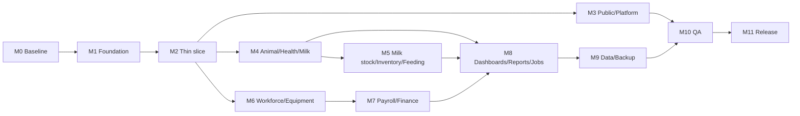

# SmartFarm — Implementation Plan

**File:** `docs/implementation-plan.md`  
**Version:** 1.0 · 24 November 2026  
**Status:** Execution plan — conditional gates retained, not a claim of approved requirements  
**Authoritative inputs:** `srs.md`, `architecture.md`, `database.md`, `appflow.md`, `design.md`, `sitemap.md`

## 1. Authority, guardrails and working conventions

- **Unchangeable core stack:** React.js + Tailwind CSS; Node.js + Express.js; PostgreSQL. The architecture's TypeScript/Vite, Drizzle/pg, express-session/Argon2id, Graphile Worker and hosting choices are *recommended candidates*, not proof of signed approval. Work must not replace the locked core.
- **Product shape:** one public **Home** page with sections (not separate About/Features pages), a Super Admin panel, and one private farm app with Farm Admin/Supervisor role experiences. Workers are records, not login users. Manual customer provisioning; no public registration, checkout, payment gateway, subscriptions, IoT, online payments, offline synchronization or unapproved AI predictions.
- **Business behavior authority:** SRS plus approved role/permission matrix and business rules. Only six files were supplied for this task; the separately cited permission matrix, business-rules document, and actual `schema.sql`/`seed.sql` were **not supplied**. Their unresolved specifics are explicit approval gates. Do not infer an implementation from candidate schema fields or visual mockups.
- **Database boundaries:** UUIDs; shared PostgreSQL with tenant-scoped FKs/RLS; platform vs farm records; precise NUMERIC amounts; transaction-local workspace context; separate restricted runtime/migration identities. Follow `database.md` rather than inventing schema changes; reconcile its candidate baseline with the actual SQL before migrations.
- **Definition of session-sized task:** each task is one small page, endpoint, service, component or check. A task with both page and endpoint is an intentionally tight CRUD unit; split into `-API` and `-UI` subtasks if an agent cannot finish it in one session, retaining the same acceptance conditions. Do not silently expand scope.
- **Dependency and parallelism:** identifiers in **Depends** must land first. **Parallel** identifies eligible work after prerequisites, provided file ownership and DB migration order remain serialized. Features with gate markers may be scaffolded with empty/blocked states but must **not activate unapproved logic**.
- **Repository:** paths are implementation targets within architecture's npm workspace convention, not a claim that the directories exist. Use conventional commands once scripts are established. A test named `npm run test:e2e`/`npm run test:integration` must be wired in M0 before invocation.
- **Git rule:** after each task's acceptance tests are green, **commit and push that task**, not a multi-task batch. Work on an appropriately reviewed feature branch; never push credentials or synthetic sensitive worker data. A blocked task cannot be marked done or pushed as complete.

### Milestone dependency sequence

**Thin-slice release gate:** M2-04 must pass before expanding M3–M9 production feature work. M0/M1 preparatory work may overlap where dependencies allow. No mock data or static frontend success counts as a passing slice.

## 2. Milestones and atomic task tickets

Every ticket includes the tested behavior and explicit final Git command. **Risk:** Critical / High / Medium / Low. The last line of each ticket is its commit-and-push instruction.

### M0 — Scope, approvals and repository bootstrap

**Objective:** Prevent unapproved behavior and establish reproducible development.

#### M0-01 — Requirement traceability and open-decision ledger

- **Files/folders:** `docs/requirements-traceability.md; docs/decision-log.md`
- **Depends:** None
- **Acceptance:** Map every SRS module and sitemap page to milestone/task; record unresolved rules as blocked, not assumed.
- **Test/check:** Review traceability against six source files
- **Risk:** **Low** · **Parallel:** No
- **Commit & push:** `git add -A && git commit -m "docs: requirement traceability & open-decision ledger" && git push -u origin HEAD`

#### M0-02 — Architecture and infrastructure sign-off record

- **Files/folders:** `docs/decision-log.md; docs/deployment-assumptions.md`
- **Depends:** M0-01
- **Acceptance:** Record core stack as locked, supporting options as candidate, 3D as approval-gated and zero-fee hosting as conditional.
- **Test/check:** Review signed decisions and exclusions
- **Risk:** **High** · **Parallel:** No
- **Commit & push:** `git add -A && git commit -m "docs: architecture & infrastructure sign-off record" && git push -u origin HEAD`

#### M0-03 — npm workspace and TypeScript skeleton

- **Files/folders:** `package.json; package-lock.json; apps/web/; apps/api/; packages/`
- **Depends:** M0-02
- **Acceptance:** Installable monorepo with separate React and Express build targets, TypeScript config and scripts.
- **Test/check:** npm ci && npm run typecheck
- **Risk:** **Low** · **Parallel:** No
- **Commit & push:** `git add -A && git commit -m "chore: npm workspace & typescript skeleton" && git push -u origin HEAD`

#### M0-04 — Lint, format, baseline test runners

- **Files/folders:** `eslint.config.*; .prettierrc*; apps/*/vitest.config.*`
- **Depends:** M0-03
- **Acceptance:** Lint, unit and integration scripts run even with zero domain features.
- **Test/check:** npm run lint && npm test
- **Risk:** **Low** · **Parallel:** Yes: M0-05
- **Commit & push:** `git add -A && git commit -m "chore: lint, format, baseline test runners" && git push -u origin HEAD`

#### M0-05 — CI workflow and branch checks

- **Files/folders:** `.github/workflows/ci.yml; README.md`
- **Depends:** M0-03
- **Acceptance:** CI runs install, lint, typecheck, test and build; no production secrets.
- **Test/check:** Run CI on test PR
- **Risk:** **Medium** · **Parallel:** Yes: M0-04
- **Commit & push:** `git add -A && git commit -m "ci: ci workflow & branch checks" && git push -u origin HEAD`

#### M0-06 — Local PostgreSQL and environment contracts

- **Files/folders:** `compose.yaml (optional); .env.example; docs/local-development.md`
- **Depends:** M0-03
- **Acceptance:** Local PostgreSQL starts; restricted development configuration; secrets ignored.
- **Test/check:** Run DB connectivity smoke test
- **Risk:** **Medium** · **Parallel:** No
- **Commit & push:** `git add -A && git commit -m "docs: local postgresql & environment contracts" && git push -u origin HEAD`

**M0 definition of done:** Decision log exists; locked stack is demonstrable; both local apps and CI execute; no real credentials committed. No unresolved mandatory gate is mislabeled as passed.

### M1 — Foundation: schema, access and UI primitives

**Objective:** Build an actual secure foundation before farm data operations.

#### M1-01 — Drizzle schema and reviewed baseline migration

- **Files/folders:** `packages/database/schema/; packages/database/migrations/`
- **Depends:** M0-06
- **Acceptance:** Schema matches database.md and available schema SQL; tenant FK and unique checks exist; no invented defaults.
- **Test/check:** drizzle migration on clean PG; schema diff review
- **Risk:** **High** · **Parallel:** No
- **Commit & push:** `git add -A && git commit -m "chore: drizzle schema & reviewed baseline migration" && git push -u origin HEAD`

#### M1-02 — Tenant RLS and restricted database roles

- **Files/folders:** `packages/database/migrations/; packages/database/tests/rls.test.ts`
- **Depends:** M1-01
- **Acceptance:** FORCE RLS, transaction-local verified workspace context and no runtime BYPASSRLS.
- **Test/check:** PG test: missing/wrong workspace returns zero rows
- **Risk:** **Critical** · **Parallel:** No
- **Commit & push:** `git add -A && git commit -m "chore: tenant rls & restricted database roles" && git push -u origin HEAD`

#### M1-03 — Reference role seeding and secure bootstrap

- **Files/folders:** `packages/database/seeds/; scripts/provision-super-admin.ts`
- **Depends:** M1-01
- **Acceptance:** Only approved role codes seeded; bootstrap hashes passwords; no demo users or hardcoded secrets.
- **Test/check:** Run seed twice; inspect DB for duplicate roles
- **Risk:** **High** · **Parallel:** Yes: M1-02
- **Commit & push:** `git add -A && git commit -m "chore: reference role seeding & secure bootstrap" && git push -u origin HEAD`

#### M1-04 — Express API shell, errors, validation and OpenAPI

- **Files/folders:** `apps/api/src/app.ts; apps/api/src/middleware/; docs/openapi.yaml`
- **Depends:** M0-03
- **Acceptance:** /api/v1 is versioned, Zod rejects invalid bodies and errors are safe; OpenAPI matches.
- **Test/check:** Supertest validation/error cases
- **Risk:** **Medium** · **Parallel:** Yes: M1-01
- **Commit & push:** `git add -A && git commit -m "chore: express api shell, errors, validation & openapi" && git push -u origin HEAD`

#### M1-05 — Session login, logout and current-user API

- **Files/folders:** `apps/api/src/modules/auth/; apps/api/src/middleware/session.ts`
- **Depends:** M1-02, M1-03, M1-04
- **Acceptance:** Argon2id check; regenerate session; secure HTTP-only cookie; status checks; logout revokes.
- **Test/check:** Supertest auth success/failure/session tests
- **Risk:** **Critical** · **Parallel:** No
- **Commit & push:** `git add -A && git commit -m "chore: session login, logout & current-user api" && git push -u origin HEAD`

#### M1-06 — RBAC, membership and field-scoped policies

- **Files/folders:** `apps/api/src/policies/; apps/api/tests/authorization.test.ts`
- **Depends:** M1-05
- **Acceptance:** Deny by default; Super Admin cannot browse farm operations; Supervisor cannot see finance/payroll or critical alerts.
- **Test/check:** Permission matrix positive/negative tests
- **Risk:** **Critical** · **Parallel:** No
- **Commit & push:** `git add -A && git commit -m "chore: rbac, membership & field-scoped policies" && git push -u origin HEAD`

#### M1-07 — Audit logging service for authorized mutations

- **Files/folders:** `apps/api/src/modules/audit/; packages/database/schema/`
- **Depends:** M1-06
- **Acceptance:** Log actor/action/resource/time without sensitive payloads and separate platform/farm logs.
- **Test/check:** Integration test logged mutation and failed mutation
- **Risk:** **High** · **Parallel:** No
- **Commit & push:** `git add -A && git commit -m "chore: audit logging service for authorized mutations" && git push -u origin HEAD`

#### M1-08 — Semantic design tokens and two themes

- **Files/folders:** `apps/web/src/styles/tokens.css; tailwind.config.*; apps/web/src/theme/`
- **Depends:** M0-03, M0-02
- **Acceptance:** Forest/pasture/ivory light and approved dark tokens; contrast checked; no dark-mode inversion filter.
- **Test/check:** Visual review light/dark + axe color contrast
- **Risk:** **Low** · **Parallel:** Yes: M1-04
- **Commit & push:** `git add -A && git commit -m "chore: semantic design tokens & two themes" && git push -u origin HEAD`

#### M1-09 — Public, platform and farm app shells

- **Files/folders:** `apps/web/src/layouts/; apps/web/src/routes/`
- **Depends:** M1-08
- **Acceptance:** Responsive shells; role-specific navigation; mobile drawers; private routes not rendered to guests.
- **Test/check:** Playwright route and mobile navigation tests
- **Risk:** **Medium** · **Parallel:** No
- **Commit & push:** `git add -A && git commit -m "chore: public, platform & farm app shells" && git push -u origin HEAD`

#### M1-10 — Reusable form, table, feedback and chart wrappers

- **Files/folders:** `apps/web/src/components/ui/; apps/web/src/components/data/`
- **Depends:** M1-08
- **Acceptance:** Accessible inputs, tables, modal, toast, empty/loading/error states and chart labels, without fabricated data.
- **Test/check:** Testing Library and axe tests
- **Risk:** **Medium** · **Parallel:** Yes: M1-09
- **Commit & push:** `git add -A && git commit -m "chore: reusable form, table, feedback & chart wrappers" && git push -u origin HEAD`

#### M1-11 — Protected API client, caching and logout invalidation

- **Files/folders:** `apps/web/src/lib/api.ts; apps/web/src/lib/query.ts; apps/web/src/auth/`
- **Depends:** M1-05, M1-09
- **Acceptance:** Credentialed calls; session expiry handling; cache keyed by identity/workspace and cleared at logout.
- **Test/check:** Mock API and Playwright session-expiry test
- **Risk:** **High** · **Parallel:** No
- **Commit & push:** `git add -A && git commit -m "chore: protected api client, caching & logout invalidation" && git push -u origin HEAD`

**M1 definition of done:** All migrations execute on fresh database; baseline tenant tests pass; standard responsive layouts and themed components work. No unresolved mandatory gate is mislabeled as passed.

### M2 — First thin vertical slice: Animal List → API → PostgreSQL

**Objective:** Demonstrate one authenticated real data read from a real workspace, with denied cross-tenant access, before expanding any feature set.

#### M2-01 — Animal fixture and scoped repository

- **Files/folders:** `apps/api/src/modules/animals/animal.repository.ts; apps/api/tests/fixtures/`
- **Depends:** M1-02, M1-06
- **Acceptance:** Test-only animals linked to two real workspaces; repository always scoped via DB transaction.
- **Test/check:** Integration test with two tenants
- **Risk:** **High** · **Parallel:** No
- **Commit & push:** `git add -A && git commit -m "feat: animal fixture & scoped repository" && git push -u origin HEAD`

#### M2-02 — GET animal list endpoint

- **Files/folders:** `apps/api/src/modules/animals/animal.routes.ts; animal.controller.ts; animal.schema.ts`
- **Depends:** M2-01, M1-04
- **Acceptance:** Authenticated paginated list returns permitted animal fields; invalid filters rejected; no tenant field trusted.
- **Test/check:** Supertest 200/401/403 and tenant isolation
- **Risk:** **High** · **Parallel:** No
- **Commit & push:** `git add -A && git commit -m "feat: get animal list endpoint" && git push -u origin HEAD`

#### M2-03 — Animal List React page with real API

- **Files/folders:** `apps/web/src/pages/farm/animals/AnimalListPage.tsx`
- **Depends:** M2-02, M1-10, M1-11
- **Acceptance:** Exact sitemap sections; list, pagination, empty/no-results/loading/error states; Add Animal visible Admin only.
- **Test/check:** Playwright farm admin/supervisor/guest flows
- **Risk:** **Medium** · **Parallel:** No
- **Commit & push:** `git add -A && git commit -m "feat: animal list react page with real api" && git push -u origin HEAD`

#### M2-04 — Vertical-slice E2E proof and review

- **Files/folders:** `tests/e2e/animal-slice.spec.ts; docs/slice-proof.md`
- **Depends:** M2-03
- **Acceptance:** Login → Animal List → Express → PostgreSQL proven; forbidden workspace data absent; screenshots/test evidence saved without sensitive data.
- **Test/check:** Run clean DB migration + E2E + CI
- **Risk:** **Critical** · **Parallel:** No
- **Commit & push:** `git add -A && git commit -m "docs: vertical-slice e2e proof & review" && git push -u origin HEAD`

**M2 definition of done:** Authenticated Farm Admin loads persisted Animal List through actual Express endpoint and PostgreSQL; fresh/empty/error views work; second workspace cannot see records; CI E2E green. No unresolved mandatory gate is mislabeled as passed.

### M3 — Public website and Super Admin onboarding

**Objective:** Implement marketing inquiry and controlled creation/access without public signup.

#### M3-01 — Public Home sections and SEO pre-render

- **Files/folders:** `apps/web/src/pages/public/HomePage.tsx; apps/web/src/components/public/; apps/web/prerender.*`
- **Depends:** M1-08, M1-10
- **Acceptance:** Nine sitemap sections in order, authentic/approved media, contact CTA, accessible SEO metadata; no extra pages.
- **Test/check:** Build prerender and Lighthouse/axe smoke
- **Risk:** **Medium** · **Parallel:** Yes: M3-02
- **Commit & push:** `git add -A && git commit -m "feat: public home sections & seo pre-render" && git push -u origin HEAD`

#### M3-02 — Public contact inquiry API

- **Files/folders:** `apps/api/src/modules/public/inquiries.*; packages/database/`
- **Depends:** M1-04, M1-01
- **Acceptance:** Zod-validated approved fields stored in contact_inquiries; abuse mitigation; no account creation.
- **Test/check:** Supertest valid/invalid/rate-limit requests
- **Risk:** **Medium** · **Parallel:** Yes: M3-01
- **Commit & push:** `git add -A && git commit -m "feat: public contact inquiry api" && git push -u origin HEAD`

#### M3-03 — Contact form integration

- **Files/folders:** `apps/web/src/components/public/ContactInquiryForm.tsx`
- **Depends:** M3-01, M3-02
- **Acceptance:** Submit creates a real inquiry; validation/errors preserve input; confirmation does not promise account creation.
- **Test/check:** Playwright submit/error/retry
- **Risk:** **Medium** · **Parallel:** No
- **Commit & push:** `git add -A && git commit -m "feat: contact form integration" && git push -u origin HEAD`

#### M3-04 — Super Admin login page

- **Files/folders:** `apps/web/src/pages/platform/LoginPage.tsx`
- **Depends:** M1-05, M1-10
- **Acceptance:** Sitemap login header/card/actions/footer; sign-in routes to platform dashboard, no signup.
- **Test/check:** Playwright invalid/valid login
- **Risk:** **Medium** · **Parallel:** Yes: M3-05
- **Commit & push:** `git add -A && git commit -m "feat: super admin login page" && git push -u origin HEAD`

#### M3-05 — Platform dashboard API and page

- **Files/folders:** `apps/api/src/modules/platform/dashboard.*; apps/web/src/pages/platform/DashboardPage.tsx`
- **Depends:** M1-06, M1-09
- **Acceptance:** Live customer/workspace/status/activity summaries only; no farm operational access.
- **Test/check:** Supertest admin-only + Playwright empty data
- **Risk:** **High** · **Parallel:** Yes: M3-04
- **Commit & push:** `git add -A && git commit -m "feat: platform dashboard api & page" && git push -u origin HEAD`

#### M3-06 — Customer list endpoint and management page

- **Files/folders:** `apps/api/src/modules/platform/customers.*; apps/web/src/pages/platform/CustomersPage.tsx`
- **Depends:** M3-05
- **Acceptance:** Search/filter/pagination and role-controlled customer information.
- **Test/check:** Supertest pagination + Playwright table
- **Risk:** **Medium** · **Parallel:** No
- **Commit & push:** `git add -A && git commit -m "feat: customer list endpoint & management page" && git push -u origin HEAD`

#### M3-07 — Add Customer page and create endpoint

- **Files/folders:** `apps/web/src/pages/platform/AddCustomerPage.tsx; apps/api/src/modules/platform/customers.*`
- **Depends:** M3-06
- **Acceptance:** Only approved customer fields, validation and cancel/save; no implicit provisioning.
- **Test/check:** Supertest create + Playwright save/cancel
- **Risk:** **High** · **Parallel:** No
- **Commit & push:** `git add -A && git commit -m "feat: add customer page & create endpoint" && git push -u origin HEAD`

#### M3-08 — Workspace management endpoint and page

- **Files/folders:** `apps/api/src/modules/platform/workspaces.*; apps/web/src/pages/platform/WorkspacesPage.tsx`
- **Depends:** M3-07
- **Acceptance:** Approved manual workspace creation with customer ownership, status and filtered list.
- **Test/check:** Supertest authorized creation; Playwright list
- **Risk:** **High** · **Parallel:** No
- **Commit & push:** `git add -A && git commit -m "feat: workspace management endpoint & page" && git push -u origin HEAD`

#### M3-09 — Farm Admin provisioning endpoint and page

- **Files/folders:** `apps/api/src/modules/platform/provisioning.*; apps/web/src/pages/platform/FarmAdminsPage.tsx`
- **Depends:** M3-08, M1-05
- **Acceptance:** Authorized provision only; approved account activation policy required; no emailed plaintext credentials.
- **Test/check:** Supertest account/membership security tests
- **Risk:** **Critical** · **Parallel:** No · **Approval gate:** Activation and cardinality approvals
- **Commit & push:** `git add -A && git commit -m "feat: farm admin provisioning endpoint & page" && git push -u origin HEAD`

#### M3-10 — Customer Access Management page/API

- **Files/folders:** `apps/web/src/pages/platform/CustomerAccessPage.tsx; apps/api/src/modules/platform/access.*`
- **Depends:** M3-09
- **Acceptance:** Explicit confirmation, audit and only approved access transitions.
- **Test/check:** Supertest action authorization + Playwright confirm/cancel
- **Risk:** **High** · **Parallel:** No · **Approval gate:** Access transition policy
- **Commit & push:** `git add -A && git commit -m "feat: customer access management page/api" && git push -u origin HEAD`

#### M3-11 — Workspace Suspension page/API

- **Files/folders:** `apps/web/src/pages/platform/SuspensionPage.tsx; apps/api/src/modules/platform/suspension.*`
- **Depends:** M3-08, M1-07
- **Acceptance:** Confirmed suspension preserves records, rejects old sessions and logs actor/action.
- **Test/check:** Integration test active-session invalidation
- **Risk:** **Critical** · **Parallel:** Yes: M3-10
- **Commit & push:** `git add -A && git commit -m "feat: workspace suspension page/api" && git push -u origin HEAD`

#### M3-12 — Password reset request and completion

- **Files/folders:** `apps/api/src/modules/auth/password-reset.*; apps/web/src/pages/auth/`
- **Depends:** M1-05
- **Acceptance:** Single-use expiring hashed tokens, safe response, password change and session revocation.
- **Test/check:** Supertest expired/reused token; Playwright reset
- **Risk:** **Critical** · **Parallel:** Yes: M3-06 · **Approval gate:** Email delivery provider readiness
- **Commit & push:** `git add -A && git commit -m "feat: password reset request & completion" && git push -u origin HEAD`

**M3 definition of done:** All approved public Home sections and Super Admin pages function; inquiries remain separate from accounts; suspension denies existing sessions. No unresolved mandatory gate is mislabeled as passed.

### M4 — Animals, health and milk production

**Objective:** Complete animal histories and accurate recorded milk without inventing missing-session or alert formulas.

#### M4-01 — Animal create/edit API and Add/Edit Animal page

- **Files/folders:** `apps/api/src/modules/animals/; apps/web/src/pages/farm/animals/AnimalFormPage.tsx`
- **Depends:** M2-04
- **Acceptance:** Farm Admin edits/creates; workspace ear-tag uniqueness and same-farm parent FKs; Supervisor denied.
- **Test/check:** Supertest 409/403 + Playwright form
- **Risk:** **High** · **Parallel:** No
- **Commit & push:** `git add -A && git commit -m "feat: animal create/edit api & add/edit animal page" && git push -u origin HEAD`

#### M4-02 — Animal Profile page and detail API

- **Files/folders:** `apps/api/src/modules/animals/; apps/web/src/pages/farm/animals/AnimalProfilePage.tsx`
- **Depends:** M4-01
- **Acceptance:** Profile overview, authorized history summaries and no cross-workspace leakage.
- **Test/check:** Supertest nested IDs + Playwright profile
- **Risk:** **High** · **Parallel:** Yes: M4-03
- **Commit & push:** `git add -A && git commit -m "feat: animal profile page & detail api" && git push -u origin HEAD`

#### M4-03 — Lifecycle History page/API

- **Files/folders:** `apps/api/src/modules/animals/lifecycle.*; apps/web/src/pages/farm/animals/LifecyclePage.tsx`
- **Depends:** M4-01
- **Acceptance:** Record status/dates/reasons; changes limited to approved transitions; no invented archive/restore.
- **Test/check:** Policy and history retention tests
- **Risk:** **High** · **Parallel:** No · **Approval gate:** Transition/archive rules
- **Commit & push:** `git add -A && git commit -m "feat: lifecycle history page/api" && git push -u origin HEAD`

#### M4-04 — Weight History page/API

- **Files/folders:** `apps/api/src/modules/animals/weights.*; apps/web/src/pages/farm/animals/WeightHistoryPage.tsx`
- **Depends:** M4-02
- **Acceptance:** Persist dated weights; actual-data chart with units and permitted editing.
- **Test/check:** Supertest precision + chart empty-state test
- **Risk:** **Medium** · **Parallel:** Yes: M4-05
- **Commit & push:** `git add -A && git commit -m "feat: weight history page/api" && git push -u origin HEAD`

#### M4-05 — Animal photo/document attachment adapter

- **Files/folders:** `apps/api/src/modules/files/; apps/web/src/components/files/`
- **Depends:** M4-02
- **Acceptance:** Private storage, owner checks, MIME/size validation, no public signed permanent URLs.
- **Test/check:** Unauthorized file retrieval and invalid upload tests
- **Risk:** **Critical** · **Parallel:** No · **Approval gate:** Formats and size limits
- **Commit & push:** `git add -A && git commit -m "feat: animal photo/document attachment adapter" && git push -u origin HEAD`

#### M4-06 — Health Records page/API

- **Files/folders:** `apps/api/src/modules/health/records.*; apps/web/src/pages/farm/health/HealthRecordsPage.tsx`
- **Depends:** M4-02
- **Acceptance:** Severity text and visuals; Supervisor field projections restricted by approved matrix.
- **Test/check:** Supertest restricted record/field cases
- **Risk:** **Critical** · **Parallel:** Yes: M4-07 · **Approval gate:** Supervisor severity/edit permissions
- **Commit & push:** `git add -A && git commit -m "feat: health records page/api" && git push -u origin HEAD`

#### M4-07 — Treatments page/API

- **Files/folders:** `apps/api/src/modules/health/treatments.*; apps/web/src/pages/farm/health/TreatmentsPage.tsx`
- **Depends:** M4-02
- **Acceptance:** Diagnosis, dosage, veterinary detail and costs stored; no automatic finance posting.
- **Test/check:** Supertest validation and no finance side effect
- **Risk:** **High** · **Parallel:** Yes: M4-06
- **Commit & push:** `git add -A && git commit -m "feat: treatments page/api" && git push -u origin HEAD`

#### M4-08 — Vaccinations page/API

- **Files/folders:** `apps/api/src/modules/health/vaccinations.*; apps/web/src/pages/farm/health/VaccinationsPage.tsx`
- **Depends:** M4-02
- **Acceptance:** History and due dates; no invented reminder recurrence.
- **Test/check:** Supertest date/filter and UI due state
- **Risk:** **Medium** · **Parallel:** Yes: M4-09
- **Commit & push:** `git add -A && git commit -m "feat: vaccinations page/api" && git push -u origin HEAD`

#### M4-09 — Veterinary Appointments page/API

- **Files/folders:** `apps/api/src/modules/health/appointments.*; apps/web/src/pages/farm/health/AppointmentsPage.tsx`
- **Depends:** M4-02
- **Acceptance:** Scoped scheduled appointments with approved details and recovery states.
- **Test/check:** Supertest nested FK and Playwright save
- **Risk:** **Medium** · **Parallel:** Yes: M4-08
- **Commit & push:** `git add -A && git commit -m "feat: veterinary appointments page/api" && git push -u origin HEAD`

#### M4-10 — Disease History page/API

- **Files/folders:** `apps/api/src/modules/health/diseases.*; apps/web/src/pages/farm/health/DiseaseHistoryPage.tsx`
- **Depends:** M4-06
- **Acceptance:** History and relationships only; no unapproved breeding lifecycle.
- **Test/check:** Integration linked-history test
- **Risk:** **Medium** · **Parallel:** No
- **Commit & push:** `git add -A && git commit -m "feat: disease history page/api" && git push -u origin HEAD`

#### M4-11 — Production Entry page/API

- **Files/folders:** `apps/api/src/modules/milk/production.*; apps/web/src/pages/farm/milk/ProductionEntryPage.tsx`
- **Depends:** M4-01
- **Acceptance:** Morning/evening litres and Good/Average/Poor; duplicate animal/date/session fails.
- **Test/check:** Supertest unique constraints + Playwright save
- **Risk:** **High** · **Parallel:** Yes: M4-08
- **Commit & push:** `git add -A && git commit -m "feat: production entry page/api" && git push -u origin HEAD`

#### M4-12 — Animal Production History page/API

- **Files/folders:** `apps/api/src/modules/milk/production-history.*; apps/web/src/pages/farm/milk/AnimalProductionPage.tsx`
- **Depends:** M4-11
- **Acceptance:** Workspace-scoped histories, session chart and actual values only.
- **Test/check:** Supertest time filters + chart test
- **Risk:** **Medium** · **Parallel:** No
- **Commit & push:** `git add -A && git commit -m "feat: animal production history page/api" && git push -u origin HEAD`

#### M4-13 — Daily Totals page and approved SQL view

- **Files/folders:** `packages/database/migrations/; apps/api/src/modules/milk/daily.*; apps/web/src/pages/farm/milk/DailyTotalsPage.tsx`
- **Depends:** M4-11
- **Acceptance:** Complete morning+evening pairs sum correctly; incomplete days visibly unresolved, not silently zero.
- **Test/check:** SQL worked example and incomplete-day test
- **Risk:** **High** · **Parallel:** No · **Approval gate:** Missing session policy for other interpretations
- **Commit & push:** `git add -A && git commit -m "feat: daily totals page & approved sql view" && git push -u origin HEAD`

#### M4-14 — Monthly Reports page/API

- **Files/folders:** `apps/api/src/modules/milk/monthly.*; apps/web/src/pages/farm/milk/MonthlyProductionPage.tsx`
- **Depends:** M4-13
- **Acceptance:** Approved farm-scoped monthly totals and breakdown with print/export hook.
- **Test/check:** Integration reconcile daily to monthly totals
- **Risk:** **High** · **Parallel:** No
- **Commit & push:** `git add -A && git commit -m "feat: monthly reports page/api" && git push -u origin HEAD`

**M4 definition of done:** All animal/health/production pages mapped and tested; duplicate ear tags rejected; only approved totals calculated; restricted health alerts remain private. No unresolved mandatory gate is mislabeled as passed.

### M5 — Milk stock, inventory and feeding

**Objective:** Persist stock source events atomically and expose permitted feeding operations.

#### M5-01 — Milk Collection page/API

- **Files/folders:** `apps/api/src/modules/milk/collections.*; apps/web/src/pages/farm/milk-stock/CollectionPage.tsx`
- **Depends:** M4-11
- **Acceptance:** Collection records and same-transaction positive milk movements; no assumed tank allocation.
- **Test/check:** PG rollback and balance tests
- **Risk:** **High** · **Parallel:** No · **Approval gate:** Collection/storage allocation rule
- **Commit & push:** `git add -A && git commit -m "feat: milk collection page/api" && git push -u origin HEAD`

#### M5-02 — Milk Storage page/API

- **Files/folders:** `apps/api/src/modules/milk/storage.*; apps/web/src/pages/farm/milk-stock/StoragePage.tsx`
- **Depends:** M5-01
- **Acceptance:** Tank/container records and scope-safe balances without invented transfers.
- **Test/check:** Integration location ownership tests
- **Risk:** **High** · **Parallel:** No · **Approval gate:** Storage allocation and transfer policy
- **Commit & push:** `git add -A && git commit -m "feat: milk storage page/api" && git push -u origin HEAD`

#### M5-03 — Milk Sales page/API

- **Files/folders:** `apps/api/src/modules/milk/sales.*; apps/web/src/pages/farm/milk-stock/MilkSalesPage.tsx`
- **Depends:** M5-01
- **Acceptance:** Admin-only Paid/Unpaid sale, price override, atomic negative movement and no gateway.
- **Test/check:** Concurrency/rollback/idempotency tests
- **Risk:** **Critical** · **Parallel:** No · **Approval gate:** Shortage, cancellation and return rules
- **Commit & push:** `git add -A && git commit -m "feat: milk sales page/api" && git push -u origin HEAD`

#### M5-04 — Wastage Records page/API

- **Files/folders:** `apps/api/src/modules/milk/wastage.*; apps/web/src/pages/farm/milk-stock/WastagePage.tsx`
- **Depends:** M5-01
- **Acceptance:** Wastage moves milk atomically; estimated loss remains uncomputed until valuation approved.
- **Test/check:** Balance tests and nullable-loss check
- **Risk:** **High** · **Parallel:** No · **Approval gate:** Wastage valuation policy
- **Commit & push:** `git add -A && git commit -m "feat: wastage records page/api" && git push -u origin HEAD`

#### M5-05 — Inventory List page/API

- **Files/folders:** `apps/api/src/modules/inventory/items.*; apps/web/src/pages/farm/inventory/InventoryListPage.tsx`
- **Depends:** M2-04
- **Acceptance:** Farm-scoped items and actual derived balances, categories/feed/medicine/other, expiry.
- **Test/check:** Supertest scoped pagination; Playwright list
- **Risk:** **Medium** · **Parallel:** Yes: M5-01
- **Commit & push:** `git add -A && git commit -m "feat: inventory list page/api" && git push -u origin HEAD`

#### M5-06 — Inventory Item Details page/API

- **Files/folders:** `apps/api/src/modules/inventory/item-detail.*; apps/web/src/pages/farm/inventory/ItemDetailPage.tsx`
- **Depends:** M5-05
- **Acceptance:** Show exact source history, balance, minimum stock and authorized actions.
- **Test/check:** Integration history reconciliation
- **Risk:** **Medium** · **Parallel:** No
- **Commit & push:** `git add -A && git commit -m "feat: inventory item details page/api" && git push -u origin HEAD`

#### M5-07 — Inventory Purchases page/API

- **Files/folders:** `apps/api/src/modules/inventory/purchases.*; apps/web/src/pages/farm/inventory/PurchasesPage.tsx`
- **Depends:** M5-05
- **Acceptance:** Purchase source and positive stock movement atomically, no financial auto-post.
- **Test/check:** Rollback, quantity precision and ownership tests
- **Risk:** **High** · **Parallel:** Yes: M5-08
- **Commit & push:** `git add -A && git commit -m "feat: inventory purchases page/api" && git push -u origin HEAD`

#### M5-08 — Stock Additions page/API

- **Files/folders:** `apps/api/src/modules/inventory/additions.*; apps/web/src/pages/farm/inventory/StockAdditionsPage.tsx`
- **Depends:** M5-05
- **Acceptance:** Quick addition source and ledger movement written once.
- **Test/check:** Duplicate submission and rollback tests
- **Risk:** **High** · **Parallel:** Yes: M5-07
- **Commit & push:** `git add -A && git commit -m "feat: stock additions page/api" && git push -u origin HEAD`

#### M5-09 — Stock Adjustments page/API

- **Files/folders:** `apps/api/src/modules/inventory/adjustments.*; apps/web/src/pages/farm/inventory/AdjustmentsPage.tsx`
- **Depends:** M5-06
- **Acceptance:** Farm Admin only, required reason, audit and movement, Supervisor 403.
- **Test/check:** Supertest actor/reason and concurrent balance tests
- **Risk:** **Critical** · **Parallel:** No
- **Commit & push:** `git add -A && git commit -m "feat: stock adjustments page/api" && git push -u origin HEAD`

#### M5-10 — Supervisor inventory usage endpoint and action

- **Files/folders:** `apps/api/src/modules/inventory/usage.*; apps/web/src/components/inventory/UsageForm.tsx`
- **Depends:** M5-06
- **Acceptance:** Permitted usage recorded with corresponding stock behavior only as approved; never stock correction.
- **Test/check:** Policy tests and movement reconciliation
- **Risk:** **High** · **Parallel:** No · **Approval gate:** Usage deduction/negative stock policy
- **Commit & push:** `git add -A && git commit -m "feat: supervisor inventory usage endpoint & action" && git push -u origin HEAD`

#### M5-11 — Feeding Plans page/API

- **Files/folders:** `apps/api/src/modules/feeding/plans.*; apps/web/src/pages/farm/feeding/PlansPage.tsx`
- **Depends:** M4-01, M5-05
- **Acceptance:** Farm Admin plan changes; Supervisor permitted read; animal/group targeting and feed items.
- **Test/check:** Supertest role, same-farm targets
- **Risk:** **High** · **Parallel:** Yes: M5-07
- **Commit & push:** `git add -A && git commit -m "feat: feeding plans page/api" && git push -u origin HEAD`

#### M5-12 — Feeding Schedule page/API

- **Files/folders:** `apps/api/src/modules/feeding/schedules.*; apps/web/src/pages/farm/feeding/SchedulePage.tsx`
- **Depends:** M5-11
- **Acceptance:** Default morning/evening and approved custom times; farm-time display.
- **Test/check:** Timezone render and no-duplicate schedule tests
- **Risk:** **Medium** · **Parallel:** No
- **Commit & push:** `git add -A && git commit -m "feat: feeding schedule page/api" && git push -u origin HEAD`

#### M5-13 — Actual Feeding Records page/API

- **Files/folders:** `apps/api/src/modules/feeding/actuals.*; apps/web/src/pages/farm/feeding/ActualFeedingPage.tsx`
- **Depends:** M5-12
- **Acceptance:** Supervisor records actual feeding against permitted plans; does not silently deduct stock.
- **Test/check:** Supertest Supervisor/outsider access and no stock mutation
- **Risk:** **High** · **Parallel:** No
- **Commit & push:** `git add -A && git commit -m "feat: actual feeding records page/api" && git push -u origin HEAD`

**M5 definition of done:** Milk/inventory source and movement writes are atomic; no duplicate stock deductions; Admin-only corrections; feeding does not implicitly consume inventory. No unresolved mandatory gate is mislabeled as passed.

### M6 — Workforce, attendance and equipment

**Objective:** Implement operational workforce/equipment records, preserving restricted worker data.

#### M6-01 — Worker List page/API

- **Files/folders:** `apps/api/src/modules/workers/list.*; apps/web/src/pages/farm/workers/WorkerListPage.tsx`
- **Depends:** M2-04
- **Acceptance:** Worker records not users; scoped list and safe role-specific field projections.
- **Test/check:** Supertest Supervisor omits CNIC where unapproved
- **Risk:** **High** · **Parallel:** No
- **Commit & push:** `git add -A && git commit -m "feat: worker list page/api" && git push -u origin HEAD`

#### M6-02 — Worker Profiles page/API

- **Files/folders:** `apps/api/src/modules/workers/profile.*; apps/web/src/pages/farm/workers/WorkerProfilePage.tsx`
- **Depends:** M6-01
- **Acceptance:** Admin creates/updates; normalized CNIC uniqueness within workspace; no worker login.
- **Test/check:** Unique CNIC and missing-workspace tests
- **Risk:** **High** · **Parallel:** No
- **Commit & push:** `git add -A && git commit -m "feat: worker profiles page/api" && git push -u origin HEAD`

#### M6-03 — Worker Documents page/private files

- **Files/folders:** `apps/api/src/modules/files/worker-documents.*; apps/web/src/pages/farm/workers/WorkerDocumentsPage.tsx`
- **Depends:** M6-02, M4-05
- **Acceptance:** Authorized upload/retrieval and metadata; private CNIC and documents are never indexed publicly.
- **Test/check:** Forbidden download, MIME and size test
- **Risk:** **Critical** · **Parallel:** No · **Approval gate:** Document format/retention approval
- **Commit & push:** `git add -A && git commit -m "feat: worker documents page/private files" && git push -u origin HEAD`

#### M6-04 — Attendance Records page/API

- **Files/folders:** `apps/api/src/modules/attendance/records.*; apps/web/src/pages/farm/attendance/AttendancePage.tsx`
- **Depends:** M6-01
- **Acceptance:** Record approved statuses and dates; Admin corrections audited; no assumed one-per-day unique.
- **Test/check:** Supertest edit policy and multiple-entry fixture
- **Risk:** **High** · **Parallel:** Yes: M6-07
- **Commit & push:** `git add -A && git commit -m "feat: attendance records page/api" && git push -u origin HEAD`

#### M6-05 — Check-in/Check-out page/API

- **Files/folders:** `apps/api/src/modules/attendance/checkin.*; apps/web/src/pages/farm/attendance/CheckInOutPage.tsx`
- **Depends:** M6-04
- **Acceptance:** Permitted timestamped actions with validation and retry; no invented late formula.
- **Test/check:** Supertest time ordering and 403 cases
- **Risk:** **High** · **Parallel:** No
- **Commit & push:** `git add -A && git commit -m "feat: check-in/check-out page/api" && git push -u origin HEAD`

#### M6-06 — Leave Management page/API

- **Files/folders:** `apps/api/src/modules/attendance/leave.*; apps/web/src/pages/farm/attendance/LeavePage.tsx`
- **Depends:** M6-01
- **Acceptance:** Farm Admin approve/reject; Supervisor cannot decide; paid/unpaid stored as approved.
- **Test/check:** Approval authorization/audit tests
- **Risk:** **Critical** · **Parallel:** No · **Approval gate:** Rejected leave/partial-day policy
- **Commit & push:** `git add -A && git commit -m "feat: leave management page/api" && git push -u origin HEAD`

#### M6-07 — Overtime records capture

- **Files/folders:** `apps/api/src/modules/attendance/overtime.*; apps/web/src/components/attendance/OvertimeEntry.tsx`
- **Depends:** M6-01
- **Acceptance:** Record date/hours without advanced pay math.
- **Test/check:** Supertest hours validation
- **Risk:** **Medium** · **Parallel:** Yes: M6-04
- **Commit & push:** `git add -A && git commit -m "feat: overtime records capture" && git push -u origin HEAD`

#### M6-08 — Equipment List page/API

- **Files/folders:** `apps/api/src/modules/equipment/list.*; apps/web/src/pages/farm/equipment/EquipmentListPage.tsx`
- **Depends:** M2-04
- **Acceptance:** Admin registration; Supervisor permitted read; no invented maintenance costs.
- **Test/check:** Supertest role and list UI
- **Risk:** **Medium** · **Parallel:** Yes: M6-04
- **Commit & push:** `git add -A && git commit -m "feat: equipment list page/api" && git push -u origin HEAD`

#### M6-09 — Equipment Details page/API

- **Files/folders:** `apps/api/src/modules/equipment/detail.*; apps/web/src/pages/farm/equipment/EquipmentDetailPage.tsx`
- **Depends:** M6-08
- **Acceptance:** Show type, quantity, condition and authorized actions; archive Admin only.
- **Test/check:** Supertest permissions and detail view
- **Risk:** **Medium** · **Parallel:** No · **Approval gate:** Equipment condition/archive vocabulary
- **Commit & push:** `git add -A && git commit -m "feat: equipment details page/api" && git push -u origin HEAD`

#### M6-10 — Maintenance History page/API

- **Files/folders:** `apps/api/src/modules/equipment/maintenance.*; apps/web/src/pages/farm/equipment/MaintenancePage.tsx`
- **Depends:** M6-09
- **Acceptance:** Supervisor can record maintenance and permitted condition updates.
- **Test/check:** Supertest permitted condition change
- **Risk:** **High** · **Parallel:** No
- **Commit & push:** `git add -A && git commit -m "feat: maintenance history page/api" && git push -u origin HEAD`

#### M6-11 — Equipment Usage Records page/API

- **Files/folders:** `apps/api/src/modules/equipment/usage.*; apps/web/src/pages/farm/equipment/UsagePage.tsx`
- **Depends:** M6-09
- **Acceptance:** Usage entries scoped to equipment and workspace, feedback states.
- **Test/check:** Supertest cross-workspace foreign key
- **Risk:** **Medium** · **Parallel:** Yes: M6-10
- **Commit & push:** `git add -A && git commit -m "feat: equipment usage records page/api" && git push -u origin HEAD`

**M6 definition of done:** All approved workforce, attendance, leave and equipment pages work, and sensitive fields are restricted on APIs, exports and files. No unresolved mandatory gate is mislabeled as passed.

### M7 — Payroll and financial records

**Objective:** Implement Farm Admin-only salary and finance workflows; gate unsupported calculations.

#### M7-01 — Salary Management page/API

- **Files/folders:** `apps/api/src/modules/payroll/salary-structures.*; apps/web/src/pages/farm/payroll/SalaryManagementPage.tsx`
- **Depends:** M6-02
- **Acceptance:** Store monthly/daily structure, frequency, rule configuration; no guessed salary formula.
- **Test/check:** Supertest Admin-only and validation
- **Risk:** **High** · **Parallel:** No · **Approval gate:** Structure/rounding approval
- **Commit & push:** `git add -A && git commit -m "feat: salary management page/api" && git push -u origin HEAD`

#### M7-02 — Payroll Records page/API

- **Files/folders:** `apps/api/src/modules/payroll/records.*; apps/web/src/pages/farm/payroll/PayrollRecordsPage.tsx`
- **Depends:** M7-01, M6-04
- **Acceptance:** Periods, breakdowns and balances persisted; calculation executes only for approved formulas.
- **Test/check:** Formula worked examples and 403 Supervisor
- **Risk:** **Critical** · **Parallel:** No · **Approval gate:** Payroll calculation approval
- **Commit & push:** `git add -A && git commit -m "feat: payroll records page/api" && git push -u origin HEAD`

#### M7-03 — Advances page/API

- **Files/folders:** `apps/api/src/modules/payroll/advances.*; apps/web/src/pages/farm/payroll/AdvancesPage.tsx`
- **Depends:** M7-01
- **Acceptance:** Salary advances recorded accurately; installment scheduling not invented.
- **Test/check:** Supertest advance list and access tests
- **Risk:** **High** · **Parallel:** Yes: M7-04
- **Commit & push:** `git add -A && git commit -m "feat: advances page/api" && git push -u origin HEAD`

#### M7-04 — Deductions page/API

- **Files/folders:** `apps/api/src/modules/payroll/deductions.*; apps/web/src/pages/farm/payroll/DeductionsPage.tsx`
- **Depends:** M7-02
- **Acceptance:** Record approved deductions and links to advances; no implicit recovery schedule.
- **Test/check:** Integration deduction/advance FK tests
- **Risk:** **High** · **Parallel:** No · **Approval gate:** Recovery rules
- **Commit & push:** `git add -A && git commit -m "feat: deductions page/api" && git push -u origin HEAD`

#### M7-05 — Salary payments and pending balances

- **Files/folders:** `apps/api/src/modules/payroll/payments.*; apps/web/src/components/payroll/SalaryPaymentForm.tsx`
- **Depends:** M7-02
- **Acceptance:** Record cash/bank/mobile wallet/custom methods where approved; no gateway; pending balances per approved rule.
- **Test/check:** Supertest multiple payment/precision cases
- **Risk:** **High** · **Parallel:** No · **Approval gate:** Multiple payments and balance policy
- **Commit & push:** `git add -A && git commit -m "feat: salary payments & pending balances" && git push -u origin HEAD`

#### M7-06 — Payslips page/API and PDF renderer

- **Files/folders:** `apps/api/src/modules/payroll/payslips.*; apps/web/src/pages/farm/payroll/PayslipsPage.tsx`
- **Depends:** M7-02, M4-05
- **Acceptance:** Authorized printable/PDF payslips from approved payroll data; stored privately.
- **Test/check:** PDF parse smoke + unauthorized-download test
- **Risk:** **High** · **Parallel:** No · **Approval gate:** Corrections/reopen policy
- **Commit & push:** `git add -A && git commit -m "feat: payslips page/api & pdf renderer" && git push -u origin HEAD`

#### M7-07 — Income Records page/API

- **Files/folders:** `apps/api/src/modules/finance/income.*; apps/web/src/pages/farm/finance/IncomePage.tsx`
- **Depends:** M1-06
- **Acceptance:** Approved categories and farm-scoped entries; no automatic milk/animal income duplication.
- **Test/check:** Supertest role and amount precision
- **Risk:** **High** · **Parallel:** Yes: M7-08
- **Commit & push:** `git add -A && git commit -m "feat: income records page/api" && git push -u origin HEAD`

#### M7-08 — Expense Records page/API

- **Files/folders:** `apps/api/src/modules/finance/expenses.*; apps/web/src/pages/farm/finance/ExpensesPage.tsx`
- **Depends:** M1-06
- **Acceptance:** Quick expense and configured categories, Admin-only; no auto-derived unapproved costs.
- **Test/check:** Supertest category ownership and 403
- **Risk:** **High** · **Parallel:** Yes: M7-07
- **Commit & push:** `git add -A && git commit -m "feat: expense records page/api" && git push -u origin HEAD`

#### M7-09 — Financial Dashboard page/API

- **Files/folders:** `apps/api/src/modules/finance/dashboard.*; apps/web/src/pages/farm/finance/FinancialDashboardPage.tsx`
- **Depends:** M7-07, M7-08
- **Acceptance:** Income/expenses/profit-loss and unpaid sales only when recognition rules approved; no Supervisor payload.
- **Test/check:** Reconciliation SQL and denied-role test
- **Risk:** **Critical** · **Parallel:** No · **Approval gate:** Cash/sales recognition policy
- **Commit & push:** `git add -A && git commit -m "feat: financial dashboard page/api" && git push -u origin HEAD`

#### M7-10 — Financial Reports page/API

- **Files/folders:** `apps/api/src/modules/finance/reports.*; apps/web/src/pages/farm/finance/FinancialReportsPage.tsx`
- **Depends:** M7-09
- **Acceptance:** Daily/weekly/monthly/custom views with accurate role-safe PDF/Excel/print.
- **Test/check:** Reconcile export rows and totals
- **Risk:** **High** · **Parallel:** No · **Approval gate:** Report recognition and rounding approval
- **Commit & push:** `git add -A && git commit -m "feat: financial reports page/api" && git push -u origin HEAD`

**M7 definition of done:** All payroll/finance pages respond only to Farm Admin; no unapproved accounting postings; approved formulas have worked-example tests. No unresolved mandatory gate is mislabeled as passed.

### M8 — Dashboards, reports, settings and notifications

**Objective:** Wire verified operational data and approved scheduled automation.

#### M8-01 — Farm Admin Dashboard page/API

- **Files/folders:** `apps/api/src/modules/dashboard/admin.*; apps/web/src/pages/farm/DashboardAdminPage.tsx`
- **Depends:** M4-14, M5-13, M6-06, M7-09
- **Acceptance:** Actual farm operational + permitted finance widgets, partial-failure states and approved customization controls.
- **Test/check:** Playwright full/partial/empty states
- **Risk:** **High** · **Parallel:** No
- **Commit & push:** `git add -A && git commit -m "feat: farm admin dashboard page/api" && git push -u origin HEAD`

#### M8-02 — Supervisor Dashboard page/API

- **Files/folders:** `apps/api/src/modules/dashboard/supervisor.*; apps/web/src/pages/farm/DashboardSupervisorPage.tsx`
- **Depends:** M4-14, M5-13, M6-05
- **Acceptance:** Only approved operational cards; no finance/payroll/critical health alert fields even in JSON.
- **Test/check:** Snapshot field allowlist and role E2E
- **Risk:** **Critical** · **Parallel:** Yes: M8-01
- **Commit & push:** `git add -A && git commit -m "feat: supervisor dashboard page/api" && git push -u origin HEAD`

#### M8-03 — Dashboard widget layout persistence

- **Files/folders:** `apps/api/src/modules/dashboard/layouts.*; apps/web/src/components/dashboard/LayoutEditor.tsx`
- **Depends:** M8-01
- **Acceptance:** Drag/reorder/resize only when layout ownership model approved; stored as validated preferences.
- **Test/check:** Persistence/reload and responsive tests
- **Risk:** **Medium** · **Parallel:** No · **Approval gate:** Per-user vs shared layout decision
- **Commit & push:** `git add -A && git commit -m "feat: dashboard widget layout persistence" && git push -u origin HEAD`

#### M8-04 — Milk Reports page/API

- **Files/folders:** `apps/api/src/modules/reports/milk.*; apps/web/src/pages/farm/reports/MilkReportsPage.tsx`
- **Depends:** M4-14
- **Acceptance:** Authorized reports with scoped date filters and printable/exportable factual records.
- **Test/check:** Compare report totals to source data
- **Risk:** **Medium** · **Parallel:** Yes: M8-05
- **Commit & push:** `git add -A && git commit -m "feat: milk reports page/api" && git push -u origin HEAD`

#### M8-05 — Available Data Exports page/API

- **Files/folders:** `apps/api/src/modules/data/exports.*; apps/web/src/pages/farm/reports/AvailableExportsPage.tsx`
- **Depends:** M1-06, M6-03
- **Acceptance:** Only role-approved data, bounded CSV/Excel/PDF, escape spreadsheet formulas, no sensitive leaks.
- **Test/check:** Role-based export diff and CSV injection tests
- **Risk:** **Critical** · **Parallel:** Yes: M8-04 · **Approval gate:** Supervisor export approval
- **Commit & push:** `git add -A && git commit -m "feat: available data exports page/api" && git push -u origin HEAD`

#### M8-06 — Farm Profile, Units, Currency, Timezone pages

- **Files/folders:** `apps/api/src/modules/settings/farm-settings.*; apps/web/src/pages/farm/settings/{FarmProfile,Units,Currency,Timezone}*.tsx`
- **Depends:** M1-06
- **Acceptance:** Each approved settings page has scoped forms; UTC instants and farm-local dates; no automatic unit conversions.
- **Test/check:** Timezone/date and authorization tests
- **Risk:** **High** · **Parallel:** No
- **Commit & push:** `git add -A && git commit -m "feat: farm profile, units, currency, timezone pages" && git push -u origin HEAD`

#### M8-07 — Preferences, Notifications Settings, Configuration pages

- **Files/folders:** `apps/api/src/modules/settings/preferences.*; apps/web/src/pages/farm/settings/{Preferences,NotificationSettings,Configuration}*.tsx`
- **Depends:** M8-06
- **Acceptance:** Approved configurable preferences and module flags; no implied new modules.
- **Test/check:** Zod whitelist and persistence tests
- **Risk:** **Medium** · **Parallel:** Yes: M8-08
- **Commit & push:** `git add -A && git commit -m "feat: preferences, notifications settings, configuration pages" && git push -u origin HEAD`

#### M8-08 — Notification Center and History pages/API

- **Files/folders:** `apps/api/src/modules/notifications/; apps/web/src/pages/farm/notifications/`
- **Depends:** M1-06
- **Acceptance:** In-app read/unread/history; recipient-scoped queries and no Supervisor High/Critical health messages.
- **Test/check:** Supertest recipient/filter and Playwright read
- **Risk:** **Critical** · **Parallel:** Yes: M8-07
- **Commit & push:** `git add -A && git commit -m "feat: notification center & history pages/api" && git push -u origin HEAD`

#### M8-09 — Graphile worker, email outbox and SMTP/API adapter

- **Files/folders:** `apps/worker/; apps/api/src/modules/email/`
- **Depends:** M1-01, M8-08
- **Acceptance:** Persist jobs/outbox, bound retries and idempotence; provider failure cannot roll back source events.
- **Test/check:** Stop/restart worker and replay job tests
- **Risk:** **High** · **Parallel:** No · **Approval gate:** Email quotas and sender readiness
- **Commit & push:** `git add -A && git commit -m "feat: graphile worker, email outbox & smtp/api adapter" && git push -u origin HEAD`

#### M8-10 — Vaccination, low-stock and health alert jobs

- **Files/folders:** `apps/worker/src/jobs/{vaccination,low-stock,health}*.ts`
- **Depends:** M8-09, M4-08, M5-05
- **Acceptance:** Only approved reminder/recipient schedules; Farm Admin-only High/Critical health messages.
- **Test/check:** Fake-clock & recipient policy tests
- **Risk:** **Critical** · **Parallel:** No · **Approval gate:** Schedule/repetition policy
- **Commit & push:** `git add -A && git commit -m "feat: vaccination, low-stock & health alert jobs" && git push -u origin HEAD`

#### M8-11 — Milk production-drop detector job

- **Files/folders:** `apps/worker/src/jobs/production-drop.ts; tests/rules/`
- **Depends:** M8-09, M4-13
- **Acceptance:** 15% threshold plus formally approved three-day baseline/missing-day policy; otherwise blocked.
- **Test/check:** Approved worked-example regression suite
- **Risk:** **High** · **Parallel:** No · **Approval gate:** Mathematical definition approval
- **Commit & push:** `git add -A && git commit -m "feat: milk production-drop detector job" && git push -u origin HEAD`

#### M8-12 — Monthly financial analytics job

- **Files/folders:** `apps/worker/src/jobs/monthly-finance.ts`
- **Depends:** M8-09, M7-09
- **Acceptance:** Calculated only from approved report recognition policy; idempotent and farm-timezone-aware.
- **Test/check:** Replay + month boundary tests
- **Risk:** **High** · **Parallel:** No · **Approval gate:** Financial formula approval
- **Commit & push:** `git add -A && git commit -m "feat: monthly financial analytics job" && git push -u origin HEAD`

**M8 definition of done:** Role-specific dashboards and all settings/notifications/report pages operate with no fake KPI or unauthorized data; jobs persist across restarts. No unresolved mandatory gate is mislabeled as passed.

### M9 — Imports, exports, backup and audit interfaces

**Objective:** Deliver authorized data portability and recoverability without cross-workspace exposure.

#### M9-01 — Import page and validated Excel parser

- **Files/folders:** `apps/api/src/modules/data/imports.*; apps/web/src/pages/farm/data/ImportPage.tsx`
- **Depends:** M8-05, M8-09
- **Acceptance:** Farm Admin-only import, bounded file/rows, duplicate/conflict report, no partial unauthorized writes.
- **Test/check:** Malicious XLSX, duplicate, rollback tests
- **Risk:** **Critical** · **Parallel:** No · **Approval gate:** Supported entities, mapping and overwrite policy
- **Commit & push:** `git add -A && git commit -m "feat: import page & validated excel parser" && git push -u origin HEAD`

#### M9-02 — Export page and async export jobs

- **Files/folders:** `apps/api/src/modules/data/exports.*; apps/web/src/pages/farm/data/ExportPage.tsx`
- **Depends:** M8-05, M8-09
- **Acceptance:** Farm Admin export UI, scoped jobs, protected download and job status.
- **Test/check:** Role leakage and retry test
- **Risk:** **Critical** · **Parallel:** No
- **Commit & push:** `git add -A && git commit -m "feat: export page & async export jobs" && git push -u origin HEAD`

#### M9-03 — Backup Configuration page

- **Files/folders:** `apps/api/src/modules/data/backup-config.*; apps/web/src/pages/farm/data/BackupPage.tsx`
- **Depends:** M8-06
- **Acceptance:** Farm Admin config is scoped; no direct whole-database access or backup secrets in UI.
- **Test/check:** Config validation/access test
- **Risk:** **High** · **Parallel:** No · **Approval gate:** Backup schedule/retention authority
- **Commit & push:** `git add -A && git commit -m "feat: backup configuration page" && git push -u origin HEAD`

#### M9-04 — Encrypted independent backup and restore script

- **Files/folders:** `scripts/backup/; scripts/restore/; docs/recovery.md`
- **Depends:** M9-03
- **Acceptance:** DB + attachments encrypted, stored independently, restore instructions validated on test environment.
- **Test/check:** Fresh restore drill and checksum compare
- **Risk:** **Critical** · **Parallel:** No · **Approval gate:** Destination, RPO/RTO and encryption approval
- **Commit & push:** `git add -A && git commit -m "feat: encrypted independent backup & restore script" && git push -u origin HEAD`

#### M9-05 — Activity Logs page/API

- **Files/folders:** `apps/api/src/modules/audit/queries.*; apps/web/src/pages/farm/data/ActivityLogsPage.tsx`
- **Depends:** M1-07
- **Acceptance:** Farm Admin reads scoped actor/action/time; no passwords, CNIC or treatment payloads in logs.
- **Test/check:** Log leak probe and pagination test
- **Risk:** **High** · **Parallel:** No
- **Commit & push:** `git add -A && git commit -m "feat: activity logs page/api" && git push -u origin HEAD`

**M9 definition of done:** Import/export/backup pages and activity logs work with secure role restrictions; independent restore drill passes. No unresolved mandatory gate is mislabeled as passed.

### M10 — Cross-cutting QA, security and accessibility hardening

**Objective:** Exercise the complete scope on realistic but synthetic data.

#### M10-01 — Route and sitemap coverage E2E suite

- **Files/folders:** `tests/e2e/routes.spec.ts; docs/coverage-matrix.md`
- **Depends:** M3-12, M4-14, M5-13, M6-11, M7-10, M8-12, M9-05
- **Acceptance:** Every approved page reachable by authorized role; unauthorized pages/CTAs absent and denied.
- **Test/check:** Playwright full navigation matrix
- **Risk:** **High** · **Parallel:** No
- **Commit & push:** `git add -A && git commit -m "docs: route & sitemap coverage e2e suite" && git push -u origin HEAD`

#### M10-02 — Tenant, session, RLS and export penetration regression

- **Files/folders:** `tests/security/; apps/api/tests/`
- **Depends:** M10-01
- **Acceptance:** Cross-tenant direct IDs, nested IDs, files, exports, jobs and session after suspension leak nothing.
- **Test/check:** Automated deny-matrix + manual attack review
- **Risk:** **Critical** · **Parallel:** Yes: M10-03
- **Commit & push:** `git add -A && git commit -m "chore: tenant, session, rls & export penetration regression" && git push -u origin HEAD`

#### M10-03 — Business rule, precision and concurrency regression

- **Files/folders:** `tests/rules/; tests/integration/`
- **Depends:** M10-01
- **Acceptance:** Approved numeric examples match; double-submits, stock races and partial failures preserve invariants.
- **Test/check:** Vitest + PG concurrent transaction tests
- **Risk:** **Critical** · **Parallel:** Yes: M10-02
- **Commit & push:** `git add -A && git commit -m "test: business rule, precision & concurrency regression" && git push -u origin HEAD`

#### M10-04 — Responsive, theme, keyboard and reduced-motion audit

- **Files/folders:** `tests/e2e/accessibility.spec.ts; docs/qa-accessibility.md`
- **Depends:** M10-01
- **Acceptance:** 320px to desktop; both themes; keyboard-only workflows, dialog focus and non-color statuses.
- **Test/check:** axe + manual WCAG 2.2 AA proposed checks
- **Risk:** **High** · **Parallel:** Yes: M10-02
- **Commit & push:** `git add -A && git commit -m "docs: responsive, theme, keyboard & reduced-motion audit" && git push -u origin HEAD`

#### M10-05 — Performance, capacity and zero-fee quota review

- **Files/folders:** `tests/performance/; docs/capacity-review.md`
- **Depends:** M10-01
- **Acceptance:** Measured API/report/load, mobile LCP and optional 3D impact; quotas explicitly approved or blocked.
- **Test/check:** k6, Lighthouse, EXPLAIN ANALYZE
- **Risk:** **High** · **Parallel:** Yes: M10-04
- **Commit & push:** `git add -A && git commit -m "docs: performance, capacity & zero-fee quota review" && git push -u origin HEAD`

#### M10-06 — Public-only decorative 3D enhancement (conditional)

- **Files/folders:** `apps/web/src/components/public/BrandMotif3D.tsx; public/assets/`
- **Depends:** M3-01, M10-04
- **Acceptance:** Only on existing Home hero OR How It Works if formally approved; CSS/static preferred; no dashboard 3D.
- **Test/check:** Reduced-motion/mobile/WebGL fallback and bundle test
- **Risk:** **Low** · **Parallel:** Yes: M10-05 · **Approval gate:** Explicit scope/design approval
- **Commit & push:** `git add -A && git commit -m "chore: public-only decorative 3d enhancement (conditional)" && git push -u origin HEAD`

#### M10-07 — Privacy, audit and dependency hardening

- **Files/folders:** `docs/security-review.md; apps/api/; package-lock.json`
- **Depends:** M10-02, M10-03
- **Acceptance:** Secret scanning, bounded uploads/bodies, HTTPS/CSRF/CORS, audit redaction and dependency review.
- **Test/check:** npm audit review + OWASP focused checklist
- **Risk:** **Critical** · **Parallel:** No
- **Commit & push:** `git add -A && git commit -m "chore: privacy, audit & dependency hardening" && git push -u origin HEAD`

**M10 definition of done:** Critical/high bugs closed, permitted-role matrix green, mobile/accessibility/performance and recovery evidence documented. No unresolved mandatory gate is mislabeled as passed.

### M11 — Deployment, handover and release

**Objective:** Release only after operational acceptances and tested recovery.

#### M11-01 — Provision approved free-tier-compatible host

- **Files/folders:** `infra/; docs/deployment.md`
- **Depends:** M10-05, M9-04
- **Acceptance:** Verified account/region/ARM64/quotas; no paid overages/trials; inaccessible resources recorded as blockers.
- **Test/check:** Capacity checklist and host smoke
- **Risk:** **Critical** · **Parallel:** No · **Approval gate:** Free capacity and owner acceptance
- **Commit & push:** `git add -A && git commit -m "docs: provision approved free-tier-compatible host" && git push -u origin HEAD`

#### M11-02 — Caddy, TLS, session origin and systemd services

- **Files/folders:** `infra/caddy/; infra/systemd/`
- **Depends:** M11-01
- **Acceptance:** HTTPS, restricted DB, API and worker restart; same-origin cookies or approved same-site configuration.
- **Test/check:** TLS/security headers and restart smoke
- **Risk:** **High** · **Parallel:** No
- **Commit & push:** `git add -A && git commit -m "chore: caddy, tls, session origin & systemd services" && git push -u origin HEAD`

#### M11-03 — Deployment pipeline and migration gate

- **Files/folders:** `.github/workflows/deploy.yml; scripts/deploy/`
- **Depends:** M11-02, M1-01
- **Acceptance:** Human approval, backup-before-migration, read-only runtime identity and migration rollback plan.
- **Test/check:** Dry-run staging deployment
- **Risk:** **Critical** · **Parallel:** No
- **Commit & push:** `git add -A && git commit -m "ci: deployment pipeline & migration gate" && git push -u origin HEAD`

#### M11-04 — Production smoke, monitoring and backup alarms

- **Files/folders:** `tests/smoke/; docs/operations.md`
- **Depends:** M11-03
- **Acceptance:** Check public inquiry, platform login, farm isolation, job execution, backups and operator alerts.
- **Test/check:** Release smoke and failure-injection drill
- **Risk:** **Critical** · **Parallel:** No
- **Commit & push:** `git add -A && git commit -m "docs: production smoke, monitoring & backup alarms" && git push -u origin HEAD`

#### M11-05 — Final traceability, release notes and handover

- **Files/folders:** `docs/release-notes.md; docs/handover.md; docs/requirements-traceability.md`
- **Depends:** M11-04
- **Acceptance:** Every requirement marked passed, blocked or signed exception; operator, backup owner and client acceptance recorded.
- **Test/check:** Stakeholder walkthrough and sign-off
- **Risk:** **High** · **Parallel:** No
- **Commit & push:** `git add -A && git commit -m "docs: final traceability, release notes & handover" && git push -u origin HEAD`

**M11 definition of done:** Release tagged, staging-to-production migration reviewed, smoke pass, restore proof, operating handover and rollback procedure signed off. No unresolved mandatory gate is mislabeled as passed.

## 3. Parallel execution lanes and integration checkpoints

- **Lane A — frontend:** tokens/shell → individual page components. **Lane B — API:** modular endpoint/service/policy. **Lane C — database:** one migration owner; schema, indexes and RLS changes serialize. **Lane D — QA:** fixtures, contract tests and E2E against merged API/UI. Separate branches and files; coordinate shared API contract before simultaneous development.
- After **M2**, M3 (public/platform) can progress alongside M4 (animals/health/milk) and M6 (workforce/equipment) if one reviewer enforces shared auth/tenancy policies. M5 needs M4 milk production/animal and stock sources; M7 depends on workforce and attendance; M8 aggregates completed domain modules. M9/QA/deployment gates cannot be bypassed.
- Contract handshake before each module: agree route/action, Zod request/response, permitted fields, DB transaction boundary, empty/error cases and named owner. For every `CONDITIONAL` permission, obtain the actual approved condition before server mutation is enabled.
- **Not parallel:** migrations on the same schema, shared auth/session/RLS middleware changes, producer/consumer contract changes without version coordination, live migration and backup/restore changes.

## 4. MVP cut line if schedule slips

A **MUST** is a required element of the approved scope, not permission to delete another SRS requirement. This table proposes *delivery sequence* rather than unilateral scope removal. If any contractual MUST cannot ship, record a signed change request or call the release incomplete.

| Cut | Priority | Scope and rule |
|---|---|---|
| **MUST** | P0 security | M0–M2 all tasks, auth and workspace isolation, suspension, RLS, audit, approved permission matrix, protected files, backup/restore gate. Never cut security for speed. |
| **MUST** | P0 functional path | Public Home/contact; manual platform onboarding; animal list/create/profile; morning/evening production and supported totals; operational attendance; core inventory records; distinct Admin/Supervisor views; role-safe smoke tests. |
| **MUST** | P1 agreed full delivery | Remaining SRS-listed health, milk sales/stock, feeding, workers, leave, payroll, finance, equipment, reports, notifications, settings, import/export and backup capabilities. These are **not excluded from signed scope**, even if phased. |
| **SHOULD** | P1 sequencing | Deliver secondary record/history screens, advanced filters, chart refinements and additional export formats after their underlying safe data/API paths, subject to client acceptance. |
| **COULD** | P2 conditional | One decorative public-only CSS/3D motif **only after formal change approval**. Omit without reducing SRS baseline. |

**Blocked does not mean cut:** missing approval for payroll math, milk-drop baseline, negative stock, financial recognition, dashboard persistence, upload rules, etc. must be resolved before those specific required behaviors are released. Present a visible documented blocker, not an invented substitute. Visual dashboard previews can be labeled *design preview*, never operational data.

## 5. Risk register and early detection

| Risk | Earliest signal | Mitigation / fallback |
|---|---|---|
| Cross-tenant data or privilege leak | M1 RLS negative tests; M2 cross-farm slice | Stop feature expansion; fix policies, field allowlists and session context; rerun full deny matrix. |
| Business rules undefined | M0 decision log; module contract review | Obtain approved worked examples; store raw entries safely, disable derived automation until signed. |
| Candidate schema does not match real SQL | M1 migration/schema diff | Reconcile `database.md`, `schema.sql`, `seed.sql` with approved baseline; reviewed versioned migration, not run-on-start DDL. |
| Stock race/duplicate deduction | M5 transaction tests | Single transactional source+movement, idempotency and row locking; block sale activation if shortage rules unknown. |
| Unapproved access to CNIC/payroll/files | M4 attachment/M6 worker tests | Private object keys, strict field projections, scoped download API; deny by default. |
| Email failure or unexpected quota | M8 outbox/failure tests | Keep in-app notifications independent; retry within approved bounds; no promise of delivery. |
| Background job replay or outage | M8 restart/replay tests | Idempotent worker, deduplication, durable queue and suspended-workspace checks. |
| Free-host limits, ARM64 or no capacity | M0 provider check, M10 load tests, M11 provisioning | No silent paid tier; request client-approved existing infrastructure or revise deployment/availability agreement. |
| Missing independent recovery | M9 restore drill | Block launch; preserve encrypted DB + attachments copies and validate full restore. |
| Conflicting theme/3D scope | M0 approvals, M1 token review | Use `design.md` semantic palette; 2D/static default; no private 3D. |
| Too-large agent tickets / merge conflicts | First module PR and task cycle | Split page/API tickets while preserving test/commit; one schema owner and API contract. |
| Wrong page or invented feature | M0 traceability/M10 route sweep | Cross-check sitemap and appflow; remove extra routes, checkout and unsupported login methods. |

## 6. Release-level definition of done

1. **Functional:** every applicable SRS requirement and sitemap page has a linked task/test and authentic data path; all unsupported flows rejected and all role-specific routes covered. Any open requirement requires approved resolution or signed deferral.
2. **Correctness:** business calculation tests use approved examples; exact decimal math; tenant-safe foreign keys; transactional stock/source writes; audited corrections.
3. **Security:** no known critical/high vulnerabilities; role/action/field checks server-side and RLS defense-in-depth; session revocation and suspension; protected files, reports, imports and exports.
4. **UX:** responsive public, platform and farm views; both light/dark themes; keyboard focus; loading, empty, invalid, API failure and no-connectivity recovery; reduced-motion behavior; approved visual style.
5. **Operations:** versioned migrations; clean provisioning; successful backup/restore and quota checks; logs/alerts; deployment rollback documented; account/provider owner named.
6. **Delivery:** CI green, reviewed task commits pushed, release tag and change log, deployment/handover documents, product walkthrough and written sign-off.

## 7. Approval matrix (must resolve before affected tasks)

| Decision | Blocking tickets | Required approval artifact |
|---|---|---|
| Architecture support stack, provider capacity, zero recurring charges | M0-02; M11-01 | Architecture and hosting owner sign-off |
| Customer/workspace cardinality, activation, session policy | M3-08–M3-10 | Confirmed provisioning and access rules |
| Complete server role/permission matrix incl. Supervisor operations/exports | M1-06 onward | Reviewed role-permission-matrix.md |
| Animal lifecycle, uploads, archive/retention | M4-03, M4-05, M6-03 | Agreed lifecycle/file handling rules |
| Milk session corrections, rolling three-day baseline, 15% alert timing | M4-13, M8-11 | Approved business-rules examples |
| Milk stock, tank allocation, sales reversal and shortage, wastage valuation | M5-01–M5-04 | Approved stock/valuation rules |
| Inventory negative stock, usage, feed deduction and recommendation formulas | M5-09–M5-13 | Approved inventory/feeding rules |
| Payroll rounding, paid/unpaid leave, advance recovery, reopening | M7-01–M7-06 | Approved payroll test cases |
| Financial cash/sales basis, cost recognition and correction rules | M7-09, M7-10, M8-12 | Approved financial report rules |
| Dashboard layout ownership and notification scheduling/recipient rules | M8-03, M8-09–M8-10 | Approved preference/notification rules |
| Import entity mapping; archive/delete; backup RPO/RTO and retention | M9-01–M9-04 | Approved data-management/recovery plan |
| Scope/design change for decorative 3D | M10-06 | Written change approval; otherwise skip |

## 8. Implementation exclusions (explicit)

Do not create cart/checkout, shipping, recurring subscription billing, online gateway integration, self-sign-up, individual worker login, IoT/RFID or device ingestion, automatic unit conversion, offline synchronization, livestock simulations, financial double-entry ledger, unapproved breeding modules, AI/medical recommendations or extra public pages. Capture milk/payment methods as **records**, not actual processing. Treat proposed zero-cost providers as conditional, not guaranteed production capacity.

## 9. Task completion template

For each task PR record: requirement ID(s), sitemap screen, dependent commit IDs, endpoint/schema changes, policy conditions, validation/error paths, automated test output, manual UI evidence (if a page), rollback notes (if mutation/migration), approval decision (if gated), and the task's pushed commit SHA. **Done = merged/reviewed green check + pushed task commit; blocked != done.**
